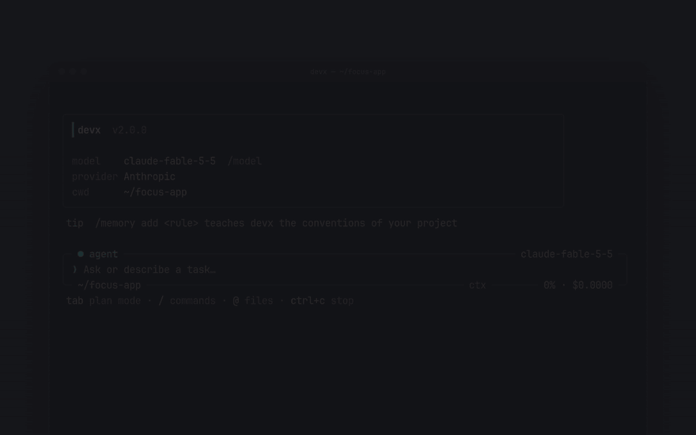

<div align="center">


<br/>

**Ultraschneller, autonomer KI-Pair-Programmer und Vibe-Coding-Agent fürs Terminal.**  
Speziell entwickelt für **Android Termux**, **Windows**, **macOS** und **Linux**.

<br/>

[](https://www.npmjs.com/package/termux-dev)
[](https://github.com/apvcode/Termux-Dev/actions/workflows/ci.yml)
[](LICENSE)
[](https://nodejs.org)
[](https://www.typescriptlang.org)
[](#quick-start)

<br/>

[English](README.md) &nbsp;•&nbsp; [Русский](README_ru.md) &nbsp;•&nbsp; [Українська](README_uk.md) &nbsp;•&nbsp; **Deutsch** &nbsp;•&nbsp; [Español](README_es.md) &nbsp;•&nbsp; [Français](README_fr.md) &nbsp;•&nbsp; [Português](README_pt.md) &nbsp;•&nbsp; [Chinese](README_zh.md) &nbsp;•&nbsp; [Japanese](README_ja.md)

<br/><br/>

<a href="assets/demo.mp4"></a>

<br/>


</div>

---

## Auf einen Blick

<table>
<tr><td valign="top" width="33%"><b>Erst planen, dann handeln</b><br/>PLAN- und AGENT-Modus, Freigabe mit einem Klick, ein Plan in der Größe der Aufgabe</td><td valign="top" width="33%"><b>Standardmäßig sicher</b><br/>fragt vor Riskantem, versteckt Geheimnisse in Ausgaben, Rückgängig über git, optionales Kostenlimit</td><td valign="top" width="33%"><b>Jedes Modell</b><br/>OpenRouter, Gemini, DeepSeek, Groq, Mistral, OpenAI, Anthropic, Ollama und mehr</td></tr><tr><td valign="top" width="33%"><b>MCP eingebaut</b><br/>ein Panel, entfernte Server über HTTP, und der Agent richtet Server selbst ein</td><td valign="top" width="33%"><b>Fürs Terminal gemacht</b><br/>handytaugliche Layouts, 18 Farbschemata, Denken und Ausgabe lassen sich einklappen</td><td valign="top" width="33%"><b>Kosten im Blick</b><br/>laufende Kosten pro Sitzung, Denkaufwand je Modell, ein Limit, wenn du eins willst</td></tr>
</table>

## Schnellstart

```bash
npm install -g termux-dev
devx
```

Unter Android zuerst in Termux `pkg install nodejs-lts` ausführen.

---

## Highlights

Die Terminaloberfläche besteht aus einem umrahmten Prompt, der den Status in seinen Rändern trägt – Modus (`agent` / `plan` / `yolo`), Modell, Ordner, Git-Branch, Kontextanzeige und Kosten –, einer Kopfkarte, einem schattierten Echo deiner Nachricht, einem `●`-Rand für den Assistenten, `◆`-Zeilen für Werkzeugaufrufe mit ruhigen einzeiligen Ergebnissen und Diff-Boxen für Änderungen sowie einer Live-Arbeitsanzeige. Jedes Layout hat eine schmale Variante für Termux im Hochformat und misst Emoji und CJK-Text korrekt. Das ursprüngliche ASCII-Layout schaltest du in `/settings` → `Interface` ein.

- **Zwei-Gehirne-Architektur (PLAN- und AGENT-Modus):**  
  Wechsle sofort zwischen **PLAN** (sicherer Architekt, interaktiver Anforderungsfragebogen, keine Code-Dumps) und **AGENT** (autonome Dateiänderungen, Terminalbefehle, automatische Paketinstallation).
- **Planfreigabe mit einem Klick (`[Go / Other]`):**  
  Ist ein Architekturplan fertig, prüfst du ihn und bestätigst mit `Go`, damit der Coder-Agent sofort loslegt.
- **Multimodale Bildanhänge:**  
  Füge Screenshots direkt aus der Zwischenablage mit `Ctrl+V` oder `Alt+V` ein (auch `/image` oder ein eingefügter Dateipfad). Sie erscheinen als Badges wie `[Image #1 203kb]` und werden als echte Bilder an das Modell gesendet – außer das Modell liest bekanntermaßen nur Text. Benötigt `wl-clipboard` unter Wayland, `xclip` unter X11, `pngpaste` unter macOS.
- **Eingebauter Live-Webserver (`/serve`):**  
  Sieh Web-Apps und HTML5-Spiele sofort auf Port 3000 an. Unter Android öffnet er sich nahtlos über `termux-open-url`.
- **Sofortiges Zurückrollen (`/undo`):**  
  Jede Änderung mit den Dateiwerkzeugen (`write_file`, `edit_file`) wird aufgezeichnet und lässt sich mit einem Befehl zurücknehmen. Änderungen durch Shell-Befehle (`bash`) werden **nicht** erfasst, und Snapshots liegen nur im Speicher der aktuellen Sitzung.
- **Selbstheilende Diagnose und Auto-Installer:**  
  Eingebaute Unterstützung für TypeScript (`tsc`), JavaScript (`node --check`), Python (`py_compile`) und Rust (`cargo check`). Die KI findet und behebt Fehler automatisch, bevor ein Durchgang endet.
- **Projekt-Gedächtnis (`.devx/memory.md`):**  
  Dauerhafter Projektkontext über Sitzungen hinweg mit `/memory add <Regel>`.
- **18 Farbschemata auf reinem Schwarz (`#0a0a0c`):**  
  Tiefes OLED-Schwarz für ablenkungsfreies Vibe-Coding im Terminal, mit vollständigen Paletten statt einer einzigen Akzentfarbe: Cyan Cyber, Synthwave Purple, Matrix Hacker, Solar Amber, Ruby Crimson, Pure Monochrome, Nord Frost, Dracula, Tokyo Night, Gruvbox, Catppuccin Mocha, Solarized Dark, Rose Pine, Monokai, GitHub Dark, Deep Ocean, Sunset Glow und Forest Moss. Siehe [Farbschemata](#farbschemata).
- **Intelligenter Sitzungsverlauf (`/resume` und `/session`):**  
  Setze Sitzungen fort – die letzten 20 Nachrichten werden in vollem Markdown dargestellt – und verfolge eindeutige Sitzungs-IDs (`#a8f9z`).
- **Intelligenter mehrzeiliger Editor (`edit_file 2.0`):**  
  Kollisionssicheres Bearbeiten von Code mit Zeilennummern bei doppelten Treffern und `replaceAll`-Unterstützung.
- **Umfassende Testsuite (Vitest):**  
  Testabdeckung für Agentenschleife, Dateisysteme, Sicherheitswächter, Snapshots und Kontextverlauf mit automatisiertem CI.
- **Oberfläche in 9 Sprachen:**  
  English (Standard), Русский, Українська, Deutsch, Español, Français, Português, 中文 und 日本語. Wähle in `/settings` → `Language`; die Auswahl gilt sofort und wird gespeichert. Meldungen, Hinweise und die Einstellungen sind übersetzt; Code, Werkzeugnamen und die Antworten des Modells nicht.
- **Universelle Unterstützung für KI-Anbieter:**  
  **OpenRouter**, **Google Gemini**, **DeepSeek**, **Groq**, **Mistral**, **OpenAI**, **Anthropic**, **Alibaba** und lokale Modelle (**Ollama**, **LM Studio**).
- **Eigene Anbieter:**  
  `/provider` → **Anbieter hinzufügen**: Gib ihm einen Namen, eine Adresse (jede OpenAI- oder Anthropic-kompatible API) und einen Schlüssel. Er wird in `~/.devxrc.json` gespeichert und steht in der Liste neben den bekannten; wähle ihn erneut, um ihn zu verwenden, Namen, Adresse oder Schlüssel zu ändern oder ihn zu löschen. Ein Server auf dem eigenen Rechner (LM Studio, lokales Gateway) lässt sich ohne Schlüssel hinzufügen.

---

## Installation und Einrichtung

### Voraussetzungen
- **Node.js**: `v20.0.0` oder höher
- **npm**, **pnpm** oder **yarn**

### Node.js und npm installieren

devx braucht Node.js 20 oder neuer (npm ist dabei). Wähle dein System:

```bash
# Windows (PowerShell)
winget install OpenJS.NodeJS.LTS

# macOS (Homebrew)
brew install node

# Ubuntu / Debian (NodeSource: die Version im eigenen Repository der Distribution ist oft älter als 20)
curl -fsSL https://deb.nodesource.com/setup_lts.x | sudo -E bash -
sudo apt-get install -y nodejs

# Fedora
sudo dnf install -y nodejs

# Arch Linux
sudo pacman -S nodejs npm

# Android (Termux)
pkg update && pkg install -y nodejs-lts
```

Öffne das Terminal neu und prüfe: `node -v` (sollte `v20` oder höher sein) und `npm -v`. Jedes System: der Installer auf [nodejs.org](https://nodejs.org/en/download) oder [nvm](https://github.com/nvm-sh/nvm).

### Schnelle globale Installation (empfohlen)

```bash
npm install -g termux-dev
```

### Android (Termux)

```bash
# 1. Pakete aktualisieren und NodeJS installieren
pkg update && pkg install -y nodejs-lts

# 2. devx global über npm installieren
npm install -g termux-dev

# 3. devx überall starten!
devx
```

### Aus dem Quellcode bauen (Entwickler)

```bash
git clone https://github.com/apvcode/Termux-Dev.git
cd Termux-Dev
npm install
npm link
```

### Vollständige Deinstallation

So entfernst du `devx` samt Konfiguration, gespeicherten Sitzungen und Daten:

```bash
# 1. Das globale npm-Paket deinstallieren
npm uninstall -g termux-dev

# 2. Konfiguration und Sitzungsverlauf entfernen (Linux / macOS / Termux)
rm -rf ~/.devx ~/.devxrc.json

# (Windows PowerShell)
Remove-Item -Recurse -Force "$HOME\.devx", "$HOME\.devxrc.json" -ErrorAction SilentlyContinue
```

---

## Erste Schritte

Starte `devx` in einem beliebigen Projektordner:

```bash
devx
```

* Beim ersten Start öffnet `devx` einen interaktiven Einrichtungsassistenten für deinen KI-Anbieter und den API-Schlüssel.
* Direkt im **PLAN-Modus** starten:
  ```bash
  devx --plan
  ```
* **Headless-Einmalmodus** (Skripte, CI/CD, Termux:Widget):
  ```bash
  devx -p "review latest git diff and find security bugs"
  devx -p "fix build errors" --yolo
  ```

---

## Slash-Befehle

Tippe `/` im Prompt, um die Befehlspalette mit Autovervollständigung zu öffnen:

| Befehl | Beschreibung |
| :--- | :--- |
| **`/plan`** | In den **PLAN**-Modus wechseln (Architekt und Anforderungsplaner) |
| **`/agent`** | In den **AGENT**-Modus wechseln (Coder und autonomer Ausführer) |
| **`/mcp`** | Model-Context-Protocol-(MCP-)Server und externe Werkzeuge verwalten (`/mcp reload`) |
| **`/usage`** | Ein Panel (schließen mit `Esc`): was das Kontextfenster füllt (Systemprompt, Werkzeugschemata, Nachrichten, Werkzeugergebnisse, Bilder), die Sitzungskosten und wie sicher sie sind, Tokens, gecachte Eingabe, Datenverkehr |
| **`/export`** | Die Sitzung als saubere GitHub-Flavored-Markdown-Mitschrift exportieren |
| **`/theme [name]`** | Das Farbschema wechseln: durchsuchbare Liste mit 18 Paletten und Live-Vorschau (siehe [Farbschemata](#farbschemata)) |
| **`/doctor`** | Diagnose der Umgebung (Node, Termux, Compiler, API-Schlüssel) |
| **`/image`** | Das Bild aus der Zwischenablage einfügen (wie `Ctrl+V` / `Alt+V`) |
| **`/serve [port]`** | Lokalen HTTP-Server für Web-/Spielvorschau starten (`/serve stop` beendet ihn) |
| **`/memory`** | Das Projektgedächtnis ansehen, ergänzen (`/memory add <Fakt>`) oder leeren |
| **`/copy`** | Die **letzte Antwort** der KI vollständig in die Zwischenablage kopieren (auch über ssh) |
| **`/rename`** | Chat umbenennen: `/rename <Name>`, ohne Namen benennt die KI ihn neu (`/title` ist dasselbe) |
| **`/permissions`** | Was ohne Rückfrage erlaubt ist („Session“ / „Always“ auf einer Freigabekarte); `/permissions clear` setzt zurück |
| **`/rewind`** | Zu einer **deiner Nachrichten** zurückgehen: der Chat danach wird entfernt (das Modell vergisst ihn auch), die Nachricht kommt zum Bearbeiten in die Eingabezeile zurück; auch die Dateien lassen sich zurücksetzen (mit git) |
| **`/undo`** | Alle Dateiänderungen des letzten KI-Durchgangs rückgängig machen |
| **`/diff`** | Farbigen Git-Diff der geänderten Projektdateien anzeigen |
| **`/commit`** | Von der KI erzeugte semantische Commit-Nachricht und Git-Commit |
| **`/status`** | Git-Repository-Status anzeigen |
| **`/session`** | Aktive Sitzungs-ID, Statistik und Metadaten anzeigen |
| **`/resume`** | Gespeicherte Chat-Sitzungen durchsuchen und fortsetzen |
| **`/session del`** | Gespeicherte Sitzungen gezielt oder gesammelt löschen |
| **`/settings`** | Farbschema, Oberfläche, YOLO-Auto-Freigabe, Projektgedächtnis, Updateprüfung und Sprache der Oberfläche einstellen |
| **`/update`** | Nach einer neuen Version suchen: eine Karte mit den Neuerungen, dann **Jetzt aktualisieren**, **Später** oder (beim Start) **Diese Version überspringen**. Die Installation läuft Schritt für Schritt auf einem Live-Bildschirm, prüft, dass npm die Version wirklich hat, und startet devx neu. Bei einem Fehler siehst du den Grund und den Befehl für die Handarbeit |
| **`/model`** | Das Modell des aktiven Anbieters mit Live-Suche wechseln |
| **`/effort [level]`** | Den Denkaufwand setzen. Angeboten werden nur Stufen, die das aktuelle Modell unterstützt (siehe [Denkaufwand](#denkaufwand)) |
| **`/provider`** | Den Anbieter wechseln (OpenRouter, Gemini, Groq, DeepSeek, Local) |
| **`/compact`** | Chat-Kontext-Tokens verdichten und zusammenfassen |
| **`/clear`** | Den Kontext leeren und eine neue Sitzung beginnen (die alte bleibt gespeichert, siehe `/resume`) |
| **`/init`** | Einen `AGENTS.md`-Entwicklerleitfaden im Projektstamm erzeugen |
| **`/help`** | Alle verfügbaren Befehle anzeigen |
| **`/exit`** | devx sauber beenden |

---

## Tastenkürzel

- **`Tab`** — wechselt sofort zwischen **PLAN** und **AGENT**, ohne deinen Entwurfstext zu verlieren.
- **`Ctrl+V`** / **`Alt+V`** — Bild aus der Zwischenablage direkt in den Prompt einfügen.
- **`@filename`** — schnelle unscharfe Dateivervollständigung und vollständiges Einbetten der Datei.
- **`Backspace`** — löscht Badges wie `[Pasted text #1]` und `[1.png 203kb]` mit einem Druck ganz.
- **`Ctrl+Backspace`** / **`Alt+Backspace`** — löscht den Text wortweise (auch während der Agent arbeitet).
- **`Ctrl+Enter`** — Beim Tippen: neue Zeile (neuer Absatz) statt Senden. `Alt+Enter` und `Shift+Enter` tun dasselbe, wenn das Terminal sie meldet; in einem Terminal, das sie nicht von `Enter` unterscheidet (etwa eine Handy-Tastatur), tippe `\` vor `Enter`.
- **`Ctrl+P`** / **`Ctrl+O`** — Klappt das Denken des Modells (`Ctrl+P`) und die Befehle mit ihrer Ausgabe (`Ctrl+O`) im ganzen Chat auf oder zu, auch was schon weiter oben steht. Standardmäßig ist alles eingeklappt; funktioniert während der Agent arbeitet und im Prompt.
- **`Esc`** — die laufende Antwort und alles, was sie gestartet hat (einen laufenden Befehl), stoppen; das Getippte wartet im nächsten Prompt. Esc schließt außerdem jede Liste und Karte.
- **`Ctrl+C`** — die laufende Generierung sofort stoppen oder beenden.

---

## Denkaufwand

`/effort` legt fest, wie viel das Modell vor der Antwort nachdenkt: `off`, `low`, `normal`, `high`, `xhigh`, `max` oder `auto` (der eigene Standard des Modells, es wird nichts gesendet). Modelle unterscheiden sich, daher bietet das Menü **nur die Stufen, die das aktuelle Modell unterstützt**:

```
╭─ effort ─────────────────────────────────── claude-sonnet-4-5 ─╮
│  ❯ ● auto    model default, nothing is sent                     │
│    ○ off     no reasoning                                       │
│    ○ normal  balanced (~6k thinking tokens)                     │
│    ○ high    deep reasoning (~16k thinking tokens)              │
│                                                                 │
│   Not offered by this model: max.                               │
╰─────────────────────────────────────────────────────────────────╯
```

- `/effort` öffnet das Menü, `/effort high` setzt eine Stufe direkt (`medium`, `none`, `maximum` und Ähnliches funktionieren als Aliase), `/effort auto` kehrt zum Standard des Modells zurück, `/effort refresh` aktualisiert die Daten, aus denen das Menü entsteht (siehe unten).
- Die Wahl wird **pro Modell** gespeichert. Nach dem Wechsel zu einem Modell, das die gespeicherte Stufe nicht anbietet, wird nichts gesendet. Die aktuelle Stufe steht neben dem Modellnamen (`o3 · think high`; `think auto` heißt: Standard des Modells). Während der Agent arbeitet, zeigt die Statuszeile, wie viele Tokens das Modell bisher für deine Anfrage geschrieben hat (`↓ 364 tokens`), und die Zeile nach dem Durchgang fasst es zusammen (`18.1k in · 59 out`).
- `devx -p "task" --effort high` setzt eine Stufe nur für einen Lauf (sie wird nie gespeichert).
- Antwortet ein Endpunkt mit 400 und beanstandet den Reasoning-Parameter, wiederholt devx die Anfrage einmal ohne ihn, sagt dir Bescheid und sendet ihn nicht mehr.

**Woher die Stufen kommen** (die erste Quelle, die das Modell kennt, gewinnt; das Menü nennt die verwendete):

1. **Dein eigenes Profil** in `~/.devxrc.json` (`reasoningProfiles`, unten).
2. **Der Endpunkt selbst.** OpenRouter listet Reasoning-Metadaten für jedes Modell (welche Stufen es akzeptiert, ob es abschaltbar ist); Ollama meldet eine „thinking“-Fähigkeit; LiteLLM und viele Gateways ergänzen Flags in ihrer Modellliste. Ein **eigener oder fremder Anbieter wird einmal gefragt**: einige kleine Anfragen an *seine eigene* Base-URL mit dem konfigurierten Schlüssel (`GET /models`, auf einem lokalen Rechner auch `POST /api/show`, bei LiteLLM `GET /model/info`). Die Antwort wird einen Tag in `~/.devx/capabilities.json` zwischengespeichert. Die großen Hersteller (OpenAI, Anthropic, Google ...) werden nicht gefragt, ihre Listen sagen nichts über Reasoning. Abschalten mit `"probeEndpoints": false` in `~/.devxrc.json`.
3. **Der [models.dev](https://models.dev)-Katalog**: Reasoning-Optionen von etwa 5700 Modellen bei 213 Anbietern (Stufen, Schalter, Token-Budgets). Ein Snapshot wird mit devx ausgeliefert, daher wird standardmäßig nichts heruntergeladen. `/effort refresh` lädt den aktuellen nach `~/.devx/` und fragt den Endpunkt erneut; nur dann kontaktiert devx models.dev, und nur weil du den Befehl ausgeführt hast. Derselbe Download aktualisiert die Preise für die Kostenanzeige (siehe Kosten).
4. **Regeln nach Modellnamen**, der Rückfall für alles, was die Quellen nicht beschreiben (Tabelle unten).

Wie eine Stufe in die Anfrage geschrieben wird, hängt weiterhin von der API deiner Base-URL ab; dieser Teil ist in devx eingebaut.

Regeln nach Modellnamen (Rückfall):

| Modell | Stufen | Gesendet als |
| :--- | :--- | :--- |
| OpenAI o-Serie, gpt-oss | low, normal, high | `reasoning_effort` (`reasoning.effort` bei OpenRouter) |
| GPT-5, 5.1, 5.2 | off (minimal bei GPT-5), low, normal, high, ab 5.2 zusätzlich xhigh | `reasoning_effort` |
| Grok 3 mini | low, high | `reasoning_effort` |
| Claude 3.7 / 4 / 4.5 | off, low, normal, high, xhigh, max (Opus 4 und 4.1 ohne max) | `thinking.budget_tokens` (Anthropic), `reasoning.max_tokens` (OpenRouter) |
| Gemini 2.5 Pro / Flash | low bis max (Flash auch off) | `thinking_budget` (Google), `reasoning.max_tokens` (OpenRouter) |
| Qwen3 | off, low, normal, high, max | `enable_thinking` / `thinking_budget` (DashScope) |
| DeepSeek V3.1+, GLM 4.5+ | off, normal | `reasoning.enabled`, `thinking.type` |
| DeepSeek-R1, QwQ, Grok 4, Magistral | keine: sie denken immer | nichts |

Ein Modell, das keine Quelle beschreibt, bekommt keine Stufen statt einer Vermutung. Wenn du weißt, wie es eine Reasoning-Einstellung annimmt, beschreibe es in `~/.devxrc.json`:

```json
{
  "reasoningProfiles": {
    "my-model": {
      "levels": ["off", "normal", "high"],
      "param": "reasoning_effort",
      "values": { "off": "none", "normal": "medium", "high": "high" }
    }
  }
}
```

`param` darf verschachtelt sein (`"reasoning.effort"`). Ein Profil überschreibt für diese Modell-ID auch die eingebaute Tabelle.

---

## Tippen, während der Agent arbeitet

Der Prompt-Rahmen bleibt während einer Aufgabe am unteren Terminalrand (mit Live-Kontext und Kosten), die Arbeit des Agenten scrollt darüber. Tippe hinein, während der Agent Dateien liest, Befehle ausführt oder nachdenkt, und drücke Enter: Die Nachricht kommt in die Warteschlange, und der Agent erhält sie **bei seinem nächsten Schritt**, zwischen zwei Werkzeugaufrufen; er arbeitet weiter, berücksichtigt aber deine Anmerkung. Eine Nachricht, die du tippst, während das Modell seine Schlussantwort schreibt, bekommt eine eigene Antwort, statt verworfen zu werden. `Ctrl+Enter` macht in deiner Nachricht eine neue Zeile statt zu senden (auch `Alt+Enter` und `Shift+Enter`; ein `\` vor `Enter` geht in Terminals, die sie nicht unterscheiden). `Ctrl+Backspace` löscht ein Wort. `Esc` (oder `Ctrl+C`) stoppt den Agenten und legt das Getippte in den nächsten Prompt zurück. `@file`-Erwähnungen funktionieren auch in diesen Nachrichten. Solange eine Freigabekarte oder eine Frage auf dem Bildschirm ist, weicht die Zeile aus, sodass dein `y` / `n` nie in der Nachricht landet. Abschalten mit `"ui": { "typeAhead": false }` in `~/.devxrc.json`.

---

## Kontextfenster

Die Fenstergröße wird nachgeschlagen, nicht erfunden. In dieser Reihenfolge: `contextLimits` in `~/.devxrc.json` (deine eigene Zahl je Modell-ID), der [models.dev](https://models.dev)-Katalog (die Zahl des Herstellers für etwa 5000 Modelle; ein Snapshot wird mit devx ausgeliefert, `/effort refresh` lädt den aktuellen), der bei der Modellwahl gespeicherte Wert, devx' Modelltabelle, eine Regel nach Modellnamen und erst dann der Standardwert 128k. `/usage` sagt, welcher verwendet wurde, und warnt, wenn es eine Schätzung ist. Alte Nachrichten werden ab 85 % des Fensters verworfen: Ein zu kleines Fenster lässt devx zu früh vergessen, ein zu großes lässt den Anbieter die Anfrage ablehnen (devx kürzt dann den Verlauf und versucht es erneut).

```json
{ "contextLimits": { "my-model": 65536 } }
```

---

## API-Formate (OpenAI und Anthropic)

Es gibt zwei Übertragungsformate: **OpenAI** (`/v1/chat/completions`) und **Anthropic** (`/v1/messages`). Das native Anthropic-Format trägt signierte Reasoning-Blöcke, Prompt-Caching und genaue Cache-Abrechnung, daher laufen Claude-Modelle darüber am besten. devx spricht beide und wählt das Format **pro Modell selbst, mit einem Schlüssel**:

- `api.anthropic.com` und Base-URLs mit dem Pfad `/anthropic/` (MiniMax, Z.ai und ähnliche) verwenden das Anthropic-Format.
- Bei jedem anderen eigenen Gateway fragt devx die Modellliste zweimal ab (einige kleine `GET {root}/v1/models`-Anfragen an deine eigene Base-URL mit deinem eigenen Schlüssel): einmal als OpenAI-Client und einmal als Anthropic-Client. Modelle, die nur die zweite Liste hat (typisch Claude), gehen über das Anthropic-Format, alles andere über das OpenAI-Format. `/model` zeigt beide Listen in einer Auswahl und markiert die Anthropic-Modelle. Setze die Base-URL einmal (`https://gateway.example.com/v1` oder ohne `/v1`); pro Modell ist nichts zu konfigurieren.
- Die Antwort wird einen Tag in `~/.devx/formats.json` zwischengespeichert (nur Modell-IDs, nie der Schlüssel). `"probeEndpoints": false` schaltet die Abfrage ab, `"apiFormat": "openai"` oder `"anthropic"` in `~/.devxrc.json` erzwingt ein Format für alles.
- Reasoning-Stufen (`/effort`) werden so geschrieben, wie die Anthropic-API sie erwartet (`thinking.budget_tokens`), sobald das Anthropic-Format verwendet wird – auch hinter einem Gateway. Reasoning-Blöcke werden aufbewahrt und mit der nächsten Anfrage zurückgesendet, damit das Modell zwischen Werkzeugaufrufen den Faden nicht verliert. Lehnt ein Gateway sie, die Cache-Marker, ein zu großes `max_tokens` oder die Reasoning-Einstellung ab, wiederholt devx die Anfrage einmal ohne den betroffenen Teil und sagt es dir.

## Kosten

Die Zahl neben der Kontextanzeige sind die in dieser Sitzung ausgegebenen Kosten. Sie zeigt, wie sicher devx ist:

| Angezeigt | Bedeutung |
| :--- | :--- |
| `$0.0123` | exakt: vom Anbieter gemeldet oder nach der Preisliste des Herstellers berechnet |
| `~$0.0123` | eine Schätzung: berechnet mit dem [models.dev](https://models.dev)-Preis desselben Modells (ein Gateway kann anders abrechnen) |
| `$0.0123+` | mindestens so viel: für manche Anfragen ist kein Preis bekannt, sie sind nicht eingerechnet |
| `n/a` | für das Modell ist kein Preis bekannt |

Preise werden in dieser Reihenfolge nachgeschlagen, die erste Quelle, die das Modell kennt, gewinnt: die Kosten, die der Anbieter in seine Antwort schrieb (OpenRouter `usage.cost`, LiteLLM) – deine eigenen `prices` in `~/.devxrc.json` – die eigene Preisliste des Endpunkts (OpenRouter, LiteLLM) – der models.dev-Katalog (etwa 8500 Modelle; ein Snapshot wird mit devx ausgeliefert, `/effort refresh` lädt den aktuellen). Gecachte Eingabe-Tokens, Cache-Schreibvorgänge und Long-Context-Stufen werden wie bei den Herstellern getrennt berechnet. Ein nicht gefundenes Modell wird nie als kostenlos angezeigt: Nur `:free`-Modelle und lokale Server kosten nichts. `/usage` listet auch die gecachte Eingabe und wie viele Anfragen nicht bepreist werden konnten.

```json
{
  "prices": {
    "my-model": { "input": 0.5, "output": 2.0, "cacheRead": 0.05 }
  }
}
```

Die Werte sind USD pro eine Million Tokens.

---

## Farbschemata

`/theme` öffnet eine Liste, die du durch Tippen filtern kannst; das markierte Schema wird unter der Liste in seinen eigenen Farben gezeigt. `/theme nord` (oder ein Alias wie `tokyo`, `mocha`, `gh`, oder eine Zahl von 1 bis 18) wechselt direkt, und die Wahl wird gespeichert.

Ein Schema ist eine vollständige Palette: Akzent, eine zweite Farbe für den Plan-Modus, Erfolgs-/Warn-/Fehlerfarben, eine Farbe für den YOLO-Modus, vier Graustufen für Text, Nebentext, Hinweise und Rahmen sowie der Hintergrund des Echos deiner Nachricht. Jedes Schema wird in den Tests auf lesbaren Kontrast auf dunklem Hintergrund geprüft.

| Schema | Charakter |
| :--- | :--- |
| `cyan` Cyan Cyber (Standard) | elektrisches Cyan und Obsidian |
| `purple` Synthwave Purple | Neon-Magenta, Retro-Violett |
| `matrix` Matrix Hacker | Phosphorgrün |
| `amber` Solar Amber | warmes CRT-Gold |
| `crimson` Ruby Crimson | Scharlachrot |
| `monochrome` Pure Monochrome | nur Weiß und Grau |
| `nord` Nord Frost | arktische Blautöne |
| `dracula` Dracula | Lila mit Rosa und Grün |
| `tokyonight` Tokyo Night | Indigo und Blau |
| `gruvbox` Gruvbox | Retro-Gelb und Orange |
| `catppuccin` Catppuccin Mocha | pastelliges Malve |
| `solarized` Solarized Dark | blendarmes Petrol und Oliv |
| `rosepine` Rose Pine | sanftes Rosé und Gold |
| `monokai` Monokai | Limette und Magenta |
| `github` GitHub Dark | klares Blau und Grün |
| `ocean` Deep Ocean | Tiefsee-Cyan |
| `sunset` Sunset Glow | Koralle und Violett |
| `forest` Forest Moss | moosige Grüntöne |

Farben sind auf Terminals mit Truecolor-Unterstützung exakt (`COLORTERM=truecolor`); auf 256-Farben-Terminals wird jede Farbe auf den nächsten Paletteneintrag abgebildet. Mit `DEVX_COLOR=256` oder `DEVX_COLOR=truecolor` erzwingst du eines von beiden.

---

## Sicherheitsmodell

`devx` führt im Auftrag eines KI-Modells Befehle aus und ändert Dateien auf deinem Rechner, daher ist es standardmäßig vorsichtig:

- **Vertrauen in den Arbeitsordner.** Beim ersten Öffnen eines Ordners wirst du gefragt, ob du ihm vertraust (Standard: nein). In einem nicht vertrauten Ordner werden `provider`, `apiKey`, `baseUrl`, `autoApprove` und `bashAllowlist` aus der `.devx.json` des Projekts **ignoriert**. Ein geklontes Repository kann deinen API-Schlüssel nicht auf seinen eigenen Server umleiten oder YOLO einschalten.
- **Projekt-MCP-Server brauchen Freigabe.** MCP-Server, die ein Projekt deklariert (`.mcp.json`, `.devx/mcp.json`, `.claude/mcp.json`, `.devx.json`), sind Programme, die auf deinem Rechner laufen würden. Du prüfst die genauen Befehle einmal; ändern sie sich, wirst du erneut gefragt. Im Headless-Modus (`-p`) werden nicht freigegebene Projektserver übersprungen. Server aus `~/.devxrc.json` und `~/.devx/mcp.json` starten immer.
- **Bestätigungen.** Im sicheren Modus verlangen `bash`, `install_package`, MCP-Werkzeuge, der Vorschau-Server und jedes Lesen oder Schreiben **außerhalb des Projektordners** eine Bestätigung.
- **YOLO (`--yolo`) ist keine Sandbox.** Es überspringt Routinebestätigungen, fragt aber weiterhin vor gefährlichen Shell-Befehlen (rekursives Löschen außerhalb des Projekts, `find -delete` auf breiten Pfaden, `curl … | sh`, `sudo`, `git push --force`, …) und vor dem Zugriff auf Zugangsdaten (`~/.ssh`, `~/.aws`, `~/.devxrc.json`, `.env`, private Schlüssel). Die Shell-Prüfung analysiert Befehle Token für Token, aber ein absichtlich verschleierter Befehl kann trotzdem durchrutschen – nutze YOLO daher nur in Ordnern und Umgebungen, deren Verlust du verkraften kannst. Im Headless-Modus lassen sich diese Bestätigungen nicht anzeigen, die Aktion wird dann abgelehnt.
- **Extra (`--extra`, oder `/settings` bei eingeschaltetem YOLO) fragt gar nichts mehr.** Weder gefährliche Befehle noch Zugangsdaten-Dateien noch einen neuen MCP-Server: Der Agent darf jeden Befehl ausführen. Beim Einschalten erscheint eine Warnung, der Prompt-Rahmen zeigt `extra`, und wie YOLO ist es beim nächsten Start wieder aus. Nur in einer Umgebung verwenden, die du verlieren darfst.
- **`fetch_url`** lehnt localhost, private Netze und Cloud-Metadaten-Adressen ab (auch nach Weiterleitungen). Mit `DEVX_ALLOW_PRIVATE_NETWORK=1` erlaubst du lokale Dokumentationsserver.
- **`/serve`** lauscht in deinem lokalen Netz (so funktioniert der QR-Code fürs Handy). Er liefert nie Dotfiles, Schlüssel, `node_modules` oder Symlinks aus, die das Projekt verlassen, sendet keine großzügigen CORS-Header und weist Anfragen an öffentliche Hostnamen ab.
- **Geheimnisse auf der Platte.** `~/.devxrc.json`, `~/.devx/` und gespeicherte Sitzungen werden nur für dich lesbar angelegt (`0600` / `0700`). Sitzungsdateien enthalten die ganze Unterhaltung, auch Dateiinhalte, die der Agent gelesen hat.
- **Limits.** `bash` beendet Befehle standardmäßig nach 120 s (das Modell kann `timeout_seconds` übergeben, maximal 1800) und schließt stdin. Lange Ausgaben behalten Anfang und Ende. `read_file` liefert höchstens ~60 000 Zeichen pro Aufruf und unterstützt `startLine` / `endLine`.

---

## Das Projekt unterstützen

Wenn dir **devx** nützt, gib dem Projekt gern einen Stern auf [GitHub](https://github.com/apvcode/Termux-Dev) – das hilft dem Projekt zu wachsen und motiviert zur Weiterentwicklung!

---

## License

Dieses Projekt steht unter der [MIT-Lizenz](LICENSE).

---

<div align="center">

Entwickelt von [ApvCode](https://github.com/ApvCode) für Entwickler, Vibe-Coder und Termux-Hacker.

</div>
