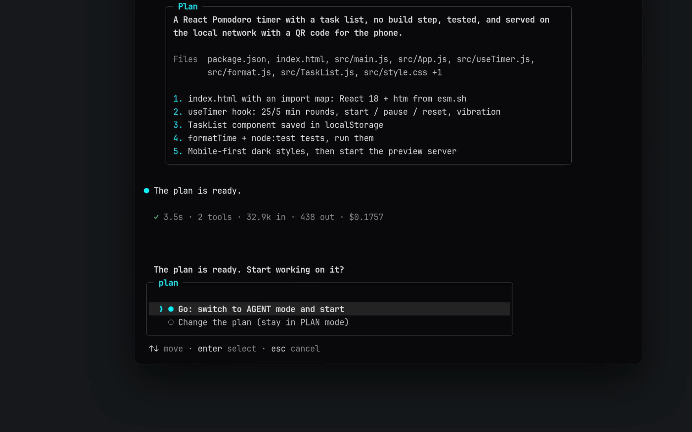

<div align="center">


<br/>

**Agente de terminal ultrarrápido y autónomo: programador en pareja con IA para vibe coding.**  
Creado especialmente para **Android Termux**, **Windows**, **macOS** y **Linux**.

<br/>

[](https://www.npmjs.com/package/termux-dev)
[](https://github.com/apvcode/Termux-Dev/actions/workflows/ci.yml)
[](LICENSE)
[](https://nodejs.org)
[](https://www.typescriptlang.org)
[](#quick-start)

<br/>

[English](README.md) &nbsp;•&nbsp; [Русский](README_ru.md) &nbsp;•&nbsp; [Українська](README_uk.md) &nbsp;•&nbsp; [Deutsch](README_de.md) &nbsp;•&nbsp; **Español** &nbsp;•&nbsp; [Français](README_fr.md) &nbsp;•&nbsp; [Português](README_pt.md) &nbsp;•&nbsp; [Chinese](README_zh.md) &nbsp;•&nbsp; [Japanese](README_ja.md)

<br/><br/>


<br/>

<a href="assets/demo.mp4"></a>

<sub>▶ <a href="assets/demo.mp4">Ver la demo (43 segundos)</a></sub>

</div>

---

## De un vistazo

<table>
<tr><td valign="top" width="33%"><b>Primero el plan, luego la acción</b><br/>modos PLAN y AGENT, aprobación con un clic, un plan a la medida de la tarea</td><td valign="top" width="33%"><b>Seguro por defecto</b><br/>pregunta antes de lo arriesgado, oculta secretos en la salida, deshacer con git, límite de coste opcional</td><td valign="top" width="33%"><b>Cualquier modelo</b><br/>OpenRouter, Gemini, DeepSeek, Groq, Mistral, OpenAI, Anthropic, Ollama y más</td></tr><tr><td valign="top" width="33%"><b>MCP integrado</b><br/>un panel, servidores remotos por HTTP, y el agente configura servidores por sí mismo</td><td valign="top" width="33%"><b>Hecho para la terminal</b><br/>diseños aptos para móvil, 18 temas, razonamiento y salida que se pueden plegar</td><td valign="top" width="33%"><b>Costes a la vista</b><br/>coste de la sesión en vivo, esfuerzo de razonamiento por modelo, un límite si lo quieres</td></tr>
</table>

## Inicio rápido

```bash
npm install -g termux-dev
devx
```

En Android, primero ejecuta en Termux `pkg install nodejs-lts`.

---

## Características

La interfaz de terminal gira en torno a un prompt enmarcado que lleva el estado en sus bordes —modo (`agent` / `plan` / `yolo`), modelo, carpeta, rama de git, medidor de contexto y coste—, una tarjeta de cabecera, un eco sombreado de tu mensaje, un margen `●` para el asistente, líneas `◆` para las llamadas a herramientas con resultados discretos de una línea y cuadros de diff para las ediciones, y un indicador de trabajo en vivo. Cada diseño tiene una variante estrecha para Termux en vertical y mide bien los emojis y el texto CJK. Vuelve al diseño ASCII original en `/settings` → `Interface`.

- **Arquitectura de doble cerebro (modos PLAN y AGENT):**  
  Cambia al instante entre **PLAN** (arquitecto seguro, cuestionario interactivo de requisitos, sin volcados de código) y **AGENT** (ediciones autónomas de archivos, comandos de terminal, instalador automático).
- **Aprobación del plan con un clic (`[Go / Other]`):**  
  Cuando el plan de arquitectura está listo, revísalo y confirma con `Go` para que el agente programador empiece de inmediato.
- **Adjuntos de imagen multimodales:**  
  Pega capturas directamente desde el portapapeles con `Ctrl+V` o `Alt+V` (también `/image` o una ruta de archivo pegada). Aparecen como insignias del tipo `[Image #1 203kb]` y se envían al modelo como imágenes reales, salvo que se sepa que el modelo solo lee texto. Requiere `wl-clipboard` en Wayland, `xclip` en X11, `pngpaste` en macOS.
- **Servidor web en vivo integrado (`/serve`):**  
  Previsualiza al instante aplicaciones web y juegos HTML5 en el puerto 3000. En Android se abre sin fricción con `termux-open-url`.
- **Reversión instantánea (`/undo`):**  
  Cada edición hecha con las herramientas de archivos (`write_file`, `edit_file`) se registra y se puede deshacer con un solo comando. Los cambios hechos por comandos de shell (`bash`) **no** se registran, y las instantáneas viven solo en la memoria de la sesión actual.
- **Diagnóstico autocurativo e instalador automático:**  
  Soporte integrado para TypeScript (`tsc`), JavaScript (`node --check`), Python (`py_compile`) y Rust (`cargo check`). La IA encuentra y corrige errores automáticamente antes de terminar el turno.
- **Banco de memoria del proyecto (`.devx/memory.md`):**  
  Contexto persistente del proyecto entre sesiones con `/memory add <regla>`.
- **18 temas de color sobre fondo negro puro (`#0a0a0c`):**  
  Negro OLED profundo para programar en la terminal sin distracciones, con paletas completas en lugar de un solo acento: Cyan Cyber, Synthwave Purple, Matrix Hacker, Solar Amber, Ruby Crimson, Pure Monochrome, Nord Frost, Dracula, Tokyo Night, Gruvbox, Catppuccin Mocha, Solarized Dark, Rose Pine, Monokai, GitHub Dark, Deep Ocean, Sunset Glow y Forest Moss. Consulta [Temas](#temas).
- **Historial de sesiones inteligente (`/resume` y `/session`):**  
  Retoma sesiones con los últimos 20 mensajes en Markdown completo y sigue los ID únicos de sesión (`#a8f9z`).
- **Editor multilínea inteligente (`edit_file 2.0`):**  
  Edición de código a prueba de colisiones, con números de línea en los errores por coincidencias duplicadas y soporte de `replaceAll`.
- **Suite de pruebas completa (Vitest):**  
  Cobertura de pruebas del bucle del agente, sistemas de archivos, guarda de seguridad, instantáneas e historial de contexto con CI automatizado.
- **Interfaz en 9 idiomas:**  
  English (por defecto), Русский, Українська, Deutsch, Español, Français, Português, 中文 y 日本語. Elige en `/settings` → `Language`; se aplica al instante y se recuerda. Se traducen los mensajes, las ayudas y la pantalla de ajustes; el código, los nombres de las herramientas y las respuestas del propio modelo no.
- **Soporte universal de proveedores de IA:**  
  **OpenRouter**, **Google Gemini**, **DeepSeek**, **Groq**, **Mistral**, **OpenAI**, **Anthropic**, **Alibaba** y modelos locales (**Ollama**, **LM Studio**).
- **Tus propios proveedores:**  
  `/provider` → **Añadir proveedor**: dale un nombre, una dirección (cualquier API compatible con OpenAI o Anthropic) y una clave. Se guarda en `~/.devxrc.json` y aparece en la lista junto a los conocidos; elígelo de nuevo para usarlo, cambiar su nombre, dirección o clave, o eliminarlo. Un servidor de tu propio equipo (LM Studio, una pasarela local) se puede añadir sin clave.

---

## Instalación y puesta en marcha

### Requisitos
- **Node.js**: `v20.0.0` o superior
- **npm**, **pnpm** o **yarn**

### Instalar Node.js y npm

devx necesita Node.js 20 o superior (npm viene incluido). Elige tu sistema:

```bash
# Windows (PowerShell)
winget install OpenJS.NodeJS.LTS

# macOS (Homebrew)
brew install node

# Ubuntu / Debian (NodeSource: la versión del repositorio de la propia distribución suele ser anterior a la 20)
curl -fsSL https://deb.nodesource.com/setup_lts.x | sudo -E bash -
sudo apt-get install -y nodejs

# Fedora
sudo dnf install -y nodejs

# Arch Linux
sudo pacman -S nodejs npm

# Android (Termux)
pkg update && pkg install -y nodejs-lts
```

Vuelve a abrir la terminal y comprueba: `node -v` (debe ser `v20` o superior) y `npm -v`. Cualquier sistema: el instalador de [nodejs.org](https://nodejs.org/en/download) o [nvm](https://github.com/nvm-sh/nvm).

### Instalación global rápida (recomendada)

```bash
npm install -g termux-dev
```

### Android (Termux)

```bash
# 1. Actualiza los paquetes e instala NodeJS
pkg update && pkg install -y nodejs-lts

# 2. Instala devx globalmente con npm
npm install -g termux-dev

# 3. ¡Lanza devx desde cualquier lugar!
devx
```

### Compilar desde el código fuente (desarrolladores)

```bash
git clone https://github.com/apvcode/Termux-Dev.git
cd Termux-Dev
npm install
npm link
```

### Desinstalación completa

Para quitar `devx` por completo junto con la configuración, las sesiones guardadas y los datos:

```bash
# 1. Desinstala el paquete global de npm
npm uninstall -g termux-dev

# 2. Elimina la configuración y el historial de sesiones (Linux / macOS / Termux)
rm -rf ~/.devx ~/.devxrc.json

# (Windows PowerShell)
Remove-Item -Recurse -Force "$HOME\.devx", "$HOME\.devxrc.json" -ErrorAction SilentlyContinue
```

---

## Primeros pasos

Lanza `devx` en cualquier carpeta de proyecto:

```bash
devx
```

* En el primer arranque, `devx` abre un asistente interactivo para configurar tu proveedor de IA y la clave de API.
* Empezar directamente en **modo PLAN**:
  ```bash
  devx --plan
  ```
* **Modo sin interfaz de una sola tarea** (scripts, CI/CD, Termux:Widget):
  ```bash
  devx -p "review latest git diff and find security bugs"
  devx -p "fix build errors" --yolo
  ```

---

## Comandos con barra

Escribe `/` en el prompt para abrir la paleta de comandos con autocompletado:

| Comando | Descripción |
| :--- | :--- |
| **`/plan`** | Cambiar al modo **PLAN** (arquitecto y planificador de requisitos) |
| **`/agent`** | Cambiar al modo **AGENT** (programador y ejecutor autónomo) |
| **`/mcp`** | Gestionar servidores del Model Context Protocol (MCP) y herramientas externas (`/mcp reload`) |
| **`/usage`** | Un panel (se cierra con `Esc`): qué llena la ventana de contexto (prompt del sistema, esquemas de herramientas, mensajes, resultados de herramientas, imágenes), el coste de la sesión y su fiabilidad, tokens, entrada en caché, tráfico |
| **`/export`** | Exportar la conversación de la sesión como una transcripción limpia en GitHub-Flavored Markdown |
| **`/theme [name]`** | Cambiar el tema de la interfaz: lista con búsqueda de 18 paletas y vista previa en vivo (consulta [Temas](#temas)) |
| **`/doctor`** | Diagnóstico del entorno (Node, Termux, compiladores, claves de API) |
| **`/image`** | Pegar la imagen del portapapeles (igual que `Ctrl+V` / `Alt+V`) |
| **`/serve [port]`** | Iniciar un servidor HTTP local para previsualizar web o juegos (`/serve stop` lo detiene) |
| **`/memory`** | Ver, añadir (`/memory add <dato>`) o vaciar el banco de memoria del proyecto |
| **`/copy`** | Copiar la **última respuesta** de la IA completa al portapapeles (también por ssh) |
| **`/rename`** | Renombrar el chat: `/rename <nombre>`, sin nombre la IA lo nombra de nuevo (`/title` es lo mismo) |
| **`/permissions`** | Qué se permite sin preguntar («Session» / «Always» en una tarjeta de aprobación); `/permissions clear` lo restablece |
| **`/rewind`** | Volver a uno de **tus mensajes**: el chat posterior se borra (el modelo también lo olvida), el mensaje vuelve a la línea de entrada para editarlo; los archivos también pueden volver (con git) |
| **`/undo`** | Revertir todos los cambios de archivos del último turno de la IA |
| **`/diff`** | Ver el diff de git en color de los archivos modificados |
| **`/commit`** | Mensaje de commit semántico generado por la IA y git commit |
| **`/status`** | Ver el estado del repositorio git |
| **`/session`** | Ver el ID de la sesión activa, estadísticas y metadatos |
| **`/resume`** | Explorar y retomar sesiones de chat guardadas |
| **`/session del`** | Borrar sesiones guardadas de forma selectiva o masiva |
| **`/settings`** | Configurar tema, interfaz, autoaprobación YOLO, memoria del proyecto, comprobación de actualizaciones e idioma de la interfaz |
| **`/update`** | Buscar una versión nueva: una tarjeta con las novedades y luego **Actualizar ahora**, **Más tarde** o (al iniciar) **Omitir esta versión**. La instalación se muestra paso a paso en una pantalla en vivo, comprueba que npm tenga la versión y reinicia devx. Si falla, muestra el motivo y el comando para hacerlo a mano |
| **`/model`** | Cambiar el modelo del proveedor activo con búsqueda en vivo |
| **`/effort [level]`** | Fijar el esfuerzo de razonamiento. Solo se ofrecen los niveles que admite el modelo actual (consulta [Esfuerzo de razonamiento](#esfuerzo-de-razonamiento)) |
| **`/provider`** | Cambiar de proveedor (OpenRouter, Gemini, Groq, DeepSeek, Local) |
| **`/compact`** | Compactar y resumir los tokens del contexto del chat |
| **`/clear`** | Vaciar el contexto y empezar una sesión nueva (la anterior queda guardada, consulta `/resume`) |
| **`/init`** | Generar la guía de desarrollo `AGENTS.md` en la raíz del proyecto |
| **`/help`** | Mostrar todos los comandos disponibles |
| **`/exit`** | Salir de devx limpiamente |

---

## Atajos de teclado

- **`Tab`** — alterna al instante entre los modos **PLAN** y **AGENT** sin perder el texto del borrador.
- **`Ctrl+V`** / **`Alt+V`** — pega una imagen del portapapeles directamente en el prompt.
- **`@filename`** — autocompletado rápido y aproximado de archivos e incrustación completa del archivo.
- **`Backspace`** — borra de una vez insignias enteras como `[Pasted text #1]` y `[1.png 203kb]`.
- **`Ctrl+Backspace`** / **`Alt+Backspace`** — borra el texto palabra por palabra (también mientras el agente trabaja).
- **`Ctrl+Enter`** — Al escribir: salto de línea (nuevo párrafo) en lugar de enviar. `Alt+Enter` y `Shift+Enter` hacen lo mismo si la terminal los reporta; en una terminal que no los distingue de `Enter` (un teclado de móvil, por ejemplo) escribe `\` antes de `Enter`.
- **`Ctrl+P`** / **`Ctrl+O`** — despliega o pliega el razonamiento del modelo (`Ctrl+P`) y los comandos con su salida (`Ctrl+O`) en todo el chat, también lo que ya está más arriba. Por defecto todo está plegado; funciona mientras el agente trabaja y en el prompt.
- **`Esc`** — detiene la respuesta actual y lo que haya iniciado (un comando en marcha); lo escrito espera en el siguiente prompt. Esc también cierra cualquier lista o tarjeta.
- **`Ctrl+C`** — detiene la generación actual de inmediato o sale.

---

## Esfuerzo de razonamiento

`/effort` fija cuánto piensa el modelo antes de responder: `off`, `low`, `normal`, `high`, `xhigh`, `max` o `auto` (el valor propio del modelo, no se envía nada). Los modelos difieren, así que el menú ofrece **solo los niveles que admite el modelo actual**:

```
╭─ effort ─────────────────────────────────── claude-sonnet-4-5 ─╮
│  ❯ ● auto    model default, nothing is sent                     │
│    ○ off     no reasoning                                       │
│    ○ normal  balanced (~6k thinking tokens)                     │
│    ○ high    deep reasoning (~16k thinking tokens)              │
│                                                                 │
│   Not offered by this model: max.                               │
╰─────────────────────────────────────────────────────────────────╯
```

- `/effort` abre el menú, `/effort high` fija un nivel directamente (`medium`, `none`, `maximum` y similares funcionan como alias), `/effort auto` vuelve al valor del modelo, `/effort refresh` actualiza los datos con los que se construye el menú (ver abajo).
- La elección se recuerda **por modelo**. Al cambiar a un modelo que no ofrece un nivel guardado, no se envía nada. El nivel actual aparece junto al nombre del modelo (`o3 · think high`; `think auto` es el valor propio del modelo). Mientras el agente trabaja, la línea de estado muestra cuántos tokens ha escrito el modelo para tu petición (`↓ 364 tokens`), y la línea posterior al turno lo resume (`18.1k in · 59 out`).
- `devx -p "task" --effort high` fija un nivel solo para una ejecución (nunca se guarda).
- Si un endpoint responde 400 y se queja del parámetro de razonamiento, devx repite la petición una vez sin él, te avisa y deja de enviarlo.

**De dónde salen los niveles** (gana la primera fuente que conozca el modelo; el menú dice cuál usó):

1. **Tu propio perfil** en `~/.devxrc.json` (`reasoningProfiles`, más abajo).
2. **El propio endpoint.** OpenRouter lista metadatos de razonamiento de cada modelo (qué niveles acepta, si se puede desactivar); Ollama informa de una capacidad «thinking»; LiteLLM y muchas pasarelas añaden indicadores a su lista de modelos. A un **proveedor personalizado o de terceros se le pregunta una vez**: unas pocas peticiones pequeñas a *su propia* base URL con la clave que configuraste (`GET /models`, en una máquina local también `POST /api/show`, en LiteLLM `GET /model/info`). La respuesta se guarda un día en `~/.devx/capabilities.json`. A los grandes fabricantes (OpenAI, Anthropic, Google...) no se les pregunta, sus listas no dicen nada del razonamiento. Desactívalo con `"probeEndpoints": false` en `~/.devxrc.json`.
3. **El catálogo [models.dev](https://models.dev)**: opciones de razonamiento de unos 5700 modelos de 213 proveedores (niveles, interruptor, presupuestos de tokens). Con devx se incluye una instantánea, así que por defecto no se descarga nada. `/effort refresh` descarga la actual en `~/.devx/` y vuelve a preguntar al endpoint; es la única vez que devx contacta con models.dev, y solo porque ejecutaste ese comando. La misma descarga actualiza los precios usados para mostrar el coste (consulta Coste).
4. **Reglas por nombre de modelo**, el recurso para todo lo que las fuentes no describen (tabla abajo).

Cómo se escribe un nivel en la petición sigue dependiendo de la API de tu base URL, así que esa parte está integrada en devx.

Reglas por nombre de modelo (recurso de reserva):

| Modelo | Niveles | Se envía como |
| :--- | :--- | :--- |
| OpenAI serie o, gpt-oss | low, normal, high | `reasoning_effort` (`reasoning.effort` en OpenRouter) |
| GPT-5, 5.1, 5.2 | off (minimal en GPT-5), low, normal, high, y xhigh desde 5.2 | `reasoning_effort` |
| Grok 3 mini | low, high | `reasoning_effort` |
| Claude 3.7 / 4 / 4.5 | off, low, normal, high, xhigh, max (Opus 4 y 4.1 sin max) | `thinking.budget_tokens` (Anthropic), `reasoning.max_tokens` (OpenRouter) |
| Gemini 2.5 Pro / Flash | de low a max (Flash también off) | `thinking_budget` (Google), `reasoning.max_tokens` (OpenRouter) |
| Qwen3 | off, low, normal, high, max | `enable_thinking` / `thinking_budget` (DashScope) |
| DeepSeek V3.1+, GLM 4.5+ | off, normal | `reasoning.enabled`, `thinking.type` |
| DeepSeek-R1, QwQ, Grok 4, Magistral | ninguno: siempre razonan | nada |

Un modelo que ninguna fuente describe no recibe niveles en lugar de una suposición. Si sabes cómo admite un ajuste de razonamiento, descríbelo en `~/.devxrc.json`:

```json
{
  "reasoningProfiles": {
    "my-model": {
      "levels": ["off", "normal", "high"],
      "param": "reasoning_effort",
      "values": { "off": "none", "normal": "medium", "high": "high" }
    }
  }
}
```

`param` puede estar anidado (`"reasoning.effort"`). Un perfil también anula la tabla integrada para ese ID de modelo.

---

## Escribir mientras el agente trabaja

El marco del prompt se queda abajo en la terminal durante una tarea (con contexto y coste en vivo), y el trabajo del agente se desplaza por encima. Escribe en él mientras el agente lee archivos, ejecuta comandos o piensa, y pulsa Enter: el mensaje se pone en cola y el agente lo recibe **en su siguiente paso**, entre dos llamadas a herramientas, así que sigue con su trabajo pero tiene en cuenta tu observación. Un mensaje escrito mientras el modelo redacta su respuesta final recibe una respuesta propia en lugar de descartarse. `Ctrl+Enter` hace un salto de línea en tu mensaje en lugar de enviarlo (también `Alt+Enter` y `Shift+Enter`; un `\` antes de `Enter` sirve en terminales que no los distinguen). `Ctrl+Backspace` borra una palabra. `Esc` (o `Ctrl+C`) detiene al agente y devuelve lo escrito al siguiente prompt. Las menciones `@file` también funcionan en estos mensajes. Mientras hay en pantalla una tarjeta de aprobación o una pregunta, la línea se aparta, así que tu `y` / `n` nunca acaba en el mensaje. Desactívalo con `"ui": { "typeAhead": false }` en `~/.devxrc.json`.

---

## Ventana de contexto

El tamaño de la ventana se consulta, no se inventa. En este orden: `contextLimits` en `~/.devxrc.json` (tu propio número por ID de modelo), el catálogo [models.dev](https://models.dev) (el número del propio fabricante para unos 5000 modelos; con devx se incluye una instantánea, `/effort refresh` descarga la actual), el valor guardado al elegir el modelo, la tabla de modelos de devx, una regla por nombre de modelo y solo entonces un valor por defecto de 128k. `/usage` indica cuál se usó y avisa cuando es una suposición. Los mensajes antiguos se descartan por encima del 85 % de la ventana, así que una ventana demasiado pequeña hace que devx olvide pronto, y una demasiado grande hace que el proveedor rechace la petición (devx entonces acorta el historial y reintenta).

```json
{ "contextLimits": { "my-model": 65536 } }
```

---

## Formatos de API (OpenAI y Anthropic)

Existen dos formatos de transmisión: **OpenAI** (`/v1/chat/completions`) y **Anthropic** (`/v1/messages`). El formato nativo de Anthropic lleva bloques de razonamiento firmados, caché de prompts y contabilidad exacta de la caché, por lo que los modelos Claude funcionan mejor con él. devx habla ambos y elige el formato **por modelo, por sí mismo, con una sola clave**:

- `api.anthropic.com` y las base URL con una ruta `/anthropic/` (MiniMax, Z.ai y similares) usan el formato Anthropic.
- Para cualquier otra pasarela personalizada, devx pide la lista de modelos dos veces (unas pocas peticiones `GET {root}/v1/models` pequeñas a tu propia base URL con tu propia clave): una como cliente OpenAI y otra como cliente Anthropic. Los modelos que solo aparecen en la segunda lista (normalmente Claude) se envían con el formato Anthropic, todo lo demás con el formato OpenAI. `/model` muestra ambas listas en un selector y marca las de Anthropic. Define la base URL una vez (`https://gateway.example.com/v1` o sin `/v1`); no hay nada que configurar por modelo.
- La respuesta se guarda un día en `~/.devx/formats.json` (solo ID de modelos, nunca la clave). `"probeEndpoints": false` desactiva la consulta, `"apiFormat": "openai"` o `"anthropic"` en `~/.devxrc.json` fuerza un formato para todo.
- Los niveles de razonamiento (`/effort`) se escriben como espera la API de Anthropic (`thinking.budget_tokens`) siempre que se usa el formato Anthropic, incluso detrás de una pasarela. Los bloques de razonamiento se conservan y se devuelven con la siguiente petición, para que el modelo no pierda el hilo entre llamadas a herramientas. Si una pasarela los rechaza, o rechaza los marcadores de caché, un `max_tokens` demasiado grande o el ajuste de razonamiento, devx reintenta una vez sin la parte conflictiva y te lo dice.

## Coste

El número junto al medidor de contexto es el dinero gastado en esta sesión. Indica lo seguro que está devx:

| Se muestra | Significado |
| :--- | :--- |
| `$0.0123` | exacto: informado por el proveedor o calculado con la lista de precios del propio fabricante |
| `~$0.0123` | una estimación: calculada con el precio de [models.dev](https://models.dev) del mismo modelo (una pasarela puede cobrar distinto) |
| `$0.0123+` | al menos esto: algunas peticiones no tienen precio conocido y no se cuentan |
| `n/a` | no se conoce precio para el modelo |

Los precios se buscan en este orden, gana la primera fuente que conozca el modelo: el coste que el proveedor puso en su respuesta (OpenRouter `usage.cost`, LiteLLM) - tus propios `prices` en `~/.devxrc.json` - la lista de precios del propio endpoint (OpenRouter, LiteLLM) - el catálogo models.dev (unos 8500 modelos; con devx se incluye una instantánea, `/effort refresh` descarga la actual). Los tokens de entrada en caché, las escrituras de caché y los tramos de contexto largo se tarifican por separado, como hacen los fabricantes. Un modelo que no se encuentra nunca se muestra como gratis: solo los modelos `:free` y los servidores locales no cuestan nada. `/usage` también lista la entrada en caché y cuántas peticiones no se pudieron tarificar.

```json
{
  "prices": {
    "my-model": { "input": 0.5, "output": 2.0, "cacheRead": 0.05 }
  }
}
```

Los valores son USD por millón de tokens.

---

## Temas

`/theme` abre una lista que puedes filtrar escribiendo; el tema resaltado se previsualiza con sus propios colores bajo la lista. `/theme nord` (o un alias como `tokyo`, `mocha`, `gh`, o un número del 1 al 18) cambia directamente, y la elección se guarda.

Un tema es una paleta completa: acento, un segundo color para el modo plan, colores de éxito / aviso / error, un color para el modo YOLO, cuatro tonos de gris para el texto, el texto secundario, las ayudas y los bordes, y el fondo del eco de tu mensaje. En las pruebas se comprueba que cada tema tenga un contraste legible sobre el fondo oscuro.

| Tema | Carácter |
| :--- | :--- |
| `cyan` Cyan Cyber (por defecto) | cian eléctrico y obsidiana |
| `purple` Synthwave Purple | magenta neón, violeta retro |
| `matrix` Matrix Hacker | verde fósforo |
| `amber` Solar Amber | dorado cálido de CRT |
| `crimson` Ruby Crimson | rojo escarlata |
| `monochrome` Pure Monochrome | solo blanco y gris |
| `nord` Nord Frost | azules árticos |
| `dracula` Dracula | púrpura con rosa y verde |
| `tokyonight` Tokyo Night | índigo y azul |
| `gruvbox` Gruvbox | amarillo y naranja retro |
| `catppuccin` Catppuccin Mocha | malva pastel |
| `solarized` Solarized Dark | turquesa y oliva de bajo deslumbramiento |
| `rosepine` Rose Pine | rosa suave y dorado |
| `monokai` Monokai | lima y magenta |
| `github` GitHub Dark | azul y verde limpios |
| `ocean` Deep Ocean | cian de mar profundo |
| `sunset` Sunset Glow | coral y violeta |
| `forest` Forest Moss | verdes musgosos |

Los colores son exactos en terminales con soporte truecolor (`COLORTERM=truecolor`); en terminales de 256 colores cada color se asigna a la entrada de paleta más cercana. Define `DEVX_COLOR=256` o `DEVX_COLOR=truecolor` para forzar una de las dos.

---

## Modelo de seguridad

`devx` ejecuta comandos y edita archivos en tu máquina en nombre de un modelo de IA, así que es conservador por defecto:

- **Confianza en el espacio de trabajo.** La primera vez que abres una carpeta se te pregunta si confías en ella (por defecto: no). En una carpeta no confiable, `provider`, `apiKey`, `baseUrl`, `autoApprove` y `bashAllowlist` del `.devx.json` del proyecto se **ignoran**. Un repositorio clonado no puede redirigir tu clave de API a su propio servidor ni activar YOLO.
- **Los servidores MCP del proyecto necesitan aprobación.** Los servidores MCP que declara un proyecto (`.mcp.json`, `.devx/mcp.json`, `.claude/mcp.json`, `.devx.json`) son programas que se ejecutarían en tu máquina. Revisas los comandos exactos una vez; si cambian, se te pregunta de nuevo. En modo sin interfaz (`-p`) los servidores de proyecto no aprobados se omiten. Los servidores de `~/.devxrc.json` y `~/.devx/mcp.json` siempre arrancan.
- **Confirmaciones.** En modo seguro, `bash`, `install_package`, las herramientas MCP, el servidor de vista previa y cada lectura o escritura **fuera de la carpeta del proyecto** requieren confirmación.
- **YOLO (`--yolo`) no es un sandbox.** Omite las confirmaciones rutinarias, pero sigue preguntando antes de comandos de shell peligrosos (borrados recursivos fuera del proyecto, `find -delete` en rutas amplias, `curl … | sh`, `sudo`, `git push --force`, …) y antes de tocar credenciales (`~/.ssh`, `~/.aws`, `~/.devxrc.json`, `.env`, claves privadas). La comprobación del shell analiza los comandos token a token, pero un comando ofuscado a propósito aún puede colarse, así que usa YOLO solo en carpetas y entornos que puedas permitirte perder. En modo sin interfaz esas confirmaciones no se pueden mostrar, por lo que la acción se deniega.
- **Extra (`--extra`, o `/settings` con YOLO activado) no pregunta absolutamente nada.** Ni los comandos peligrosos, ni los archivos de credenciales, ni un servidor MCP nuevo: el agente puede ejecutar cualquier comando. Al activarlo se muestra una advertencia, el marco del prompt dice `extra` y, como YOLO, se desactiva en el siguiente inicio. Úsalo solo en un entorno que puedas permitirte perder.
- **`fetch_url`** rechaza localhost, redes privadas y direcciones de metadatos de la nube (también tras redirecciones). Define `DEVX_ALLOW_PRIVATE_NETWORK=1` para permitir servidores de documentación locales.
- **`/serve`** escucha en tu red local (así funciona el código QR del móvil). Nunca sirve dotfiles, claves, `node_modules` ni enlaces simbólicos que salgan del proyecto, no envía cabeceras CORS permisivas y rechaza las peticiones dirigidas a un nombre de host público.
- **Secretos en reposo.** `~/.devxrc.json`, `~/.devx/` y las sesiones guardadas se crean legibles solo para ti (`0600` / `0700`). Los archivos de sesión contienen toda la conversación, incluido el contenido de los archivos que el agente leyó.
- **Límites.** `bash` detiene los comandos a los 120 s por defecto (el modelo puede pasar `timeout_seconds`, máximo 1800) y cierra stdin. La salida larga conserva su principio y su final. `read_file` devuelve como máximo ~60 000 caracteres por llamada y admite `startLine` / `endLine`.

---

## Apoya el proyecto

Si **devx** te resulta útil, considera darle una estrella en [GitHub](https://github.com/apvcode/Termux-Dev): ayuda a que el proyecto crezca y motiva a seguir desarrollándolo.

---

## License

Este proyecto se distribuye bajo la [licencia MIT](LICENSE).

---

<div align="center">

Hecho por [ApvCode](https://github.com/ApvCode) para desarrolladores, vibe coders y hackers de Termux.

</div>
