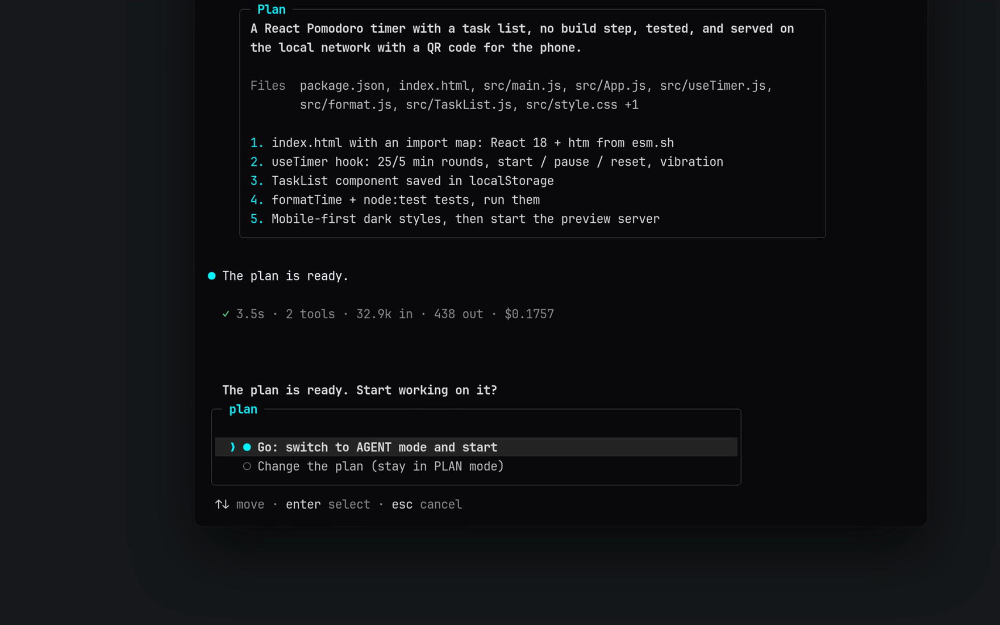

<div align="center">


<br/>

**Agent de terminal ultra-rapide et autonome : binôme IA pour le vibe coding.**  
Conçu spécialement pour **Android Termux**, **Windows**, **macOS** et **Linux**.

<br/>

[](https://www.npmjs.com/package/termux-dev)
[](https://github.com/apvcode/Termux-Dev/actions/workflows/ci.yml)
[](LICENSE)
[](https://nodejs.org)
[](https://www.typescriptlang.org)
[](#quick-start)

<br/>

[English](README.md) &nbsp;•&nbsp; [Русский](README_ru.md) &nbsp;•&nbsp; [Українська](README_uk.md) &nbsp;•&nbsp; [Deutsch](README_de.md) &nbsp;•&nbsp; [Español](README_es.md) &nbsp;•&nbsp; **Français** &nbsp;•&nbsp; [Português](README_pt.md) &nbsp;•&nbsp; [Chinese](README_zh.md) &nbsp;•&nbsp; [Japanese](README_ja.md)

<br/><br/>


<br/>

<a href="assets/demo.mp4"></a>

<sub>▶ <a href="assets/demo.mp4">Voir la démo (43 secondes)</a></sub>

</div>

---

## En bref

<table>
<tr><td valign="top" width="33%"><b>D’abord le plan, ensuite l’action</b><br/>modes PLAN et AGENT, validation en un clic, un plan à la mesure de la tâche</td><td valign="top" width="33%"><b>Sûr par défaut</b><br/>demande avant le risqué, masque les secrets dans la sortie, annulation via git, limite de coût optionnelle</td><td valign="top" width="33%"><b>N’importe quel modèle</b><br/>OpenRouter, Gemini, DeepSeek, Groq, Mistral, OpenAI, Anthropic, Ollama et plus</td></tr><tr><td valign="top" width="33%"><b>MCP intégré</b><br/>un panneau, des serveurs distants en HTTP, et l’agent configure les serveurs lui-même</td><td valign="top" width="33%"><b>Fait pour le terminal</b><br/>mises en page adaptées au téléphone, 18 thèmes, réflexion et sortie repliables</td><td valign="top" width="33%"><b>Des coûts visibles</b><br/>coût de la session en direct, effort de raisonnement par modèle, une limite si vous le souhaitez</td></tr>
</table>

## Démarrage rapide

```bash
npm install -g termux-dev
devx
```

Sur Android, exécutez d’abord dans Termux `pkg install nodejs-lts`.

---

## Points forts

L’interface du terminal s’articule autour d’une invite encadrée qui porte l’état dans ses bordures — mode (`agent` / `plan` / `yolo`), modèle, dossier, branche git, jauge de contexte et coût —, d’une carte d’en-tête, d’un écho ombré de votre message, d’une gouttière `●` pour l’assistant, de lignes `◆` pour les appels d’outils avec des résultats discrets d’une ligne et des cadres de diff pour les modifications, et d’un indicateur de travail en direct. Chaque mise en page a une variante étroite pour Termux en portrait et mesure correctement les emoji et le texte CJK. Revenez à la mise en page ASCII d’origine dans `/settings` → `Interface`.

- **Architecture à deux cerveaux (modes PLAN et AGENT) :**  
  Basculez instantanément entre **PLAN** (architecte prudent, questionnaire interactif des besoins, pas de déversement de code) et **AGENT** (modifications de fichiers autonomes, commandes de terminal, installation automatique).
- **Validation du plan en un clic (`[Go / Other]`) :**  
  Quand un plan d’architecture est finalisé, relisez-le et confirmez avec `Go` pour lancer aussitôt l’agent codeur.
- **Pièces jointes d’images multimodales :**  
  Collez des captures d’écran directement depuis le presse-papiers avec `Ctrl+V` ou `Alt+V` (aussi `/image`, ou un chemin de fichier collé). Elles apparaissent sous forme de badges comme `[Image #1 203kb]` et sont envoyées au modèle comme de vraies images, sauf si le modèle est connu pour ne lire que du texte. Nécessite `wl-clipboard` sous Wayland, `xclip` sous X11, `pngpaste` sous macOS.
- **Serveur web en direct intégré (`/serve`) :**  
  Prévisualisez instantanément des applications web et des jeux HTML5 sur le port 3000. Sur Android, il s’ouvre sans effort via `termux-open-url`.
- **Retour arrière instantané (`/undo`) :**  
  Chaque modification faite avec les outils de fichiers (`write_file`, `edit_file`) est enregistrée et peut être annulée d’une seule commande. Les changements faits par des commandes shell (`bash`) ne sont **pas** suivis, et les instantanés ne vivent qu’en mémoire pour la session en cours.
- **Diagnostic auto-réparateur et installeur automatique :**  
  Prise en charge intégrée de TypeScript (`tsc`), JavaScript (`node --check`), Python (`py_compile`) et Rust (`cargo check`). L’IA trouve et corrige les erreurs automatiquement avant de terminer un tour.
- **Banque de mémoire du projet (`.devx/memory.md`) :**  
  Contexte de projet persistant entre les sessions avec `/memory add <règle>`.
- **18 thèmes de couleurs sur fond noir pur (`#0a0a0c`) :**  
  Un noir OLED profond pour coder dans le terminal sans distraction, avec des palettes complètes plutôt qu’un seul accent : Cyan Cyber, Synthwave Purple, Matrix Hacker, Solar Amber, Ruby Crimson, Pure Monochrome, Nord Frost, Dracula, Tokyo Night, Gruvbox, Catppuccin Mocha, Solarized Dark, Rose Pine, Monokai, GitHub Dark, Deep Ocean, Sunset Glow et Forest Moss. Voir [Thèmes](#thèmes).
- **Historique de sessions intelligent (`/resume` et `/session`) :**  
  Reprenez des sessions avec les 20 derniers messages rendus en Markdown complet et suivez des ID de session uniques (`#a8f9z`).
- **Éditeur multiligne intelligent (`edit_file 2.0`) :**  
  Édition de code sans collision, avec les numéros de ligne dans les erreurs en cas de correspondances en double et prise en charge de `replaceAll`.
- **Suite de tests complète (Vitest) :**  
  Couverture de tests de la boucle de l’agent, des systèmes de fichiers, du garde de sécurité, des instantanés et de l’historique de contexte, avec CI automatisée.
- **Interface en 9 langues :**  
  English (par défaut), Русский, Українська, Deutsch, Español, Français, Português, 中文 et 日本語. Choisissez dans `/settings` → `Language` ; le choix s’applique aussitôt et est mémorisé. Les messages, les conseils et l’écran des réglages sont traduits ; le code, les noms d’outils et les réponses du modèle ne le sont pas.
- **Prise en charge universelle des fournisseurs d’IA :**  
  **OpenRouter**, **Google Gemini**, **DeepSeek**, **Groq**, **Mistral**, **OpenAI**, **Anthropic**, **Alibaba** et les modèles locaux (**Ollama**, **LM Studio**).
- **Vos propres fournisseurs :**  
  `/provider` → **Ajouter un fournisseur** : donnez-lui un nom, une adresse (toute API compatible OpenAI ou Anthropic) et une clé. Il est enregistré dans `~/.devxrc.json` et apparaît dans la liste à côté des fournisseurs connus ; choisissez-le de nouveau pour l’utiliser, changer son nom, son adresse ou sa clé, ou le supprimer. Un serveur de votre propre machine (LM Studio, une passerelle locale) peut être ajouté sans clé.

---

## Installation et mise en route

### Prérequis
- **Node.js** : `v20.0.0` ou supérieur
- **npm**, **pnpm** ou **yarn**

### Installer Node.js et npm

devx nécessite Node.js 20 ou plus récent (npm est inclus). Choisissez votre système :

```bash
# Windows (PowerShell)
winget install OpenJS.NodeJS.LTS

# macOS (Homebrew)
brew install node

# Ubuntu / Debian (NodeSource : la version du dépôt de la distribution est souvent antérieure à la 20)
curl -fsSL https://deb.nodesource.com/setup_lts.x | sudo -E bash -
sudo apt-get install -y nodejs

# Fedora
sudo dnf install -y nodejs

# Arch Linux
sudo pacman -S nodejs npm

# Android (Termux)
pkg update && pkg install -y nodejs-lts
```

Rouvrez le terminal et vérifiez : `node -v` (doit être `v20` ou supérieur) et `npm -v`. Tout système : l’installeur sur [nodejs.org](https://nodejs.org/en/download) ou [nvm](https://github.com/nvm-sh/nvm).

### Installation globale rapide (recommandée)

```bash
npm install -g termux-dev
```

### Android (Termux)

```bash
# 1. Mettre à jour les paquets et installer NodeJS
pkg update && pkg install -y nodejs-lts

# 2. Installer devx globalement avec npm
npm install -g termux-dev

# 3. Lancer devx n’importe où !
devx
```

### Compiler depuis les sources (développeurs)

```bash
git clone https://github.com/apvcode/Termux-Dev.git
cd Termux-Dev
npm install
npm link
```

### Désinstallation complète

Pour supprimer entièrement `devx` avec la configuration, les sessions enregistrées et les données :

```bash
# 1. Désinstaller le paquet npm global
npm uninstall -g termux-dev

# 2. Supprimer la configuration et l’historique des sessions (Linux / macOS / Termux)
rm -rf ~/.devx ~/.devxrc.json

# (Windows PowerShell)
Remove-Item -Recurse -Force "$HOME\.devx", "$HOME\.devxrc.json" -ErrorAction SilentlyContinue
```

---

## Premiers pas

Lancez `devx` dans n’importe quel dossier de projet :

```bash
devx
```

* Au premier lancement, `devx` ouvre un assistant interactif pour configurer votre fournisseur d’IA et votre clé d’API.
* Démarrer directement en **mode PLAN** :
  ```bash
  devx --plan
  ```
* **Mode headless à tâche unique** (scripts, CI/CD, Termux:Widget) :
  ```bash
  devx -p "review latest git diff and find security bugs"
  devx -p "fix build errors" --yolo
  ```

---

## Commandes slash

Tapez `/` dans l’invite pour ouvrir la palette de commandes avec autocomplétion :

| Commande | Description |
| :--- | :--- |
| **`/plan`** | Passer en mode **PLAN** (architecte et planificateur des besoins) |
| **`/agent`** | Passer en mode **AGENT** (codeur et exécutant autonome) |
| **`/mcp`** | Gérer les serveurs Model Context Protocol (MCP) et les outils externes (`/mcp reload`) |
| **`/usage`** | Un panneau (fermer avec `Esc`) : ce qui remplit la fenêtre de contexte (prompt système, schémas d’outils, messages, résultats d’outils, images), le coût de la session et sa fiabilité, les jetons, l’entrée en cache, le trafic |
| **`/export`** | Exporter la conversation de la session en une transcription GitHub-Flavored Markdown propre |
| **`/theme [name]`** | Changer le thème de l’interface : liste filtrable de 18 palettes avec aperçu en direct (voir [Thèmes](#thèmes)) |
| **`/doctor`** | Diagnostic de l’environnement (Node, Termux, compilateurs, clés d’API) |
| **`/image`** | Coller l’image du presse-papiers (comme `Ctrl+V` / `Alt+V`) |
| **`/serve [port]`** | Démarrer un serveur HTTP local pour l’aperçu web / jeux (`/serve stop` l’arrête) |
| **`/memory`** | Voir, ajouter (`/memory add <fait>`) ou vider la banque de mémoire du projet |
| **`/copy`** | Copier la **dernière réponse** de l’IA en entier dans le presse-papiers (aussi par ssh) |
| **`/rename`** | Renommer le chat : `/rename <nom>`, sans nom l’IA le renomme (`/title` est identique) |
| **`/permissions`** | Ce qui est autorisé sans demander (« Session » / « Always » sur une carte d’approbation) ; `/permissions clear` réinitialise |
| **`/rewind`** | Revenir à l’un de **vos messages** : la conversation après lui est supprimée (le modèle l’oublie aussi), le message revient dans la ligne de saisie pour être modifié ; les fichiers peuvent revenir aussi (avec git) |
| **`/undo`** | Annuler toutes les modifications de fichiers du dernier tour de l’IA |
| **`/diff`** | Voir le diff git coloré des fichiers modifiés du projet |
| **`/commit`** | Message de commit sémantique généré par l’IA et git commit |
| **`/status`** | Voir l’état du dépôt git |
| **`/session`** | Voir l’ID de la session active, les statistiques et les métadonnées |
| **`/resume`** | Parcourir et reprendre les sessions de chat enregistrées |
| **`/session del`** | Supprimer des sessions enregistrées, une par une ou en masse |
| **`/settings`** | Régler le thème, l’interface, l’auto-approbation YOLO, la mémoire du projet, la vérification des mises à jour et la langue de l’interface |
| **`/update`** | Chercher une nouvelle version : une carte avec les nouveautés, puis **Mettre à jour maintenant**, **Plus tard** ou (au démarrage) **Ignorer cette version**. L’installation se déroule étape par étape sur un écran en direct, vérifie que npm a bien la version et redémarre devx. En cas d’échec, vous voyez la raison et la commande à lancer à la main |
| **`/model`** | Changer le modèle du fournisseur actif avec recherche en direct |
| **`/effort [level]`** | Définir l’effort de raisonnement. Seuls les niveaux que le modèle actuel prend en charge sont proposés (voir [Effort de raisonnement](#effort-de-raisonnement)) |
| **`/provider`** | Changer de fournisseur (OpenRouter, Gemini, Groq, DeepSeek, Local) |
| **`/compact`** | Compacter et résumer les jetons du contexte du chat |
| **`/clear`** | Vider le contexte et commencer une nouvelle session (l’ancienne reste enregistrée, voir `/resume`) |
| **`/init`** | Générer le guide développeur `AGENTS.md` à la racine du projet |
| **`/help`** | Afficher toutes les commandes disponibles |
| **`/exit`** | Quitter devx proprement |

---

## Raccourcis clavier

- **`Tab`** — bascule instantanément entre les modes **PLAN** et **AGENT** sans perdre votre brouillon.
- **`Ctrl+V`** / **`Alt+V`** — colle une image du presse-papiers directement dans l’invite.
- **`@filename`** — autocomplétion rapide et approximative des fichiers, et intégration complète du fichier.
- **`Backspace`** — supprime d’un coup des badges entiers comme `[Pasted text #1]` et `[1.png 203kb]`.
- **`Ctrl+Backspace`** / **`Alt+Backspace`** — efface le texte mot par mot (aussi pendant que l’agent travaille).
- **`Ctrl+Enter`** — Pendant la saisie : saut de ligne (nouveau paragraphe) au lieu d’envoyer. `Alt+Enter` et `Shift+Enter` font de même si le terminal les transmet ; sur un terminal qui ne les distingue pas de `Enter` (un clavier de téléphone, par exemple), tapez `\` avant `Enter`.
- **`Ctrl+P`** / **`Ctrl+O`** — déplie ou replie la réflexion du modèle (`Ctrl+P`) et les commandes avec leur sortie (`Ctrl+O`) dans tout le chat, y compris ce qui est déjà plus haut. Tout est replié par défaut ; fonctionne pendant que l’agent travaille et dans l’invite.
- **`Esc`** — arrête la réponse en cours et ce qu’elle a lancé (une commande en cours) ; ce que vous avez tapé attend dans l’invite suivante. Esc ferme aussi toute liste et toute carte.
- **`Ctrl+C`** — arrête immédiatement la génération en cours ou quitte.

---

## Effort de raisonnement

`/effort` règle combien le modèle réfléchit avant de répondre : `off`, `low`, `normal`, `high`, `xhigh`, `max` ou `auto` (la valeur propre au modèle, rien n’est envoyé). Les modèles diffèrent, donc le menu propose **uniquement les niveaux que le modèle actuel prend en charge** :

```
╭─ effort ─────────────────────────────────── claude-sonnet-4-5 ─╮
│  ❯ ● auto    model default, nothing is sent                     │
│    ○ off     no reasoning                                       │
│    ○ normal  balanced (~6k thinking tokens)                     │
│    ○ high    deep reasoning (~16k thinking tokens)              │
│                                                                 │
│   Not offered by this model: max.                               │
╰─────────────────────────────────────────────────────────────────╯
```

- `/effort` ouvre le menu, `/effort high` définit directement un niveau (`medium`, `none`, `maximum` et similaires fonctionnent comme alias), `/effort auto` revient à la valeur du modèle, `/effort refresh` met à jour les données dont le menu est construit (voir plus bas).
- Le choix est mémorisé **par modèle**. Après un passage à un modèle qui ne propose pas le niveau enregistré, rien n’est envoyé. Le niveau actuel s’affiche à côté du nom du modèle (`o3 · think high` ; `think auto` signifie la valeur propre au modèle). Pendant que l’agent travaille, la ligne d’état montre combien de jetons le modèle a écrits pour votre demande (`↓ 364 tokens`), et la ligne après le tour en fait le total (`18.1k in · 59 out`).
- `devx -p "task" --effort high` définit un niveau pour une seule exécution (jamais enregistré).
- Si un point d’accès répond 400 en se plaignant du paramètre de raisonnement, devx répète la requête une fois sans lui, vous le dit et cesse de l’envoyer.

**D’où viennent les niveaux** (la première source qui connaît le modèle l’emporte ; le menu indique laquelle) :

1. **Votre propre profil** dans `~/.devxrc.json` (`reasoningProfiles`, ci-dessous).
2. **Le point d’accès lui-même.** OpenRouter liste les métadonnées de raisonnement de chaque modèle (quels niveaux il accepte, s’il peut être désactivé) ; Ollama signale une capacité « thinking » ; LiteLLM et beaucoup de passerelles ajoutent des indicateurs à leur liste de modèles. Un **fournisseur personnalisé ou tiers est interrogé une fois** : quelques petites requêtes vers *sa propre* base URL avec la clé que vous avez configurée (`GET /models`, sur une machine locale aussi `POST /api/show`, pour LiteLLM `GET /model/info`). La réponse est mise en cache un jour dans `~/.devx/capabilities.json`. Les grands éditeurs (OpenAI, Anthropic, Google...) ne sont pas interrogés, leurs listes ne disent rien du raisonnement. Désactivez avec `"probeEndpoints": false` dans `~/.devxrc.json`.
3. **Le catalogue [models.dev](https://models.dev)** : options de raisonnement d’environ 5700 modèles de 213 fournisseurs (niveaux, bascule, budgets de jetons). Un instantané est fourni avec devx, donc rien n’est téléchargé par défaut. `/effort refresh` télécharge le catalogue actuel dans `~/.devx/` et réinterroge le point d’accès ; c’est la seule fois où devx contacte models.dev, et seulement parce que vous avez lancé cette commande. Le même téléchargement met à jour les prix utilisés pour l’affichage du coût (voir Coût).
4. **Règles par nom de modèle**, le recours pour tout ce que les sources ne décrivent pas (tableau ci-dessous).

La façon dont un niveau est écrit dans la requête dépend encore de l’API de votre base URL ; cette partie est intégrée à devx.

Règles par nom de modèle (le recours) :

| Modèle | Niveaux | Envoyé comme |
| :--- | :--- | :--- |
| OpenAI série o, gpt-oss | low, normal, high | `reasoning_effort` (`reasoning.effort` sur OpenRouter) |
| GPT-5, 5.1, 5.2 | off (minimal sur GPT-5), low, normal, high, plus xhigh à partir de 5.2 | `reasoning_effort` |
| Grok 3 mini | low, high | `reasoning_effort` |
| Claude 3.7 / 4 / 4.5 | off, low, normal, high, xhigh, max (Opus 4 et 4.1 sans max) | `thinking.budget_tokens` (Anthropic), `reasoning.max_tokens` (OpenRouter) |
| Gemini 2.5 Pro / Flash | de low à max (Flash aussi off) | `thinking_budget` (Google), `reasoning.max_tokens` (OpenRouter) |
| Qwen3 | off, low, normal, high, max | `enable_thinking` / `thinking_budget` (DashScope) |
| DeepSeek V3.1+, GLM 4.5+ | off, normal | `reasoning.enabled`, `thinking.type` |
| DeepSeek-R1, QwQ, Grok 4, Magistral | aucun : ils raisonnent toujours | rien |

Un modèle qu’aucune source ne décrit n’a aucun niveau plutôt qu’une supposition. Si vous savez comment il accepte un réglage de raisonnement, décrivez-le dans `~/.devxrc.json` :

```json
{
  "reasoningProfiles": {
    "my-model": {
      "levels": ["off", "normal", "high"],
      "param": "reasoning_effort",
      "values": { "off": "none", "normal": "medium", "high": "high" }
    }
  }
}
```

`param` peut être imbriqué (`"reasoning.effort"`). Un profil remplace aussi le tableau intégré pour cet ID de modèle.

---

## Écrire pendant que l’agent travaille

Le cadre de l’invite reste en bas du terminal pendant une tâche (avec le contexte et le coût en direct), et le travail de l’agent défile au-dessus. Écrivez-y pendant que l’agent lit des fichiers, exécute des commandes ou réfléchit, puis appuyez sur Entrée : le message est mis en file et l’agent le reçoit **à son étape suivante**, entre deux appels d’outils ; il poursuit son travail en tenant compte de votre remarque. Un message écrit pendant que le modèle rédige sa réponse finale reçoit sa propre réponse au lieu d’être perdu. `Ctrl+Enter` fait un saut de ligne dans votre message au lieu de l’envoyer (`Alt+Enter` et `Shift+Enter` aussi ; un `\` avant `Enter` marche sur les terminaux qui ne les distinguent pas). `Ctrl+Backspace` efface un mot. `Esc` (ou `Ctrl+C`) arrête l’agent et remet ce que vous avez tapé dans l’invite suivante. Les mentions `@file` fonctionnent aussi dans ces messages. Tant qu’une carte d’approbation ou une question est à l’écran, la ligne s’efface, si bien que vos `y` / `n` n’atterrissent jamais dans le message. Désactivez avec `"ui": { "typeAhead": false }` dans `~/.devxrc.json`.

---

## Fenêtre de contexte

La taille de la fenêtre est recherchée, pas inventée. Dans cet ordre : `contextLimits` dans `~/.devxrc.json` (votre propre nombre par ID de modèle), le catalogue [models.dev](https://models.dev) (le nombre du fabricant pour environ 5000 modèles ; un instantané est fourni avec devx, `/effort refresh` télécharge le catalogue actuel), la valeur enregistrée au choix du modèle, la table de modèles de devx, une règle par nom de modèle, et seulement ensuite une valeur par défaut de 128k. `/usage` indique laquelle a servi et avertit quand c’est une supposition. Les anciens messages sont abandonnés au-delà de 85 % de la fenêtre : une fenêtre trop petite fait oublier devx trop tôt, une trop grande fait refuser la requête par le fournisseur (devx raccourcit alors l’historique et réessaie).

```json
{ "contextLimits": { "my-model": 65536 } }
```

---

## Formats d’API (OpenAI et Anthropic)

Deux formats d’échange existent : **OpenAI** (`/v1/chat/completions`) et **Anthropic** (`/v1/messages`). Le format Anthropic natif porte des blocs de raisonnement signés, la mise en cache des prompts et une comptabilité exacte du cache, donc les modèles Claude fonctionnent mieux avec lui. devx parle les deux et choisit le format **pour chaque modèle, tout seul, avec une seule clé** :

- `api.anthropic.com` et les base URL avec un chemin `/anthropic/` (MiniMax, Z.ai et similaires) utilisent le format Anthropic.
- Pour toute autre passerelle personnalisée, devx demande deux fois la liste des modèles (quelques petites requêtes `GET {root}/v1/models` vers votre propre base URL avec votre propre clé) : une fois comme client OpenAI et une fois comme client Anthropic. Les modèles que seule la seconde liste contient (typiquement Claude) passent par le format Anthropic, tout le reste par le format OpenAI. `/model` montre les deux listes dans un seul sélecteur et marque celles d’Anthropic. Définissez la base URL une fois (`https://gateway.example.com/v1` ou sans `/v1`) ; rien n’est à configurer par modèle.
- La réponse est mise en cache un jour dans `~/.devx/formats.json` (ID de modèles uniquement, jamais la clé). `"probeEndpoints": false` désactive l’interrogation, `"apiFormat": "openai"` ou `"anthropic"` dans `~/.devxrc.json` impose un format pour tout.
- Les niveaux de raisonnement (`/effort`) sont écrits comme l’API Anthropic l’attend (`thinking.budget_tokens`) chaque fois que le format Anthropic est utilisé, même derrière une passerelle. Les blocs de raisonnement sont conservés et renvoyés avec la requête suivante, pour que le modèle ne perde pas le fil entre les appels d’outils. Si une passerelle les rejette, ou rejette les marqueurs de cache, un `max_tokens` trop grand ou le réglage de raisonnement, devx réessaie une fois sans la partie fautive et vous le dit.

## Coût

Le nombre à côté de la jauge de contexte est l’argent dépensé dans cette session. Il indique le degré de certitude de devx :

| Affiché | Signification |
| :--- | :--- |
| `$0.0123` | exact : rapporté par le fournisseur, ou calculé d’après la grille tarifaire de l’éditeur |
| `~$0.0123` | une estimation : calculée avec le prix [models.dev](https://models.dev) du même modèle (une passerelle peut facturer autrement) |
| `$0.0123+` | au moins ce montant : certaines requêtes n’ont pas de prix connu et ne sont pas comptées |
| `n/a` | aucun prix connu pour le modèle |

Les prix sont recherchés dans cet ordre, la première source qui connaît le modèle l’emporte : le coût que le fournisseur a mis dans sa réponse (OpenRouter `usage.cost`, LiteLLM) - vos propres `prices` dans `~/.devxrc.json` - la grille de prix du point d’accès (OpenRouter, LiteLLM) - le catalogue models.dev (environ 8500 modèles ; un instantané est fourni avec devx, `/effort refresh` télécharge le catalogue actuel). Les jetons d’entrée en cache, les écritures de cache et les paliers de long contexte sont facturés séparément, comme le font les éditeurs. Un modèle introuvable n’est jamais affiché gratuit : seuls les modèles `:free` et les serveurs locaux ne coûtent rien. `/usage` liste aussi l’entrée en cache et le nombre de requêtes qui n’ont pu être chiffrées.

```json
{
  "prices": {
    "my-model": { "input": 0.5, "output": 2.0, "cacheRead": 0.05 }
  }
}
```

Les valeurs sont en USD par million de jetons.

---

## Thèmes

`/theme` ouvre une liste que vous pouvez filtrer en tapant ; le thème surligné est prévisualisé dans ses propres couleurs sous la liste. `/theme nord` (ou un alias comme `tokyo`, `mocha`, `gh`, ou un nombre de 1 à 18) change directement, et le choix est enregistré.

Un thème est une palette complète : accent, une seconde couleur pour le mode plan, couleurs de succès / avertissement / erreur, une couleur pour le mode YOLO, quatre niveaux de gris pour le texte, le texte secondaire, les conseils et les bordures, et le fond de l’écho de votre message. Chaque thème est vérifié dans les tests pour un contraste lisible sur fond sombre.

| Thème | Caractère |
| :--- | :--- |
| `cyan` Cyan Cyber (par défaut) | cyan électrique et obsidienne |
| `purple` Synthwave Purple | magenta néon, violet rétro |
| `matrix` Matrix Hacker | vert phosphore |
| `amber` Solar Amber | or chaud de CRT |
| `crimson` Ruby Crimson | rouge écarlate |
| `monochrome` Pure Monochrome | uniquement blanc et gris |
| `nord` Nord Frost | bleus arctiques |
| `dracula` Dracula | violet avec rose et vert |
| `tokyonight` Tokyo Night | indigo et bleu |
| `gruvbox` Gruvbox | jaune et orange rétro |
| `catppuccin` Catppuccin Mocha | mauve pastel |
| `solarized` Solarized Dark | sarcelle et olive peu éblouissantes |
| `rosepine` Rose Pine | rose doux et or |
| `monokai` Monokai | citron vert et magenta |
| `github` GitHub Dark | bleu et vert nets |
| `ocean` Deep Ocean | cyan des grands fonds |
| `sunset` Sunset Glow | corail et violet |
| `forest` Forest Moss | verts de mousse |

Les couleurs sont exactes sur les terminaux compatibles truecolor (`COLORTERM=truecolor`) ; sur les terminaux 256 couleurs, chaque couleur est ramenée à l’entrée de palette la plus proche. Définissez `DEVX_COLOR=256` ou `DEVX_COLOR=truecolor` pour forcer l’un des deux.

---

## Modèle de sécurité

`devx` exécute des commandes et modifie des fichiers sur votre machine pour le compte d’un modèle d’IA ; il est donc prudent par défaut :

- **Confiance dans l’espace de travail.** La première fois que vous ouvrez un dossier, on vous demande si vous lui faites confiance (par défaut : non). Dans un dossier non fiable, `provider`, `apiKey`, `baseUrl`, `autoApprove` et `bashAllowlist` du `.devx.json` du projet sont **ignorés**. Un dépôt cloné ne peut pas rediriger votre clé d’API vers son propre serveur ni activer YOLO.
- **Les serveurs MCP du projet demandent une approbation.** Les serveurs MCP déclarés par un projet (`.mcp.json`, `.devx/mcp.json`, `.claude/mcp.json`, `.devx.json`) sont des programmes qui s’exécuteraient sur votre machine. Vous examinez une fois les commandes exactes ; si elles changent, on vous redemande. En mode headless (`-p`), les serveurs de projet non approuvés sont ignorés. Les serveurs de `~/.devxrc.json` et `~/.devx/mcp.json` démarrent toujours.
- **Confirmations.** En mode sûr, `bash`, `install_package`, les outils MCP, le serveur d’aperçu et chaque lecture ou écriture **hors du dossier du projet** demandent une confirmation.
- **YOLO (`--yolo`) n’est pas un bac à sable.** Il saute les confirmations courantes, mais demande encore avant les commandes shell dangereuses (suppressions récursives hors du projet, `find -delete` sur de larges chemins, `curl … | sh`, `sudo`, `git push --force`, …) et avant de toucher aux identifiants (`~/.ssh`, `~/.aws`, `~/.devxrc.json`, `.env`, clés privées). La vérification du shell analyse les commandes jeton par jeton, mais une commande volontairement obscurcie peut encore passer ; n’utilisez donc YOLO que dans des dossiers et des environnements que vous pouvez vous permettre de perdre. En mode headless, ces confirmations ne peuvent pas être affichées, l’action est donc refusée.
- **Extra (`--extra`, ou `/settings` quand YOLO est activé) ne demande absolument rien.** Ni les commandes dangereuses, ni les fichiers d’identifiants, ni un nouveau serveur MCP : l’agent peut exécuter n’importe quelle commande. Un avertissement s’affiche à l’activation, le cadre de l’invite indique `extra` et, comme YOLO, il est désactivé au prochain démarrage. À n’utiliser que dans un environnement que vous pouvez perdre.
- **`fetch_url`** refuse localhost, les réseaux privés et les adresses de métadonnées cloud (aussi après des redirections). Définissez `DEVX_ALLOW_PRIVATE_NETWORK=1` pour autoriser des serveurs de documentation locaux.
- **`/serve`** écoute sur votre réseau local (c’est ainsi que fonctionne le QR code du téléphone). Il ne sert jamais les dotfiles, les clés, `node_modules` ni les liens symboliques qui sortent du projet, n’envoie pas d’en-têtes CORS permissifs et rejette les requêtes adressées à un nom d’hôte public.
- **Secrets au repos.** `~/.devxrc.json`, `~/.devx/` et les sessions enregistrées sont créés lisibles par vous seul (`0600` / `0700`). Les fichiers de session contiennent toute la conversation, y compris le contenu des fichiers lus par l’agent.
- **Limites.** `bash` arrête les commandes après 120 s par défaut (le modèle peut passer `timeout_seconds`, maximum 1800) et ferme stdin. Une longue sortie garde son début et sa fin. `read_file` renvoie au plus ~60 000 caractères par appel et prend en charge `startLine` / `endLine`.

---

## Soutenir le projet

Si **devx** vous est utile, pensez à lui donner une étoile sur [GitHub](https://github.com/apvcode/Termux-Dev) — cela aide le projet à grandir et motive la suite du développement !

---

## License

Ce projet est distribué sous [licence MIT](LICENSE).

---

<div align="center">

Réalisé par [ApvCode](https://github.com/ApvCode) pour les développeurs, les vibe coders et les hackers Termux.

</div>
