<div align="center">


<br/><br/>

**超高速で自律的な、ターミナル向け AI ペアプログラマー兼 Vibe Coding エージェント。**  
**Android Termux**、**Windows**、**macOS**、**Linux** 専用に作られています。

[](https://www.npmjs.com/package/termux-dev)
[](https://github.com/apvcode/Termux-Dev/actions/workflows/ci.yml)
[](LICENSE)
[](https://nodejs.org)
[](https://www.typescriptlang.org)
[](#)

<br/>

[English](README.md) &nbsp;•&nbsp; [Русский](README_ru.md) &nbsp;•&nbsp; [Українська](README_uk.md) &nbsp;•&nbsp; [Deutsch](README_de.md) &nbsp;•&nbsp; [Español](README_es.md) &nbsp;•&nbsp; [Français](README_fr.md) &nbsp;•&nbsp; [Português](README_pt.md) &nbsp;•&nbsp; [中文](README_zh.md) &nbsp;•&nbsp; **日本語**

<br/><br/>



</div>

---

## 主な特長

ターミナルの画面は、枠付きのプロンプトを中心に構成されています。枠線にはステータス（モード `agent` / `plan` / `yolo`、モデル、フォルダ、git ブランチ、コンテキストメーター、コスト）が表示されます。そのほか、ヘッダーカード、陰影付きのメッセージ表示、アシスタント用の `●` ガター、静かな 1 行の結果を持つ `◆` ツール呼び出し行、編集用の diff ボックス、リアルタイムの作業インジケーターがあります。どのレイアウトにも縦持ちの Termux 向けの狭い画面用バリアントがあり、絵文字や CJK 文字の幅も正しく計算します。元の ASCII レイアウトには `/settings` → `Interface` で戻せます。

- **ツインブレイン構成（PLAN と AGENT モード）：**  
  **PLAN**（安全なアーキテクト、対話式の要件ヒアリング、コードの丸出しなし）と **AGENT**（ファイルの自律編集、ターミナルコマンド、自動インストール）を即座に切り替えられます。
- **ワンクリックのプラン承認（`[Go / Other]`）：**  
  アーキテクチャプランが固まったら、内容を確認して `Go` を選ぶだけで、コーディングエージェントがすぐに動き出します。
- **マルチモーダルな画像添付：**  
  `Ctrl+V` または `Alt+V` でクリップボードからスクリーンショットをそのまま貼り付けられます（`/image` やファイルパスの貼り付けも可）。`[Image #1 203kb]` のようなバッジで表示され、テキスト専用と分かっているモデルでなければ、本物の画像としてモデルに送られます。Wayland では `wl-clipboard`、X11 では `xclip`、macOS では `pngpaste` が必要です。
- **内蔵のライブ Web サーバー（`/serve`）：**  
  Web アプリや HTML5 ゲームをポート 3000 で即座にプレビューできます。Android では `termux-open-url` でスムーズに開きます。
- **即時スナップショットによるロールバック（`/undo`）：**  
  ファイルツール（`write_file`、`edit_file`）で行った編集はすべて記録され、1 つのコマンドで元に戻せます。シェルコマンド（`bash`）による変更は記録**されません**。スナップショットは現在のセッションのメモリ内にのみ保持されます。
- **自己修復する診断と自動インストーラー：**  
  TypeScript（`tsc`）、JavaScript（`node --check`）、Python（`py_compile`）、Rust（`cargo check`）を標準でサポート。AI がターンを終える前に、エラーを自動で見つけて修正します。
- **プロジェクトメモリバンク（`.devx/memory.md`）：**  
  `/memory add <ルール>` で、セッションをまたいでプロジェクトの文脈を保持します。
- **純黒背景（`#0a0a0c`）の 18 種類のカラーテーマ：**  
  気が散らない CLI での Vibe Coding のための深い OLED ブラック。単一のアクセントではなく完全なパレットを備えます：Cyan Cyber、Synthwave Purple、Matrix Hacker、Solar Amber、Ruby Crimson、Pure Monochrome、Nord Frost、Dracula、Tokyo Night、Gruvbox、Catppuccin Mocha、Solarized Dark、Rose Pine、Monokai、GitHub Dark、Deep Ocean、Sunset Glow、Forest Moss。[テーマ](#テーマ)を参照してください。
- **スマートなセッション履歴（`/resume` と `/session`）：**  
  直近 20 件のメッセージを完全な Markdown で表示してセッションを再開し、固有のセッション ID（`#a8f9z`）を追跡できます。
- **スマートな複数行エディター（`edit_file 2.0`）：**  
  衝突に強いコード編集。重複一致のときは行番号付きでエラーを報告し、`replaceAll` にも対応します。
- **充実したテストスイート（Vitest）：**  
  エージェントループ、ファイルシステム、セキュリティガード、スナップショット、コンテキスト履歴を網羅し、CI で自動実行します。
- **9 言語のインターフェース：**  
  English（既定）、Русский、Українська、Deutsch、Español、Français、Português、中文、日本語。`/settings` → `Language` で選ぶと即座に反映され、記憶されます。メッセージ、ヒント、設定画面が翻訳され、コード、ツール名、モデル自身の回答は翻訳されません。
- **あらゆる AI プロバイダーに対応：**  
  **OpenRouter**、**Google Gemini**、**DeepSeek**、**Groq**、**Mistral**、**OpenAI**、**Anthropic**、**Alibaba**、そしてローカルモデル（**Ollama**、**LM Studio**）。

---

## インストールとセットアップ

### 前提条件
- **Node.js**：`v20.0.0` 以上
- **npm**、**pnpm**、または **yarn**

### グローバルへの簡単インストール（推奨）

```bash
npm install -g termux-dev
```

### Android（Termux）

```bash
# 1. パッケージを更新して NodeJS をインストール
pkg update && pkg install -y nodejs-lts

# 2. npm で devx をグローバルにインストール
npm install -g termux-dev

# 3. どこでも devx を起動！
devx
```

### ソースからビルド（開発者向け）

```bash
git clone https://github.com/apvcode/Termux-Dev.git
cd Termux-Dev
npm install
npm link
```

### 完全なアンインストール

設定、保存したセッション、データも含めて `devx` を完全に削除するには：

```bash
# 1. グローバルの npm パッケージをアンインストール
npm uninstall -g termux-dev

# 2. 設定とセッション履歴を削除（Linux / macOS / Termux）
rm -rf ~/.devx ~/.devxrc.json

# （Windows PowerShell）
Remove-Item -Recurse -Force "$HOME\.devx", "$HOME\.devxrc.json" -ErrorAction SilentlyContinue
```

---

## はじめに

任意のプロジェクトフォルダで `devx` を起動します：

```bash
devx
```

* 初回起動時、`devx` は AI プロバイダーと API キーを設定する対話式のセットアップウィザードを開きます。
* 最初から **PLAN モード**で起動する：
  ```bash
  devx --plan
  ```
* **ヘッドレス単発モード**（スクリプト、CI/CD、Termux:Widget）：
  ```bash
  devx -p "review latest git diff and find security bugs"
  devx -p "fix build errors" --yolo
  ```

---

## スラッシュコマンド

プロンプトで `/` を入力すると、オートコンプリート付きのコマンドパレットが開きます：

| コマンド | 説明 |
| :--- | :--- |
| **`/plan`** | **PLAN** モードに切り替え（アーキテクト兼要件プランナー） |
| **`/agent`** | **AGENT** モードに切り替え（コーダー兼自律実行者） |
| **`/mcp`** | Model Context Protocol（MCP）サーバーと外部ツールを管理（`/mcp reload`） |
| **`/usage`** | パネル（`Esc` で閉じる）：コンテキストウィンドウを何が占めているか（システムプロンプト、ツールスキーマ、メッセージ、ツール結果、画像）、セッションのコストとその確からしさ、トークン、キャッシュされた入力、通信量 |
| **`/export`** | セッションの会話を整った GitHub-Flavored Markdown の記録として書き出す |
| **`/theme [name]`** | UI テーマを切り替え：検索できる 18 種類のパレット一覧とライブプレビュー（[テーマ](#テーマ)を参照） |
| **`/doctor`** | 環境の健全性を診断（Node、Termux、コンパイラ、API キー） |
| **`/image`** | クリップボードの画像を貼り付け（`Ctrl+V` / `Alt+V` と同じ） |
| **`/serve [port]`** | Web / ゲームのプレビュー用にローカル HTTP サーバーを起動（`/serve stop` で停止） |
| **`/memory`** | プロジェクトメモリバンクの表示、追加（`/memory add <事実>`）、消去 |
| **`/copy`** | AI の**最後の回答**を全文クリップボードにコピー（ssh 経由でも動作） |
| **`/rename`** | チャット名を変更: `/rename <名前>`。名前なしなら AI が付け直します（`/title` も同じ） |
| **`/permissions`** | 確認なしで許可されているもの（承認カードの Session / Always）。`/permissions clear` でリセット |
| **`/undo`** | AI の直前のターンによるファイル変更をすべて元に戻す |
| **`/diff`** | 変更されたプロジェクトファイルの色付き git diff を表示 |
| **`/commit`** | AI が生成するセマンティックなコミットメッセージで git commit |
| **`/status`** | git リポジトリの状態を表示 |
| **`/session`** | 現在のセッション ID、統計、メタデータを表示 |
| **`/resume`** | 保存したチャットセッションを閲覧して再開 |
| **`/session del`** | 保存したセッションを個別または一括で削除 |
| **`/settings`** | テーマ、インターフェース、YOLO 自動承認、プロジェクトメモリ、更新確認、インターフェース言語を設定 |
| **`/update`** | GitHub から最新の更新を確認してインストール |
| **`/model`** | 現在のプロバイダーのモデルをライブ検索で切り替え |
| **`/effort [level]`** | 推論の強さを設定。現在のモデルが対応するレベルだけが表示されます（[推論の強さ](#推論の強さ)を参照） |
| **`/provider`** | プロバイダーを切り替え（OpenRouter、Gemini、Groq、DeepSeek、Local） |
| **`/compact`** | チャットコンテキストのトークンを圧縮して要約 |
| **`/clear`** | コンテキストを消去して新しいセッションを開始（古いセッションは保存されたまま、`/resume` を参照） |
| **`/init`** | プロジェクトのルートに開発者ガイド `AGENTS.md` を生成 |
| **`/help`** | 利用可能なコマンドをすべて表示 |
| **`/exit`** | devx を正常に終了 |

---

## キー操作

- **`Tab`** — 入力中の下書きを失わずに **PLAN** と **AGENT** を即座に切り替えます。
- **`Ctrl+V`** / **`Alt+V`** — クリップボードの画像をプロンプトに直接貼り付けます。
- **`@filename`** — 高速なあいまいファイル補完と、ファイル全体の埋め込み。
- **`Backspace`** — `[Pasted text #1]` や `[1.png 203kb]` などのバッジを 1 回で丸ごと削除します。
- **`Ctrl+Backspace`** / **`Alt+Backspace`** — テキストを単語単位で削除します（エージェントの作業中も使えます）。
- **`Ctrl+Enter`** — エージェントの作業中に、その時点のタスクを中断して、あなたのメッセージをすぐに送信します（`Ctrl+Enter` と `Enter` を区別できないターミナルでは `Alt+Enter` が同じ働きをします）。
- **`Ctrl+P`** / **`Ctrl+O`** — チャット全体で、モデルの思考（`Ctrl+P`）とコマンドおよびその出力（`Ctrl+O`）を展開・折りたたみます。すでに上にある内容も対象です。既定ではすべて折りたたみ。エージェントの作業中にも入力欄でも使えます。
- **`Ctrl+C`** — 現在の生成をただちに停止、または終了します。

---

## 推論の強さ

`/effort` は、モデルが回答の前にどれだけ考えるかを設定します：`off`、`low`、`normal`、`high`、`xhigh`、`max`、または `auto`（モデル自身の既定値、何も送りません）。モデルごとに異なるため、メニューには**現在のモデルが対応するレベルだけ**が表示されます：

```
╭─ effort ─────────────────────────────────── claude-sonnet-4-5 ─╮
│  ❯ ● auto    model default, nothing is sent                     │
│    ○ off     no reasoning                                       │
│    ○ normal  balanced (~6k thinking tokens)                     │
│    ○ high    deep reasoning (~16k thinking tokens)              │
│                                                                 │
│   Not offered by this model: max.                               │
╰─────────────────────────────────────────────────────────────────╯
```

- `/effort` でメニューを開き、`/effort high` でレベルを直接設定します（`medium`、`none`、`maximum` などもエイリアスとして使えます）。`/effort auto` でモデルの既定値に戻し、`/effort refresh` でメニューの元になるデータを更新します（後述）。
- 選択は**モデルごと**に記憶されます。保存したレベルを提供しないモデルに切り替えると、何も送られません。現在のレベルはモデル名の横に表示されます（`o3 · think high`。`think auto` はモデル自身の既定値）。エージェントの作業中、ステータス行にはモデルがこれまでにあなたのリクエストのために書いたトークン数（`↓ 364 tokens`）が表示され、ターン後の行で合計が示されます（`18.1k in · 59 out`）。
- `devx -p "task" --effort high` は 1 回の実行にだけレベルを設定します（保存されません）。
- エンドポイントが 400 を返して推論パラメーターに文句を言った場合、devx はそれを外して 1 回だけ再試行し、その旨を伝え、以後は送らなくなります。

**レベルの出どころ**（そのモデルを知っている最初の情報源が優先されます。メニューはどれを使ったかを表示します）：

1. **あなた自身のプロファイル**（`~/.devxrc.json` の `reasoningProfiles`、後述）。
2. **エンドポイント自体。** OpenRouter は全モデルの推論メタデータ（受け付ける強さ、オフにできるか）を一覧にし、Ollama は「thinking」機能を報告し、LiteLLM や多くのゲートウェイはモデル一覧にフラグを追加します。**カスタムまたはサードパーティのプロバイダーには一度だけ問い合わせます**：設定したキーを使って*そのプロバイダー自身の* base URL に数回の小さなリクエストを送ります（`GET /models`、ローカルマシンでは `POST /api/show` も、LiteLLM では `GET /model/info`）。回答は `~/.devx/capabilities.json` に 1 日キャッシュされます。大手ベンダー（OpenAI、Anthropic、Google など）には問い合わせません。それらの一覧には推論の情報がないためです。`~/.devxrc.json` の `"probeEndpoints": false` で無効にできます。
3. **[models.dev](https://models.dev) カタログ**：213 プロバイダー・約 5700 モデルの推論オプション（強さ、切り替え、トークン予算）。スナップショットが devx に同梱されているため、既定では何もダウンロードしません。`/effort refresh` は最新版を `~/.devx/` に取得し、エンドポイントにもう一度問い合わせます。devx が models.dev に接続するのはこのときだけで、あなたがそのコマンドを実行したからです。同じダウンロードでコスト表示に使う価格も更新されます（コストを参照）。
4. **モデル名によるルール**。情報源が説明していないものすべてに対するフォールバックです（下の表）。

レベルがリクエストにどう書かれるかは、引き続き base URL の API によって決まるため、その部分は devx に組み込まれています。

モデル名によるルール（フォールバック）：

| モデル | レベル | 送信形式 |
| :--- | :--- | :--- |
| OpenAI o シリーズ、gpt-oss | low、normal、high | `reasoning_effort`（OpenRouter では `reasoning.effort`） |
| GPT-5、5.1、5.2 | off（GPT-5 は minimal）、low、normal、high、5.2 以降は xhigh も | `reasoning_effort` |
| Grok 3 mini | low、high | `reasoning_effort` |
| Claude 3.7 / 4 / 4.5 | off、low、normal、high、xhigh、max（Opus 4 と 4.1 は max なし） | `thinking.budget_tokens`（Anthropic）、`reasoning.max_tokens`（OpenRouter） |
| Gemini 2.5 Pro / Flash | low から max（Flash は off も） | `thinking_budget`（Google）、`reasoning.max_tokens`（OpenRouter） |
| Qwen3 | off、low、normal、high、max | `enable_thinking` / `thinking_budget`（DashScope） |
| DeepSeek V3.1+、GLM 4.5+ | off、normal | `reasoning.enabled`、`thinking.type` |
| DeepSeek-R1、QwQ、Grok 4、Magistral | なし：常に推論する | 送信しない |

どの情報源も説明していないモデルには、推測ではなくレベルなしが割り当てられます。推論設定をどう受け取るか分かっている場合は、`~/.devxrc.json` に記述してください：

```json
{
  "reasoningProfiles": {
    "my-model": {
      "levels": ["off", "normal", "high"],
      "param": "reasoning_effort",
      "values": { "off": "none", "normal": "medium", "high": "high" }
    }
  }
}
```

`param` は入れ子にできます（`"reasoning.effort"`）。プロファイルは、そのモデル ID に限り組み込みの表も上書きします。

---

## エージェントの作業中に入力する

タスクの間、プロンプトの枠は（リアルタイムのコンテキストとコスト付きで）ターミナルの下部に残り、エージェントの作業はその上をスクロールします。エージェントがファイルを読んだりコマンドを実行したり考えたりしている間に入力して Enter を押すと、メッセージはキューに入り、エージェントは**次のステップ**で、2 つのツール呼び出しの間にそれを受け取ります。作業を続けながら、あなたの指摘も考慮します。モデルが最終回答を書いている最中に入力したメッセージは、破棄されずに独立した返答を受け取ります。`Ctrl+Enter` は次のステップを待ちません。エージェントの現在のタスクを中断して、メッセージをすぐに送信します（ターミナルがこのキーを報告できる必要があります。代替は `Alt+Enter` です）。`Ctrl+Backspace` は単語を削除します。`Esc` は行を消去し、`Ctrl+C` は引き続きエージェントを止め、入力した内容を次のプロンプトに戻します。これらのメッセージでも `@file` の指定が使えます。承認カードや質問が画面に出ている間は入力行が脇に退くため、あなたの `y` / `n` がメッセージに紛れ込むことはありません。`~/.devxrc.json` の `"ui": { "typeAhead": false }` で無効にできます。

---

## コンテキストウィンドウ

ウィンドウのサイズは、でっち上げではなく調べて決めます。次の順序です：`~/.devxrc.json` の `contextLimits`（モデル ID ごとのあなた自身の数値）、[models.dev](https://models.dev) カタログ（約 5000 モデルについてのメーカー自身の数値。スナップショットが devx に同梱され、`/effort refresh` で最新版を取得）、モデル選択時に保存された値、devx のモデル表、モデル名によるルール、そして最後にようやく既定の 128k。`/usage` はどれが使われたかを示し、推測の場合は警告します。古いメッセージはウィンドウの 85% を超えると破棄されるため、小さすぎるウィンドウでは devx が早く忘れ、大きすぎるとプロバイダーがリクエストを拒否します（その場合、devx は履歴を短くして再試行します）。

```json
{ "contextLimits": { "my-model": 65536 } }
```

---

## API 形式（OpenAI と Anthropic）

通信形式は 2 つあります：**OpenAI**（`/v1/chat/completions`）と **Anthropic**（`/v1/messages`）。Anthropic のネイティブ形式は、署名付きの推論ブロック、プロンプトキャッシュ、正確なキャッシュ計測を備えているため、Claude モデルはこの形式が最適です。devx は両方を話し、形式を**モデルごとに自動で、キー 1 つで**選びます：

- `api.anthropic.com` と、パスに `/anthropic/` を含む base URL（MiniMax、Z.ai など）は Anthropic 形式を使います。
- それ以外のカスタムゲートウェイでは、devx はモデル一覧を 2 回取得します（あなた自身のキーで、あなた自身の base URL に数回の小さな `GET {root}/v1/models` リクエスト）：1 回は OpenAI クライアントとして、もう 1 回は Anthropic クライアントとして。2 つ目の一覧にしかないモデル（通常は Claude）は Anthropic 形式で、それ以外は OpenAI 形式で送られます。`/model` は両方の一覧を 1 つの選択画面に表示し、Anthropic のものに印を付けます。base URL は一度設定するだけです（`https://gateway.example.com/v1` または `/v1` なし）。モデルごとの設定は不要です。
- 回答は `~/.devx/formats.json` に 1 日キャッシュされます（モデル ID のみで、キーは決して保存しません）。`"probeEndpoints": false` で問い合わせを無効にでき、`~/.devxrc.json` の `"apiFormat": "openai"` または `"anthropic"` はすべてに 1 つの形式を強制します。
- Anthropic 形式が使われる場合は常に（ゲートウェイの背後でも）、推論レベル（`/effort`）は Anthropic API が期待する形（`thinking.budget_tokens`）で書かれます。推論ブロックは保持されて次のリクエストで送り返されるため、モデルはツール呼び出しの間で思考の流れを失いません。ゲートウェイがそれらやキャッシュマーカー、大きすぎる `max_tokens`、推論設定を拒否した場合、devx は問題のある部分を外して 1 回だけ再試行し、その旨を伝えます。

## コスト

コンテキストメーターの横の数字は、このセッションで使った金額です。devx がどれだけ確信しているかも示します：

| 表示 | 意味 |
| :--- | :--- |
| `$0.0123` | 正確：プロバイダーが報告した、またはベンダー自身の価格表で算出した金額 |
| `~$0.0123` | 推定：同じモデルの [models.dev](https://models.dev) の価格で算出（ゲートウェイは異なる請求をする場合があります） |
| `$0.0123+` | 少なくともこの額：一部のリクエストは価格が不明で、含まれていません |
| `n/a` | そのモデルの価格は不明 |

価格は次の順序で調べられ、そのモデルを知っている最初の情報源が優先されます：プロバイダーがレスポンスに入れたコスト（OpenRouter `usage.cost`、LiteLLM）→ `~/.devxrc.json` のあなた自身の `prices` → エンドポイント自身の価格表（OpenRouter、LiteLLM）→ models.dev カタログ（約 8500 モデル。スナップショットが devx に同梱され、`/effort refresh` で最新版を取得）。キャッシュされた入力トークン、キャッシュ書き込み、長文コンテキストの階層は、ベンダーと同じように別々に課金されます。見つからないモデルが無料として表示されることは決してありません。ゼロコストなのは `:free` モデルとローカルサーバーだけです。`/usage` はキャッシュされた入力と、価格を付けられなかったリクエスト数も一覧にします。

```json
{
  "prices": {
    "my-model": { "input": 0.5, "output": 2.0, "cacheRead": 0.05 }
  }
}
```

値は 100 万トークンあたりの USD です。

---

## テーマ

`/theme` は、入力で絞り込める一覧を開きます。ハイライトされたテーマは一覧の下にそのテーマ自身の色でプレビューされます。`/theme nord`（または `tokyo`、`mocha`、`gh` などのエイリアス、あるいは 1〜18 の番号）で直接切り替わり、選択は保存されます。

テーマは完全なパレットです：アクセント、plan モード用の第 2 の色、成功 / 警告 / エラーの色、YOLO モードの色、テキスト・補助テキスト・ヒント・枠線用の 4 段階のグレー、そしてメッセージ表示の背景。すべてのテーマは、暗い背景で読みやすいコントラストがあるかをテストで確認しています。

| テーマ | 特徴 |
| :--- | :--- |
| `cyan` Cyan Cyber（既定） | エレクトリックシアンと黒曜石 |
| `purple` Synthwave Purple | ネオンマゼンタ、レトロなバイオレット |
| `matrix` Matrix Hacker | 蛍光グリーン |
| `amber` Solar Amber | 温かな CRT のゴールド |
| `crimson` Ruby Crimson | 緋色 |
| `monochrome` Pure Monochrome | 白とグレーのみ |
| `nord` Nord Frost | 北極のブルー |
| `dracula` Dracula | 紫にピンクとグリーン |
| `tokyonight` Tokyo Night | インディゴとブルー |
| `gruvbox` Gruvbox | レトロな黄色とオレンジ |
| `catppuccin` Catppuccin Mocha | パステルモーヴ |
| `solarized` Solarized Dark | まぶしさを抑えたティールとオリーブ |
| `rosepine` Rose Pine | やわらかなローズとゴールド |
| `monokai` Monokai | ライムとマゼンタ |
| `github` GitHub Dark | すっきりしたブルーとグリーン |
| `ocean` Deep Ocean | 深海のシアン |
| `sunset` Sunset Glow | コーラルとバイオレット |
| `forest` Forest Moss | 苔のグリーン |

色は truecolor 対応のターミナル（`COLORTERM=truecolor`）では正確で、256 色のターミナルでは各色が最も近いパレット項目に割り当てられます。`DEVX_COLOR=256` または `DEVX_COLOR=truecolor` を設定すると、どちらかを強制できます。

---

## セキュリティモデル

`devx` は AI モデルの代わりに、あなたのマシン上でコマンドを実行しファイルを編集します。そのため、既定では慎重に動作します：

- **ワークスペースの信頼。** フォルダを初めて開くとき、信頼するかどうかを尋ねられます（既定：いいえ）。信頼していないフォルダでは、プロジェクトの `.devx.json` にある `provider`、`apiKey`、`baseUrl`、`autoApprove`、`bashAllowlist` は**無視**されます。クローンしたリポジトリが、あなたの API キーを自分のサーバーへ向け直したり、YOLO を有効にしたりすることはできません。
- **プロジェクトの MCP サーバーは承認が必要です。** プロジェクトが宣言する MCP サーバー（`.mcp.json`、`.devx/mcp.json`、`.claude/mcp.json`、`.devx.json`）は、あなたのマシンで実行されるプログラムです。正確なコマンドを一度確認し、変更されると再度尋ねられます。ヘッドレスモード（`-p`）では、未承認のプロジェクトサーバーはスキップされます。`~/.devxrc.json` と `~/.devx/mcp.json` のサーバーは常に起動します。
- **確認。** 安全モードでは、`bash`、`install_package`、MCP ツール、プレビューサーバー、そして**プロジェクトフォルダの外**へのあらゆる読み書きに確認が必要です。
- **YOLO（`--yolo`）はサンドボックスではありません。** 通常の確認は省略しますが、危険なシェルコマンド（プロジェクト外の再帰的な削除、広いパスへの `find -delete`、`curl … | sh`、`sudo`、`git push --force` など）の前や、認証情報（`~/.ssh`、`~/.aws`、`~/.devxrc.json`、`.env`、秘密鍵）に触れる前には、引き続き確認します。シェルのチェックはコマンドをトークン単位で解析しますが、意図的に難読化されたコマンドはすり抜ける可能性があるため、失っても構わないフォルダや環境でのみ YOLO を使ってください。ヘッドレスモードではこれらの確認を表示できないため、その操作は拒否されます。
- **`fetch_url`** は localhost、プライベートネットワーク、クラウドのメタデータアドレスを拒否します（リダイレクト後も同様）。ローカルのドキュメントサーバーを許可するには `DEVX_ALLOW_PRIVATE_NETWORK=1` を設定します。
- **`/serve`** はローカルネットワークで待ち受けます（スマートフォン用の QR コードはこの仕組みで動きます）。ドットファイル、鍵、`node_modules`、プロジェクト外へ出るシンボリックリンクは決して配信せず、緩い CORS ヘッダーも送らず、公開ホスト名宛てのリクエストは拒否します。
- **保存時の秘密情報。** `~/.devxrc.json`、`~/.devx/`、保存されたセッションは、あなただけが読める権限（`0600` / `0700`）で作成されます。セッションファイルには、エージェントが読んだファイルの内容を含む会話全体が入っています。
- **制限。** `bash` は既定で 120 秒後にコマンドを停止し（モデルは `timeout_seconds` を渡せます。最大 1800）、stdin を閉じます。長い出力は先頭と末尾が残ります。`read_file` は 1 回の呼び出しで最大約 60 000 文字を返し、`startLine` / `endLine` に対応します。

---

## プロジェクトを応援する

**devx** が役に立ったら、[GitHub](https://github.com/apvcode/Termux-Dev) でスターを付けていただけると嬉しいです。プロジェクトの成長と今後の開発の励みになります！

---

## License

このプロジェクトは [MIT ライセンス](LICENSE) で提供されています。

---

<div align="center">

開発者、Vibe Coder、Termux ハッカーのために [ApvCode](https://github.com/ApvCode) が作りました。

</div>
