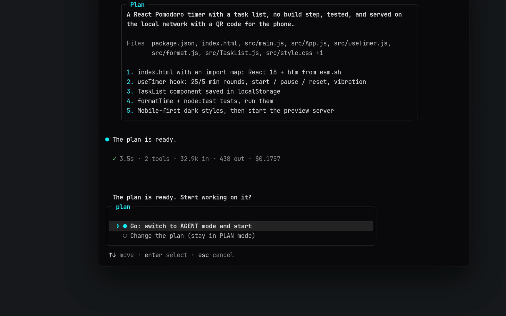

<div align="center">


<br/>

**Agente de terminal ultrarrápido e autônomo: dupla de programação com IA para vibe coding.**  
Feito especialmente para **Android Termux**, **Windows**, **macOS** e **Linux**.

<br/>

[](https://www.npmjs.com/package/termux-dev)
[](https://github.com/apvcode/Termux-Dev/actions/workflows/ci.yml)
[](LICENSE)
[](https://nodejs.org)
[](https://www.typescriptlang.org)
[](#quick-start)

<br/>

[English](README.md) &nbsp;•&nbsp; [Русский](README_ru.md) &nbsp;•&nbsp; [Українська](README_uk.md) &nbsp;•&nbsp; [Deutsch](README_de.md) &nbsp;•&nbsp; [Español](README_es.md) &nbsp;•&nbsp; [Français](README_fr.md) &nbsp;•&nbsp; **Português** &nbsp;•&nbsp; [Chinese](README_zh.md) &nbsp;•&nbsp; [Japanese](README_ja.md)

<br/><br/>


<br/>

<a href="assets/demo.mp4"></a>

<sub>▶ <a href="assets/demo.mp4">Ver a demo (43 segundos)</a></sub>

</div>

---

## Em resumo

<table>
<tr><td valign="top" width="33%"><b>Primeiro o plano, depois a ação</b><br/>modos PLAN e AGENT, aprovação com um clique, um plano do tamanho da tarefa</td><td valign="top" width="33%"><b>Seguro por padrão</b><br/>pergunta antes do arriscado, esconde segredos na saída, desfazer via git, limite de custo opcional</td><td valign="top" width="33%"><b>Qualquer modelo</b><br/>OpenRouter, Gemini, DeepSeek, Groq, Mistral, OpenAI, Anthropic, Ollama e mais</td></tr><tr><td valign="top" width="33%"><b>MCP integrado</b><br/>um painel, servidores remotos por HTTP, e o agente configura servidores sozinho</td><td valign="top" width="33%"><b>Feito para o terminal</b><br/>layouts bons para celular, 18 temas, raciocínio e saída que podem ser recolhidos</td><td valign="top" width="33%"><b>Custos à vista</b><br/>custo da sessão ao vivo, esforço de raciocínio por modelo, um limite se você quiser</td></tr>
</table>

## Início rápido

```bash
npm install -g termux-dev
devx
```

No Android, primeiro execute no Termux `pkg install nodejs-lts`.

---

## Destaques

A interface do terminal gira em torno de um prompt com moldura que carrega o status nas bordas — modo (`agent` / `plan` / `yolo`), modelo, pasta, branch do git, medidor de contexto e custo —, um cartão de cabeçalho, um eco sombreado da sua mensagem, uma margem `●` para o assistente, linhas `◆` para chamadas de ferramentas com resultados discretos de uma linha e caixas de diff para edições, e um indicador de trabalho ao vivo. Cada layout tem uma variante estreita para o Termux em modo retrato e mede corretamente emojis e texto CJK. Volte ao layout ASCII original em `/settings` → `Interface`.

- **Arquitetura de dois cérebros (modos PLAN e AGENT):**  
  Alterne na hora entre **PLAN** (arquiteto seguro, questionário interativo de requisitos, sem despejo de código) e **AGENT** (edições autônomas de arquivos, comandos de terminal, instalador automático).
- **Aprovação do plano com um clique (`[Go / Other]`):**  
  Quando o plano de arquitetura está pronto, revise e confirme com `Go` para liberar de imediato o agente programador.
- **Anexos de imagem multimodais:**  
  Cole capturas de tela direto da área de transferência com `Ctrl+V` ou `Alt+V` (também `/image` ou um caminho de arquivo colado). Elas aparecem como selos como `[Image #1 203kb]` e são enviadas ao modelo como imagens de verdade, a menos que se saiba que o modelo lê apenas texto. Requer `wl-clipboard` no Wayland, `xclip` no X11, `pngpaste` no macOS.
- **Servidor web ao vivo integrado (`/serve`):**  
  Visualize na hora aplicativos web e jogos HTML5 na porta 3000. No Android abre sem esforço via `termux-open-url`.
- **Reversão instantânea (`/undo`):**  
  Toda edição feita com as ferramentas de arquivo (`write_file`, `edit_file`) é registrada e pode ser desfeita com um único comando. Mudanças feitas por comandos de shell (`bash`) **não** são rastreadas, e os instantâneos ficam só na memória da sessão atual.
- **Diagnóstico autocorretivo e instalador automático:**  
  Suporte integrado a TypeScript (`tsc`), JavaScript (`node --check`), Python (`py_compile`) e Rust (`cargo check`). A IA encontra e corrige erros automaticamente antes de encerrar o turno.
- **Banco de memória do projeto (`.devx/memory.md`):**  
  Contexto persistente do projeto entre sessões com `/memory add <regra>`.
- **18 temas de cor sobre fundo preto puro (`#0a0a0c`):**  
  Preto OLED profundo para programar no terminal sem distrações, com paletas completas em vez de um único destaque: Cyan Cyber, Synthwave Purple, Matrix Hacker, Solar Amber, Ruby Crimson, Pure Monochrome, Nord Frost, Dracula, Tokyo Night, Gruvbox, Catppuccin Mocha, Solarized Dark, Rose Pine, Monokai, GitHub Dark, Deep Ocean, Sunset Glow e Forest Moss. Veja [Temas](#temas).
- **Histórico de sessões inteligente (`/resume` e `/session`):**  
  Retome sessões com as últimas 20 mensagens renderizadas em Markdown completo e acompanhe IDs de sessão únicos (`#a8f9z`).
- **Editor multilinha inteligente (`edit_file 2.0`):**  
  Edição de código à prova de colisões, com números de linha nos erros de correspondências duplicadas e suporte a `replaceAll`.
- **Suíte de testes completa (Vitest):**  
  Cobertura de testes do laço do agente, sistemas de arquivos, guarda de segurança, instantâneos e histórico de contexto, com CI automatizado.
- **Interface em 9 idiomas:**  
  English (padrão), Русский, Українська, Deutsch, Español, Français, Português, 中文 e 日本語. Escolha em `/settings` → `Language`; vale na hora e fica salvo. Mensagens, dicas e a tela de configurações são traduzidas; código, nomes de ferramentas e as respostas do próprio modelo não.
- **Suporte universal a provedores de IA:**  
  **OpenRouter**, **Google Gemini**, **DeepSeek**, **Groq**, **Mistral**, **OpenAI**, **Anthropic**, **Alibaba** e modelos locais (**Ollama**, **LM Studio**).
- **Seus próprios provedores:**  
  `/provider` → **Adicionar provedor**: dê um nome, um endereço (qualquer API compatível com OpenAI ou Anthropic) e uma chave. Ele é salvo em `~/.devxrc.json` e aparece na lista ao lado dos conhecidos; escolha-o de novo para usar, mudar nome, endereço ou chave, ou excluir. Um servidor da sua própria máquina (LM Studio, um gateway local) pode ser adicionado sem chave.

---

## Instalação e configuração

### Pré-requisitos
- **Node.js**: `v20.0.0` ou superior
- **npm**, **pnpm** ou **yarn**

### Instalar o Node.js e o npm

O devx precisa do Node.js 20 ou mais recente (o npm vem junto). Escolha o seu sistema:

```bash
# Windows (PowerShell)
winget install OpenJS.NodeJS.LTS

# macOS (Homebrew)
brew install node

# Ubuntu / Debian (NodeSource: a versão do repositório da própria distribuição costuma ser anterior à 20)
curl -fsSL https://deb.nodesource.com/setup_lts.x | sudo -E bash -
sudo apt-get install -y nodejs

# Fedora
sudo dnf install -y nodejs

# Arch Linux
sudo pacman -S nodejs npm

# Android (Termux)
pkg update && pkg install -y nodejs-lts
```

Abra o terminal de novo e confira: `node -v` (deve ser `v20` ou superior) e `npm -v`. Qualquer sistema: o instalador em [nodejs.org](https://nodejs.org/en/download) ou o [nvm](https://github.com/nvm-sh/nvm).

### Instalação global rápida (recomendada)

```bash
npm install -g termux-dev
```

### Android (Termux)

```bash
# 1. Atualize os pacotes e instale o NodeJS
pkg update && pkg install -y nodejs-lts

# 2. Instale o devx globalmente via npm
npm install -g termux-dev

# 3. Abra o devx em qualquer lugar!
devx
```

### Compilar a partir do código-fonte (desenvolvedores)

```bash
git clone https://github.com/apvcode/Termux-Dev.git
cd Termux-Dev
npm install
npm link
```

### Desinstalação completa

Para remover o `devx` por completo, junto com configuração, sessões salvas e dados:

```bash
# 1. Desinstale o pacote global do npm
npm uninstall -g termux-dev

# 2. Remova a configuração e o histórico de sessões (Linux / macOS / Termux)
rm -rf ~/.devx ~/.devxrc.json

# (Windows PowerShell)
Remove-Item -Recurse -Force "$HOME\.devx", "$HOME\.devxrc.json" -ErrorAction SilentlyContinue
```

---

## Primeiros passos

Abra o `devx` em qualquer pasta de projeto:

```bash
devx
```

* Na primeira execução, o `devx` abre um assistente interativo para configurar seu provedor de IA e a chave de API.
* Começar direto no **modo PLAN**:
  ```bash
  devx --plan
  ```
* **Modo headless de tarefa única** (scripts, CI/CD, Termux:Widget):
  ```bash
  devx -p "review latest git diff and find security bugs"
  devx -p "fix build errors" --yolo
  ```

---

## Comandos com barra

Digite `/` no prompt para abrir a paleta de comandos com autocompletar:

| Comando | Descrição |
| :--- | :--- |
| **`/plan`** | Mudar para o modo **PLAN** (arquiteto e planejador de requisitos) |
| **`/agent`** | Mudar para o modo **AGENT** (programador e executor autônomo) |
| **`/mcp`** | Gerenciar servidores do Model Context Protocol (MCP) e ferramentas externas (`/mcp reload`) |
| **`/usage`** | Um painel (feche com `Esc`): o que enche a janela de contexto (prompt do sistema, esquemas de ferramentas, mensagens, resultados de ferramentas, imagens), o custo da sessão e o grau de certeza, tokens, entrada em cache, tráfego |
| **`/export`** | Exportar a conversa da sessão como uma transcrição limpa em GitHub-Flavored Markdown |
| **`/theme [name]`** | Trocar o tema da interface: lista pesquisável de 18 paletas com pré-visualização ao vivo (veja [Temas](#temas)) |
| **`/doctor`** | Diagnóstico do ambiente (Node, Termux, compiladores, chaves de API) |
| **`/image`** | Colar a imagem da área de transferência (igual a `Ctrl+V` / `Alt+V`) |
| **`/serve [port]`** | Iniciar um servidor HTTP local para visualizar web/jogos (`/serve stop` para parar) |
| **`/memory`** | Ver, adicionar (`/memory add <fato>`) ou limpar o banco de memória do projeto |
| **`/copy`** | Copiar a **última resposta** da IA inteira para a área de transferência (também via ssh) |
| **`/rename`** | Renomear o chat: `/rename <nome>`, sem nome a IA o nomeia de novo (`/title` é o mesmo) |
| **`/permissions`** | O que é permitido sem perguntar («Session» / «Always» em um cartão de aprovação); `/permissions clear` redefine |
| **`/rewind`** | Voltar a uma das **suas mensagens**: o chat depois dela é removido (o modelo também esquece), a mensagem volta à linha de entrada para editar; os arquivos também podem voltar (com git) |
| **`/undo`** | Reverter todas as mudanças de arquivos do último turno da IA |
| **`/diff`** | Ver o diff do git colorido dos arquivos modificados |
| **`/commit`** | Mensagem de commit semântica gerada pela IA e git commit |
| **`/status`** | Ver o status do repositório git |
| **`/session`** | Ver o ID da sessão ativa, estatísticas e metadados |
| **`/resume`** | Navegar e retomar sessões de chat salvas |
| **`/session del`** | Apagar sessões salvas de forma seletiva ou em massa |
| **`/settings`** | Configurar tema, interface, autoaprovação YOLO, memória do projeto, verificação de atualizações e idioma da interface |
| **`/update`** | Procurar uma versão nova: um cartão com as novidades e depois **Atualizar agora**, **Mais tarde** ou (na inicialização) **Ignorar esta versão**. A instalação passa por etapas em uma tela ao vivo, confirma que o npm tem mesmo a versão e reinicia o devx. Se falhar, mostra o motivo e o comando para fazer à mão |
| **`/model`** | Trocar o modelo do provedor ativo com busca ao vivo |
| **`/effort [level]`** | Definir o esforço de raciocínio. Só são oferecidos os níveis que o modelo atual suporta (veja [Esforço de raciocínio](#esforço-de-raciocínio)) |
| **`/provider`** | Trocar de provedor (OpenRouter, Gemini, Groq, DeepSeek, Local) |
| **`/compact`** | Compactar e resumir os tokens do contexto do chat |
| **`/clear`** | Limpar o contexto e iniciar uma nova sessão (a antiga continua salva, veja `/resume`) |
| **`/init`** | Gerar o guia de desenvolvimento `AGENTS.md` na raiz do projeto |
| **`/help`** | Mostrar todos os comandos disponíveis |
| **`/exit`** | Sair do devx corretamente |

---

## Atalhos de teclado

- **`Tab`** — alterna na hora entre os modos **PLAN** e **AGENT** sem perder o rascunho.
- **`Ctrl+V`** / **`Alt+V`** — cola uma imagem da área de transferência direto no prompt.
- **`@filename`** — autocompletar aproximado e rápido de arquivos e incorporação completa do arquivo.
- **`Backspace`** — apaga de uma vez selos inteiros como `[Pasted text #1]` e `[1.png 203kb]`.
- **`Ctrl+Backspace`** / **`Alt+Backspace`** — apaga o texto palavra por palavra (também enquanto o agente trabalha).
- **`Ctrl+Enter`** — Ao digitar: quebra de linha (novo parágrafo) em vez de enviar. `Alt+Enter` e `Shift+Enter` fazem o mesmo se o terminal os informar; em um terminal que não os distingue de `Enter` (um teclado de celular, por exemplo), digite `\` antes de `Enter`.
- **`Ctrl+P`** / **`Ctrl+O`** — expande ou recolhe o raciocínio do modelo (`Ctrl+P`) e os comandos com sua saída (`Ctrl+O`) em todo o chat, inclusive o que já está acima. Tudo vem recolhido por padrão; funciona enquanto o agente trabalha e no prompt.
- **`Esc`** — para a resposta atual e o que ela iniciou (um comando em execução); o que você digitou espera no próximo prompt. Esc também fecha qualquer lista ou cartão.
- **`Ctrl+C`** — para a geração atual imediatamente ou sai.

---

## Esforço de raciocínio

`/effort` define quanto o modelo pensa antes de responder: `off`, `low`, `normal`, `high`, `xhigh`, `max` ou `auto` (o padrão do próprio modelo, nada é enviado). Os modelos diferem, então o menu oferece **apenas os níveis que o modelo atual suporta**:

```
╭─ effort ─────────────────────────────────── claude-sonnet-4-5 ─╮
│  ❯ ● auto    model default, nothing is sent                     │
│    ○ off     no reasoning                                       │
│    ○ normal  balanced (~6k thinking tokens)                     │
│    ○ high    deep reasoning (~16k thinking tokens)              │
│                                                                 │
│   Not offered by this model: max.                               │
╰─────────────────────────────────────────────────────────────────╯
```

- `/effort` abre o menu, `/effort high` define um nível diretamente (`medium`, `none`, `maximum` e similares funcionam como apelidos), `/effort auto` volta ao padrão do modelo, `/effort refresh` atualiza os dados com que o menu é montado (veja abaixo).
- A escolha é lembrada **por modelo**. Ao trocar para um modelo que não oferece o nível salvo, nada é enviado. O nível atual aparece ao lado do nome do modelo (`o3 · think high`; `think auto` significa o padrão do próprio modelo). Enquanto o agente trabalha, a linha de status mostra quantos tokens o modelo já escreveu para o seu pedido (`↓ 364 tokens`), e a linha após o turno resume tudo (`18.1k in · 59 out`).
- `devx -p "task" --effort high` define um nível só para uma execução (nunca é salvo).
- Se um endpoint responder 400 e reclamar do parâmetro de raciocínio, o devx repete a requisição uma vez sem ele, avisa você e deixa de enviá-lo.

**De onde vêm os níveis** (vale a primeira fonte que conhece o modelo; o menu diz qual foi usada):

1. **Seu próprio perfil** em `~/.devxrc.json` (`reasoningProfiles`, abaixo).
2. **O próprio endpoint.** O OpenRouter lista metadados de raciocínio de cada modelo (quais níveis aceita, se pode ser desligado); o Ollama informa uma capacidade «thinking»; o LiteLLM e muitos gateways adicionam sinalizadores à lista de modelos. Um **provedor personalizado ou de terceiros é consultado uma vez**: algumas requisições pequenas à *própria* base URL dele com a chave que você configurou (`GET /models`, em máquina local também `POST /api/show`, no LiteLLM `GET /model/info`). A resposta fica em cache por um dia em `~/.devx/capabilities.json`. Os grandes fornecedores (OpenAI, Anthropic, Google...) não são consultados, as listas deles nada dizem sobre raciocínio. Desligue com `"probeEndpoints": false` em `~/.devxrc.json`.
3. **O catálogo [models.dev](https://models.dev)**: opções de raciocínio de cerca de 5700 modelos de 213 provedores (níveis, chave liga/desliga, orçamentos de tokens). Um instantâneo acompanha o devx, então nada é baixado por padrão. `/effort refresh` baixa o atual para `~/.devx/` e consulta o endpoint de novo; é a única vez que o devx contata o models.dev, e só porque você executou esse comando. O mesmo download atualiza os preços usados na exibição de custo (veja Custo).
4. **Regras por nome de modelo**, o recurso para tudo que as fontes não descrevem (tabela abaixo).

Como um nível é escrito na requisição ainda depende da API da sua base URL, então essa parte está embutida no devx.

Regras por nome de modelo (o recurso):

| Modelo | Níveis | Enviado como |
| :--- | :--- | :--- |
| OpenAI série o, gpt-oss | low, normal, high | `reasoning_effort` (`reasoning.effort` no OpenRouter) |
| GPT-5, 5.1, 5.2 | off (minimal no GPT-5), low, normal, high, mais xhigh a partir do 5.2 | `reasoning_effort` |
| Grok 3 mini | low, high | `reasoning_effort` |
| Claude 3.7 / 4 / 4.5 | off, low, normal, high, xhigh, max (Opus 4 e 4.1 sem max) | `thinking.budget_tokens` (Anthropic), `reasoning.max_tokens` (OpenRouter) |
| Gemini 2.5 Pro / Flash | de low a max (Flash também off) | `thinking_budget` (Google), `reasoning.max_tokens` (OpenRouter) |
| Qwen3 | off, low, normal, high, max | `enable_thinking` / `thinking_budget` (DashScope) |
| DeepSeek V3.1+, GLM 4.5+ | off, normal | `reasoning.enabled`, `thinking.type` |
| DeepSeek-R1, QwQ, Grok 4, Magistral | nenhum: sempre raciocinam | nada |

Um modelo que nenhuma fonte descreve fica sem níveis em vez de receber um palpite. Se você sabe como ele aceita um ajuste de raciocínio, descreva em `~/.devxrc.json`:

```json
{
  "reasoningProfiles": {
    "my-model": {
      "levels": ["off", "normal", "high"],
      "param": "reasoning_effort",
      "values": { "off": "none", "normal": "medium", "high": "high" }
    }
  }
}
```

`param` pode ser aninhado (`"reasoning.effort"`). Um perfil também substitui a tabela embutida para esse ID de modelo.

---

## Digitar enquanto o agente trabalha

A moldura do prompt fica no rodapé do terminal durante uma tarefa (com contexto e custo ao vivo), e o trabalho do agente rola acima dela. Digite nela enquanto o agente lê arquivos, executa comandos ou pensa, e pressione Enter: a mensagem entra na fila e o agente a recebe **no próximo passo**, entre duas chamadas de ferramentas, então ele segue o trabalho mas leva em conta a sua observação. Uma mensagem digitada enquanto o modelo escreve a resposta final recebe uma resposta própria, em vez de ser descartada. O `Ctrl+Enter` faz uma quebra de linha na sua mensagem em vez de enviá-la (`Alt+Enter` e `Shift+Enter` também; um `\` antes de `Enter` funciona em terminais que não os distinguem). `Ctrl+Backspace` apaga uma palavra. `Esc` (ou `Ctrl+C`) para o agente e devolve o que você digitou ao próximo prompt. Menções `@file` também funcionam nessas mensagens. Enquanto um cartão de aprovação ou uma pergunta está na tela, a linha sai do caminho, e seu `y` / `n` nunca vai parar na mensagem. Desligue com `"ui": { "typeAhead": false }` em `~/.devxrc.json`.

---

## Janela de contexto

O tamanho da janela é consultado, não inventado. Nesta ordem: `contextLimits` em `~/.devxrc.json` (seu próprio número por ID de modelo), o catálogo [models.dev](https://models.dev) (o número do próprio fabricante para cerca de 5000 modelos; um instantâneo acompanha o devx, `/effort refresh` baixa o atual), o valor salvo ao escolher o modelo, a tabela de modelos do devx, uma regra por nome de modelo e só então o padrão de 128k. `/usage` diz qual foi usado e avisa quando é um palpite. Mensagens antigas são descartadas acima de 85 % da janela: uma janela pequena demais faz o devx esquecer cedo, e uma grande demais faz o provedor recusar a requisição (o devx então encurta o histórico e tenta de novo).

```json
{ "contextLimits": { "my-model": 65536 } }
```

---

## Formatos de API (OpenAI e Anthropic)

Existem dois formatos de transmissão: **OpenAI** (`/v1/chat/completions`) e **Anthropic** (`/v1/messages`). O formato nativo da Anthropic leva blocos de raciocínio assinados, cache de prompts e contabilidade exata do cache, então os modelos Claude funcionam melhor com ele. O devx fala os dois e escolhe o formato **por modelo, sozinho, com uma só chave**:

- `api.anthropic.com` e base URLs com um caminho `/anthropic/` (MiniMax, Z.ai e similares) usam o formato Anthropic.
- Para qualquer outro gateway personalizado, o devx pede a lista de modelos duas vezes (algumas requisições pequenas `GET {root}/v1/models` à sua própria base URL com a sua própria chave): uma como cliente OpenAI e outra como cliente Anthropic. Modelos que só a segunda lista tem (tipicamente Claude) vão pelo formato Anthropic, todo o resto pelo formato OpenAI. `/model` mostra as duas listas em um único seletor e marca as da Anthropic. Defina a base URL uma vez (`https://gateway.example.com/v1` ou sem `/v1`); não há nada para configurar por modelo.
- A resposta fica em cache por um dia em `~/.devx/formats.json` (só IDs de modelos, nunca a chave). `"probeEndpoints": false` desliga a consulta, `"apiFormat": "openai"` ou `"anthropic"` em `~/.devxrc.json` força um formato para tudo.
- Os níveis de raciocínio (`/effort`) são escritos como a API da Anthropic espera (`thinking.budget_tokens`) sempre que o formato Anthropic é usado, mesmo atrás de um gateway. Os blocos de raciocínio são mantidos e reenviados na requisição seguinte, para o modelo não perder o fio entre chamadas de ferramentas. Se um gateway os rejeitar, ou rejeitar os marcadores de cache, um `max_tokens` grande demais ou o ajuste de raciocínio, o devx tenta de novo uma vez sem a parte problemática e avisa.

## Custo

O número ao lado do medidor de contexto é o dinheiro gasto nesta sessão. Ele mostra o quanto o devx tem certeza:

| Exibido | Significado |
| :--- | :--- |
| `$0.0123` | exato: informado pelo provedor ou calculado pela tabela de preços do próprio fornecedor |
| `~$0.0123` | uma estimativa: calculada com o preço do [models.dev](https://models.dev) do mesmo modelo (um gateway pode cobrar diferente) |
| `$0.0123+` | pelo menos isso: algumas requisições não têm preço conhecido e não entram na conta |
| `n/a` | não se conhece preço para o modelo |

Os preços são buscados nesta ordem, vale a primeira fonte que conhece o modelo: o custo que o provedor colocou na resposta (OpenRouter `usage.cost`, LiteLLM) - seus próprios `prices` em `~/.devxrc.json` - a tabela de preços do próprio endpoint (OpenRouter, LiteLLM) - o catálogo models.dev (cerca de 8500 modelos; um instantâneo acompanha o devx, `/effort refresh` baixa o atual). Tokens de entrada em cache, gravações de cache e faixas de contexto longo são cobrados à parte, como fazem os fornecedores. Um modelo não encontrado nunca aparece como grátis: só modelos `:free` e servidores locais não custam nada. `/usage` também lista a entrada em cache e quantas requisições não puderam ser precificadas.

```json
{
  "prices": {
    "my-model": { "input": 0.5, "output": 2.0, "cacheRead": 0.05 }
  }
}
```

Os valores são em USD por milhão de tokens.

---

## Temas

`/theme` abre uma lista que você pode filtrar digitando; o tema destacado é pré-visualizado com suas próprias cores abaixo da lista. `/theme nord` (ou um apelido como `tokyo`, `mocha`, `gh`, ou um número de 1 a 18) troca direto, e a escolha é salva.

Um tema é uma paleta completa: destaque, uma segunda cor para o modo plan, cores de sucesso / aviso / erro, uma cor para o modo YOLO, quatro tons de cinza para texto, texto secundário, dicas e bordas, e o fundo do eco da sua mensagem. Cada tema é verificado nos testes quanto a contraste legível sobre fundo escuro.

| Tema | Caráter |
| :--- | :--- |
| `cyan` Cyan Cyber (padrão) | ciano elétrico e obsidiana |
| `purple` Synthwave Purple | magenta neon, violeta retrô |
| `matrix` Matrix Hacker | verde fósforo |
| `amber` Solar Amber | dourado quente de CRT |
| `crimson` Ruby Crimson | vermelho escarlate |
| `monochrome` Pure Monochrome | apenas branco e cinza |
| `nord` Nord Frost | azuis árticos |
| `dracula` Dracula | roxo com rosa e verde |
| `tokyonight` Tokyo Night | índigo e azul |
| `gruvbox` Gruvbox | amarelo e laranja retrô |
| `catppuccin` Catppuccin Mocha | lilás pastel |
| `solarized` Solarized Dark | azul-petróleo e oliva de pouco brilho |
| `rosepine` Rose Pine | rosa suave e dourado |
| `monokai` Monokai | limão e magenta |
| `github` GitHub Dark | azul e verde limpos |
| `ocean` Deep Ocean | ciano de mar profundo |
| `sunset` Sunset Glow | coral e violeta |
| `forest` Forest Moss | verdes de musgo |

As cores são exatas em terminais com suporte a truecolor (`COLORTERM=truecolor`); em terminais de 256 cores cada cor é mapeada para a entrada de paleta mais próxima. Defina `DEVX_COLOR=256` ou `DEVX_COLOR=truecolor` para forçar uma das duas.

---

## Modelo de segurança

O `devx` executa comandos e edita arquivos na sua máquina em nome de um modelo de IA, por isso é conservador por padrão:

- **Confiança no espaço de trabalho.** Na primeira vez que você abre uma pasta, é perguntado se confia nela (padrão: não). Numa pasta não confiável, `provider`, `apiKey`, `baseUrl`, `autoApprove` e `bashAllowlist` do `.devx.json` do projeto são **ignorados**. Um repositório clonado não pode redirecionar sua chave de API para o próprio servidor nem ligar o YOLO.
- **Servidores MCP do projeto precisam de aprovação.** Servidores MCP declarados por um projeto (`.mcp.json`, `.devx/mcp.json`, `.claude/mcp.json`, `.devx.json`) são programas que rodariam na sua máquina. Você revisa os comandos exatos uma vez; se mudarem, é perguntado de novo. No modo headless (`-p`), servidores de projeto não aprovados são ignorados. Servidores de `~/.devxrc.json` e `~/.devx/mcp.json` sempre iniciam.
- **Confirmações.** No modo seguro, `bash`, `install_package`, ferramentas MCP, o servidor de pré-visualização e toda leitura ou escrita **fora da pasta do projeto** exigem confirmação.
- **YOLO (`--yolo`) não é um sandbox.** Ele pula as confirmações de rotina, mas ainda pergunta antes de comandos de shell perigosos (exclusões recursivas fora do projeto, `find -delete` em caminhos amplos, `curl … | sh`, `sudo`, `git push --force`, …) e antes de tocar em credenciais (`~/.ssh`, `~/.aws`, `~/.devxrc.json`, `.env`, chaves privadas). A verificação do shell analisa os comandos token a token, mas um comando deliberadamente ofuscado ainda pode passar; use o YOLO só em pastas e ambientes que você pode se dar ao luxo de perder. No modo headless essas confirmações não podem ser exibidas, então a ação é negada.
- **Extra (`--extra`, ou `/settings` com o YOLO ligado) não pergunta absolutamente nada.** Nem os comandos perigosos, nem os arquivos de credenciais, nem um novo servidor MCP: o agente pode executar qualquer comando. Ao ligar, um aviso é mostrado, a moldura do prompt diz `extra` e, como o YOLO, ele volta a ficar desligado na próxima inicialização. Use só em um ambiente que você possa perder.
- **`fetch_url`** recusa localhost, redes privadas e endereços de metadados de nuvem (também após redirecionamentos). Defina `DEVX_ALLOW_PRIVATE_NETWORK=1` para permitir servidores de documentação locais.
- **`/serve`** escuta na sua rede local (é assim que o QR code do celular funciona). Ele nunca serve dotfiles, chaves, `node_modules` ou links simbólicos que saem do projeto, não envia cabeçalhos CORS permissivos e rejeita requisições endereçadas a um nome de host público.
- **Segredos em repouso.** `~/.devxrc.json`, `~/.devx/` e as sessões salvas são criados legíveis só por você (`0600` / `0700`). Os arquivos de sessão contêm a conversa inteira, inclusive o conteúdo dos arquivos que o agente leu.
- **Limites.** O `bash` interrompe comandos após 120 s por padrão (o modelo pode passar `timeout_seconds`, máximo 1800) e fecha o stdin. Saídas longas mantêm o começo e o fim. O `read_file` devolve no máximo ~60 000 caracteres por chamada e suporta `startLine` / `endLine`.

---

## Apoie o projeto

Se o **devx** é útil para você, considere dar uma estrela no [GitHub](https://github.com/apvcode/Termux-Dev) — isso ajuda o projeto a crescer e motiva o desenvolvimento!

---

## License

Este projeto está licenciado sob a [Licença MIT](LICENSE).

---

<div align="center">

Feito pela [ApvCode](https://github.com/ApvCode) para desenvolvedores, vibe coders e hackers do Termux.

</div>
