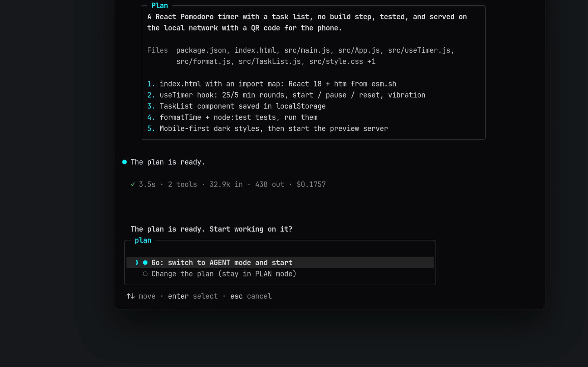

<div align="center">


<br/>

**Сверхбыстрый автономный ИИ-напарник для программирования и вайб-кодинга в терминале.**  
Создан специально для **Android Termux**, **Windows**, **macOS** и **Linux**.

<br/>

[](https://www.npmjs.com/package/termux-dev)
[](https://github.com/apvcode/Termux-Dev/actions/workflows/ci.yml)
[](LICENSE)
[](https://nodejs.org)
[](https://www.typescriptlang.org)
[](#quick-start)

<br/>

[English](README.md) &nbsp;•&nbsp; **Русский** &nbsp;•&nbsp; [Українська](README_uk.md) &nbsp;•&nbsp; [Deutsch](README_de.md) &nbsp;•&nbsp; [Español](README_es.md) &nbsp;•&nbsp; [Français](README_fr.md) &nbsp;•&nbsp; [Português](README_pt.md) &nbsp;•&nbsp; [Chinese](README_zh.md) &nbsp;•&nbsp; [Japanese](README_ja.md)

<br/><br/>

<a href="assets/demo.mp4"></a>

<sub>▶ <a href="assets/demo.mp4">Смотреть демо (43 секунды)</a></sub>

<br/>


</div>

---

## Коротко

<table>
<tr><td valign="top" width="33%"><b>Сначала план, потом дело</b><br/>режимы PLAN и AGENT, утверждение в один клик, план по размеру задачи</td><td valign="top" width="33%"><b>Безопасно по умолчанию</b><br/>спрашивает перед рискованным, прячет секреты в выводе, откат через git, необязательный лимит расходов</td><td valign="top" width="33%"><b>Любая модель</b><br/>OpenRouter, Gemini, DeepSeek, Groq, Mistral, OpenAI, Anthropic, Ollama и другие</td></tr><tr><td valign="top" width="33%"><b>MCP из коробки</b><br/>панель, удалённые серверы по HTTP, а агент сам умеет подключать серверы</td><td valign="top" width="33%"><b>Сделан для терминала</b><br/>удобные макеты для телефона, 18 тем, рассуждения и вывод можно сворачивать</td><td valign="top" width="33%"><b>Расходы на виду</b><br/>стоимость сессии вживую, глубина размышления для каждой модели, лимит, если нужен</td></tr>
</table>

## Быстрый старт

```bash
npm install -g termux-dev
devx
```

На Android сначала выполните в Termux `pkg install nodejs-lts`.

---

Интерфейс построен вокруг рамки ввода, в границах которой видно состояние: режим (`agent` / `plan` / `yolo`), модель, папка, git-ветка, индикатор контекста и стоимость. Плюс карточка-шапка, затенённое эхо вашего сообщения, gutter `●` у ответа ассистента, строки `◆` для вызовов инструментов с тихими однострочными результатами и diff-блоки для правок, а также живой индикатор работы. У каждого экрана есть узкий вариант для Termux в портрете, эмодзи и CJK считаются корректно. Исходный ASCII-вариант можно включить в `/settings` → `Interface`.

## Главные возможности

- **Двухрежимная архитектура (PLAN и AGENT):**  
  Мгновенное переключение между **PLAN** (безопасный архитектор, интерактивные опросники, запрет на несанкционированные правки) и **AGENT** (автономное создание/редактирование файлов, выполнение bash-команд, авто-установка пакетов).
- **Утверждение плана в 1 клик (`[Go / Other]`):**  
  Когда архитектурный план готов, подтвердите его кнопкой `Go` — агент мгновенно переключится в режим кодера и приступит к реализации.
- **Мультимодальное зрение и вставка скриншотов:**  
  Вставляйте скриншоты прямо из буфера обмена по `Ctrl+V` или `Alt+V` (также `/image` или вставка пути к файлу). Они показываются бейджами вида `[Image #1 203kb]` и уходят модели как настоящие картинки, если только модель не читает один текст. Нужен `wl-clipboard` на Wayland, `xclip` на X11, `pngpaste` на macOS.
- **Встроенный локальный веб-сервер (`/serve`):**  
  Мгновенный предпросмотр веб-приложений и HTML5-игр на порту 3000. На Android автоматически открывается через `termux-open-url`.
- **Фоновые задачи (`/tasks`):**  
  Агент может запустить dev-сервер, watcher или долгий прогон тестов в фоне и продолжать работать. Он умеет ждать нужную строку (`ready|error`), читать вывод позже, и узнаёт, когда задача завершилась или напечатала то, о чём он просил. Если вы в этот момент у строки ввода, агент сам подхватит новость. Значок `◈ 2 bg` в рамке ввода показывает, что запущено; `/tasks` показывает список, `/tasks <id>` вывод, `/tasks stop <id|all>` останавливает. Запуск спрашивает разрешение как `bash`; при выходе из devx всё останавливается. Параметр `"backgroundAutoWake": false` отключает самостоятельную реакцию агента.
- **Мгновенный откат изменений (`/undo`):**  
  Каждая правка через файловые инструменты (`write_file`, `edit_file`) сохраняется в снимок и отменяется одной командой. Изменения, сделанные shell-командами (`bash`), **не отслеживаются**, а снимки хранятся только в памяти текущей сессии.
- **Самодиагностика и авто-исправление ошибок:**  
  Встроенная проверка кода для TypeScript (`tsc`), JavaScript (`node --check`), Python (`py_compile`) и Rust (`cargo check`). AI сам находит и исправляет синтаксические ошибки перед завершением ответа.
- **Банк памяти проекта (`.devx/memory.md`):**  
  Долгосрочная память правил и архитектурных решений между сессиями (`/memory add <правило>`).
- **Уведомления, когда devx ждёт вас:**  
  Когда агенту нужно подтверждение или он задаёт вопрос (`◆ Clarify`), а терминал не на переднем плане, приходит уведомление (родной протокол kitty, `notify-send` в Linux, `osascript` в macOS; в Termux уведомление Android с короткой вибрацией). О завершённой задаче тоже сообщается, с началом ответа. Терминал должен сообщать о смене фокуса (большинство современных умеют); если devx не может понять, смотрите ли вы на окно, он молчит, а не всплывает перед вами.
- **Прошлые чаты (`search_chats`):**  
  Когда вы говорите «как мы решили в прошлый раз» или «в том чате про парсер», агент может поискать по сохранённым чатам по ключевым словам (на любом языке, другие формы слов находятся: страница / страницу) и прочитать нужный кусками. Это только чтение и только локально, поэтому разрешение не спрашивается; открытый сейчас чат не ищется; вывод инструментов не индексируется; а прочитанное передаётся модели как данные, а не как инструкции. На обычной задаче агент этим не пользуется.
- **18 цветовых тем на чисто чёрном фоне (`#0a0a0c`):**  
  Глубокий OLED-чёрный фон для комфортной ночной разработки. Темы — это полные палитры, а не один акцентный цвет: Cyan Cyber, Synthwave Purple, Matrix Hacker, Solar Amber, Ruby Crimson, Pure Monochrome, Nord Frost, Dracula, Tokyo Night, Gruvbox, Catppuccin Mocha, Solarized Dark, Rose Pine, Monokai, GitHub Dark, Deep Ocean, Sunset Glow и Forest Moss. См. [Темы](#темы).
- **История сессий с уникальными ID (`/resume` и `/session`):**  
  Восстановление сессий с предпросмотром последних 20 сообщений в Markdown и короткими хэш-ID (`#a8f9z`).
- **Умный редактор `edit_file 2.0`:**  
  Безопасная замена фрагментов кода с защитой от коллизий при дубликатах, указанием номеров строк и поддержкой `replaceAll`.
- **Тестовый фундамент (Vitest):**  
  Полное покрытие юнит-тестами ядра агента, файловой системы, безопасности, снимков и истории контекста с авто-тестами в CI.
- **Интерфейс на 9 языках:**  
  English (по умолчанию), Русский, Українська, Deutsch, Español, Français, Português, 中文 и 日本語. Язык выбирается в `/settings` → `Язык`, применяется сразу и запоминается. Переводятся сообщения, подсказки и экран настроек; код, названия инструментов и ответы самой модели не переводятся.
- **Поддержка любых провайдеров:**  
  **OpenRouter**, **Google Gemini**, **DeepSeek**, **Groq**, **Mistral**, **OpenAI**, **Anthropic**, **Alibaba**, а также локальные **Ollama** и **LM Studio**.
- **Свои провайдеры:**  
  `/provider` → **Добавить провайдера**: дайте ему имя, адрес (любой API, совместимый с OpenAI или Anthropic) и ключ. Он сохранится в `~/.devxrc.json` и появится в списке рядом с известными; выберите его снова, чтобы использовать, изменить имя, адрес или ключ, либо удалить. Сервер на вашем компьютере (LM Studio, локальный шлюз) можно добавить без ключа.

---

## Установка и запуск

### Требования
- **Node.js**: `v20.0.0` или выше
- **npm**, **pnpm** или **yarn**

### Установка Node.js и npm

devx нужен Node.js 20 или новее (npm идёт вместе с ним). Выберите свою систему:

```bash
# Windows (PowerShell)
winget install OpenJS.NodeJS.LTS

# macOS (Homebrew)
brew install node

# Ubuntu / Debian (NodeSource: версия в репозитории самого дистрибутива часто старше 20)
curl -fsSL https://deb.nodesource.com/setup_lts.x | sudo -E bash -
sudo apt-get install -y nodejs

# Fedora
sudo dnf install -y nodejs

# Arch Linux
sudo pacman -S nodejs npm

# Android (Termux)
pkg update && pkg install -y nodejs-lts
```

Откройте терминал заново и проверьте: `node -v` (должно быть `v20` или выше) и `npm -v`. Любая система: установщик на [nodejs.org](https://nodejs.org/en/download) или [nvm](https://github.com/nvm-sh/nvm).

### Быстрая глобальная установка (Рекомендуется)

```bash
npm install -g termux-dev
```

### Установка на Android (Termux)

```bash
# 1. Обновляем пакеты и ставим NodeJS
pkg update && pkg install -y nodejs-lts

# 2. Устанавливаем devx глобально через npm
npm install -g termux-dev

# 3. Запускаем devx в любой папке!
devx
```

### Сборка из исходников (Для разработчиков)

```bash
git clone https://github.com/apvcode/Termux-Dev.git
cd Termux-Dev
npm install
npm link
```

### Полное удаление

Чтобы полностью удалить `devx` вместе с конфигурацией, историей сессий и сохранёнными данными:

```bash
# 1. Удаляем глобальный npm-пакет
npm uninstall -g termux-dev

# 2. Удаляем конфиг и историю сессий (Linux / macOS / Termux)
rm -rf ~/.devx ~/.devxrc.json

# (Windows PowerShell)
Remove-Item -Recurse -Force "$HOME\.devx", "$HOME\.devxrc.json" -ErrorAction SilentlyContinue
```

---

## Начало работы

Запустите команду в папке любого вашего проекта:

```bash
devx
```

* При первом запуске откроется мастер настройки: выберите любимого AI-провайдера и введите API-ключ.
* Запуск сразу в режиме архитектора:
  ```bash
  devx --plan
  ```
* Запуск в **Headless One-Shot режиме** (скрипты, CI/CD, Termux:Widget):
  ```bash
  devx -p "проверь последний git diff и найди баги"
  devx -p "исправь ошибки сборки" --yolo
  ```

---

## Слэш-команды

Напишите `/` в строке ввода, чтобы открыть интерактивное меню команд:

| Команда | Описание |
| :--- | :--- |
| **`/plan`** | Переключиться в режим архитектора (**PLAN**) |
| **`/agent`** | Переключиться в режим исполнителя (**AGENT**) |
| **`/mcp`** | Управление MCP-серверами и внешними инструментами (`/mcp reload`) |
| **`/usage`** | Панель (закрывается по `Esc`): чем заполнено окно контекста (системный промпт, схемы инструментов, сообщения, результаты инструментов, картинки), стоимость сессии и насколько она точна, токены, кешированный ввод, трафик |
| **`/export`** | Экспортировать сессию диалога в чистый GitHub Markdown файл |
| **`/theme [имя]`** | Сменить тему: список из 18 палитр с поиском и предпросмотром (см. [Темы](#темы)) |
| **`/doctor`** | Запустить системную диагностику (Node, Termux, Компиляторы, Ключи) |
| **`/image`** | Вставить картинку из буфера обмена (то же, что `Ctrl+V` / `Alt+V`) |
| **`/serve [порт]`** | Запустить локальный веб-сервер (`/serve stop` для остановки) |
| **`/memory`** | Посмотреть, добавить (`/memory add <факт>`) или очистить банк памяти |
| **`/copy`** | Скопировать **последний ответ** ИИ в буфер обмена целиком (работает и по ssh) |
| **`/rename`** | Переименовать чат: `/rename <название>`, без названия ИИ придумает его заново (`/title` — то же самое) |
| **`/permissions`** | Что разрешено без вопросов («Session» / «Always» на карточке подтверждения); `/permissions clear` сбрасывает |
| **`/rewind`** | Вернуться к одному из **ваших сообщений**: чат после него стирается (модель тоже его забывает), сообщение возвращается в строку ввода для правки; файлы тоже можно вернуть (с git) |
| **`/tasks`** | Фоновые задачи: список, `/tasks <id>` вывод, `/tasks stop <id\|all>`, `/tasks clear` |
| **`/undo`** | Откатить все изменения файлов за последний шаг AI |
| **`/diff`** | Показать цветной git diff изменённых файлов |
| **`/commit`** | Сгенерировать сообщение коммита с помощью AI и закоммитить в git |
| **`/status`** | Показать текущий статус Git репозитория |
| **`/session`** | Показать ID, статистику и файл активной сессии |
| **`/resume`** | Выбрать и восстановить сохранённую сессию с историей |
| **`/session del`** | Выборочно или полностью удалить сессии |
| **`/settings`** | Тема, интерфейс, авто-подтверждение (YOLO), память проекта, проверка обновлений и язык интерфейса |
| **`/update`** | Проверить новую версию: карточка с тем, что нового, затем **Обновить сейчас**, **Позже** или (при запуске) **Пропустить версию**. Установка идёт на живом экране по шагам, проверяет, что нужная версия действительно есть в npm, и перезапускает devx. При ошибке покажет причину и команду для ручного запуска |
| **`/model`** | Сменить модель текущего провайдера с живым поиском |
| **`/effort [уровень]`** | Задать глубину размышления. Предлагаются только уровни, которые поддерживает текущая модель (см. [Глубина размышления](#глубина-размышления)) |
| **`/provider`** | Сменить AI-провайдера (OpenRouter, Gemini, Groq, DeepSeek, Local) |
| **`/compact`** | Сжать контекст диалога для экономии токенов |
| **`/clear`** | Очистить контекст и начать новую сессию (старая остаётся сохранённой, см. `/resume`) |
| **`/init`** | Создать файл инструкций `AGENTS.md` в корне проекта |
| **`/help`** | Показать список всех доступных команд |
| **`/exit`** | Завершить работу devx |

---

## Горячие клавиши

- **`Tab`** — Мгновенное переключение между режимами **PLAN** и **AGENT** без потери набранного текста.
- **`Ctrl+V`** / **`Alt+V`** — Вставка скриншота/картинки из буфера обмена.
- **`@файл`** — Умное автодополнение файлов и прикрепление их содержимого к запросу.
- **`Backspace`** — Атомарное удаление бейджей `[Pasted text #1]` и `[1.png 203kb]` за одно нажатие.
- **`Ctrl+Backspace`** / **`Alt+Backspace`** — Стирание текста по слову (в том числе пока агент работает).
- **`Ctrl+Enter`** — При вводе: перенос строки (новый абзац) вместо отправки. `Alt+Enter` и `Shift+Enter` делают то же, если терминал их передаёт; в терминале, который не отличает их от `Enter` (например, телефонная клавиатура), поставьте `\` перед `Enter`. devx просит терминал различать эти клавиши только там, где это заведомо работает (kitty, Ghostty, WezTerm, iTerm2, foot, Alacritty); Termux и другие терминалы, которые принимают этот запрос за код курсора или стиля, его не получают. `DEVX_EXTENDED_KEYS=1` (или `0`) включает (или выключает) его принудительно.
- **`Ctrl+P`** / **`Ctrl+O`** — Развернуть или свернуть рассуждения модели (`Ctrl+P`) и команды с их выводом (`Ctrl+O`) во всём чате, в том числе то, что уже выше. По умолчанию всё свёрнуто; работает и пока агент работает, и в строке ввода.
- **`Esc`** — Остановить текущий ответ и всё, что он запустил (идущую команду); набранное ждёт в следующем вводе. Esc также закрывает любой список и карточку.
- **`Ctrl+C`** — Мгновенная остановка генерации ответа или выход.

---

## Глубина размышления

`/effort` задаёт, насколько долго модель думает перед ответом: `off`, `low`, `normal`, `high`, `xhigh`, `max` или `auto` (поведение модели по умолчанию, ничего не отправляется). Модели отличаются, поэтому меню предлагает **только уровни, которые поддерживает текущая модель**:

```
╭─ effort ─────────────────────────────────── claude-sonnet-4-5 ─╮
│  ❯ ● auto    model default, nothing is sent                     │
│    ○ off     no reasoning                                       │
│    ○ normal  balanced (~6k thinking tokens)                     │
│    ○ high    deep reasoning (~16k thinking tokens)              │
│                                                                 │
│   Not offered by this model: max.                               │
╰─────────────────────────────────────────────────────────────────╯
```

- `/effort` открывает меню, `/effort high` задаёт уровень сразу (подходят и синонимы: `medium`, `none`, `maximum`), `/effort auto` возвращает умолчание модели, `/effort refresh` обновляет данные, из которых строится меню (см. ниже).
- Выбор запоминается **для каждой модели отдельно**. После перехода на модель, у которой нет сохранённого уровня, ничего не отправляется. Текущий уровень показан рядом с названием модели (`o3 · think high`; `think auto` означает умолчание модели). Пока агент работает, строка статуса показывает, сколько токенов модель написала на ваш запрос к этому моменту (`↓ 364 tokens`), а строка после хода подводит итог (`18.1k in · 59 out`).
- `devx -p "задача" --effort high` задаёт уровень только на один запуск (не сохраняется).
- Если эндпоинт отвечает 400 и жалуется на параметр размышления, devx один раз повторяет запрос без него, сообщает вам и больше его не отправляет.

**Откуда берутся уровни** (побеждает первый источник, знающий модель; меню называет, какой использован):

1. **Ваш профиль** в `~/.devxrc.json` (`reasoningProfiles`, ниже).
2. **Сам эндпоинт.** OpenRouter отдаёт метаданные размышления для каждой модели, Ollama сообщает возможность «thinking», LiteLLM и многие шлюзы добавляют флаги в список моделей. **Сторонний или свой провайдер опрашивается один раз:** несколько небольших запросов на *его собственный* base URL с вашим ключом (`GET /models`, на локальной машине ещё `POST /api/show`, для LiteLLM `GET /model/info`). Ответ кешируется на сутки в `~/.devx/capabilities.json`. Крупных вендоров (OpenAI, Anthropic, Google) не опрашиваем: их списки моделей ничего не говорят о размышлении. Отключить можно строкой `"probeEndpoints": false` в `~/.devxrc.json`.
3. **Каталог [models.dev](https://models.dev):** варианты размышления примерно 5700 моделей 213 провайдеров. Снимок поставляется вместе с devx, поэтому по умолчанию ничего не скачивается. `/effort refresh` загружает актуальный каталог в `~/.devx/` и заново спрашивает эндпоинт. Это единственный случай, когда devx обращается к models.dev, и только потому, что вы сами выполнили команду. Та же загрузка обновляет цены для показа стоимости (см. «Стоимость»).
4. **Правила по имени модели** — запасной вариант для всего, что источники не описывают (таблица ниже).

Как именно уровень попадает в запрос, по-прежнему зависит от API в вашем base URL, эта часть встроена в devx.

Правила по имени модели (запасной вариант):

| Модель | Уровни | Как отправляется |
| :--- | :--- | :--- |
| OpenAI o-серия, gpt-oss | low, normal, high | `reasoning_effort` (`reasoning.effort` в OpenRouter) |
| GPT-5, 5.1, 5.2 | off (minimal у GPT-5), low, normal, high, а с 5.2 ещё xhigh | `reasoning_effort` |
| Grok 3 mini | low, high | `reasoning_effort` |
| Claude 3.7 / 4 / 4.5 | off, low, normal, high, xhigh, max (Opus 4 и 4.1 без max) | `thinking.budget_tokens` (Anthropic), `reasoning.max_tokens` (OpenRouter) |
| Gemini 2.5 Pro / Flash | от low до max (у Flash ещё off) | `thinking_budget` (Google), `reasoning.max_tokens` (OpenRouter) |
| Qwen3 | off, low, normal, high, max | `enable_thinking` / `thinking_budget` (DashScope) |
| DeepSeek V3.1+, GLM 4.5+ | off, normal | `reasoning.enabled`, `thinking.type` |
| DeepSeek-R1, QwQ, Grok 4, Magistral | нет: они всегда размышляют | ничего |

Модель, которую не описывает ни один источник, не получает уровней вместо догадки. Если вы знаете, как она принимает настройку размышления, опишите её в `~/.devxrc.json`:

```json
{
  "reasoningProfiles": {
    "my-model": {
      "levels": ["off", "normal", "high"],
      "param": "reasoning_effort",
      "values": { "off": "none", "normal": "medium", "high": "high" }
    }
  }
}
```

`param` может быть вложенным (`"reasoning.effort"`). Профиль также перекрывает встроенную таблицу для этого id модели.

---

## Ввод во время работы агента

Рамка ввода остаётся внизу терминала во время задачи (с живым контекстом и стоимостью), а работа агента прокручивается над ней. Пишите в неё, пока агент читает файлы, запускает команды или думает, и жмите Enter: сообщение встаёт в очередь, и агент получает его **на следующем шаге**, между двумя вызовами инструментов. Он продолжает работу, но учитывает вашу реплику. Сообщение, набранное пока модель пишет финальный ответ, получает собственный ответ, а не теряется. `Ctrl+Enter` делает перенос строки в сообщении вместо отправки (так же `Alt+Enter` и `Shift+Enter`; `\` перед `Enter` работает в терминалах, которые их не различают). `Ctrl+Backspace` стирает слово. `Esc` (или `Ctrl+C`) останавливает агента и возвращает набранное в следующий ввод. `@файлы` в таких сообщениях тоже работают. Пока на экране карточка подтверждения или вопрос, строка уступает место, и ваши `y` / `n` не попадут в сообщение. Отключить можно через `"ui": { "typeAhead": false }` в `~/.devxrc.json`.

---

## Окно контекста

Размер окна не придумывается, а ищется. По порядку: `contextLimits` в `~/.devxrc.json` (ваше число для id модели), каталог [models.dev](https://models.dev) (число самого производителя для примерно 5000 моделей; снимок идёт вместе с devx, `/effort refresh` скачивает актуальный), значение, сохранённое при выборе модели, таблица devx, правило по имени модели и только потом умолчание 128k. `/usage` показывает, какой источник сработал, и предупреждает, если это догадка. Старые сообщения отбрасываются выше 85% окна: слишком маленькое окно заставляет devx забывать раньше времени, слишком большое приводит к отказу провайдера (тогда devx сокращает историю и повторяет запрос).

```json
{ "contextLimits": { "my-model": 65536 } }
```

---

## Форматы API (OpenAI и Anthropic)

Есть два формата запросов: **OpenAI** (`/v1/chat/completions`) и **Anthropic** (`/v1/messages`). Нативный формат Anthropic передаёт подписанные блоки размышления, кеш промпта и точный учёт кеша, поэтому модели Claude лучше всего работают через него. devx умеет оба и выбирает формат **для каждой модели сам, с одним ключом**:

- `api.anthropic.com` и base URL с путём `/anthropic/` (MiniMax, Z.ai и подобные) используют формат Anthropic.
- Для любого другого шлюза devx запрашивает список моделей дважды (пара небольших `GET {корень}/v1/models` на ваш собственный base URL с вашим ключом): как клиент OpenAI и как клиент Anthropic. Модели, которые есть только во втором списке (обычно Claude), идут через формат Anthropic, остальные через OpenAI. `/model` показывает оба списка в одном меню и помечает модели формата Anthropic. Base URL задаётся один раз (`https://gateway.example.com/v1` или без `/v1`), для каждой модели ничего настраивать не нужно.
- Ответ кешируется на сутки в `~/.devx/formats.json` (только id моделей, ключ туда не попадает). `"probeEndpoints": false` отключает опрос, `"apiFormat": "openai"` или `"anthropic"` в `~/.devxrc.json` принудительно задаёт один формат для всего.
- Уровни размышления (`/effort`) при формате Anthropic записываются так, как ждёт API Anthropic (`thinking.budget_tokens`), даже за шлюзом. Блоки размышления сохраняются и отправляются обратно со следующим запросом, поэтому модель не теряет нить между вызовами инструментов. Если шлюз отвергает их, метки кеша, слишком большой `max_tokens` или настройку размышления, devx один раз повторяет запрос без этой части и сообщает об этом.

## Стоимость

Число рядом со шкалой контекста показывает потраченные в сессии деньги и честно говорит, насколько devx в нём уверен:

| Вид | Значение |
| :--- | :--- |
| `$0.0123` | точно: сообщил провайдер или посчитано по официальному прайсу вендора |
| `~$0.0123` | оценка: посчитано по цене этой модели из каталога [models.dev](https://models.dev) (шлюз может брать иначе) |
| `$0.0123+` | не меньше этого: у части запросов цена неизвестна, они не учтены |
| `n/a` | цена модели неизвестна |

Цена ищется по порядку, побеждает первый источник, знающий модель: стоимость, которую провайдер сам вернул в ответе (OpenRouter `usage.cost`, LiteLLM) - ваши `prices` в `~/.devxrc.json` - собственный прайс эндпоинта (OpenRouter, LiteLLM) - каталог models.dev (около 8500 моделей; снимок идёт вместе с devx, `/effort refresh` скачивает актуальный). Кешированные входные токены, запись в кеш и тарифы длинного контекста считаются отдельно, как у вендоров. Модель, которую не нашли, никогда не показывается бесплатной: ноль стоят только модели `:free` и локальные серверы. `/usage` дополнительно показывает кешированный ввод и число запросов без цены.

```json
{
  "prices": {
    "my-model": { "input": 0.5, "output": 2.0, "cacheRead": 0.05 }
  }
}
```

Значения в долларах США за миллион токенов.

---

## Темы

`/theme` открывает список, который можно фильтровать вводом; выделенная тема сразу показывается под списком в своих цветах. `/theme nord` (или алиас вроде `tokyo`, `mocha`, `gh`, либо номер от 1 до 18) переключает напрямую, выбор сохраняется.

Тема — это полная палитра: акцент, второй цвет для режима plan, цвета успеха, предупреждения и ошибки, цвет режима YOLO, четыре ступени серого для текста, второстепенного текста, подсказок и рамок, а также фон эха вашего сообщения. Каждая тема проверяется тестами на читаемый контраст на тёмном фоне.

| Тема | Характер |
| :--- | :--- |
| `cyan` Cyan Cyber (по умолчанию) | электрический циан и обсидиан |
| `purple` Synthwave Purple | неоновая маджента, ретро-фиолет |
| `matrix` Matrix Hacker | зелёный люминофор |
| `amber` Solar Amber | тёплое золото ЭЛТ |
| `crimson` Ruby Crimson | алый красный |
| `monochrome` Pure Monochrome | только белый и серый |
| `nord` Nord Frost | арктические синие |
| `dracula` Dracula | фиолетовый с розовым и зелёным |
| `tokyonight` Tokyo Night | индиго и синий |
| `gruvbox` Gruvbox | ретро-жёлтый и оранжевый |
| `catppuccin` Catppuccin Mocha | пастельный сиреневый |
| `solarized` Solarized Dark | неяркий бирюзовый и оливковый |
| `rosepine` Rose Pine | мягкий розовый и золотой |
| `monokai` Monokai | лайм и маджента |
| `github` GitHub Dark | чистый синий и зелёный |
| `ocean` Deep Ocean | глубоководный циан |
| `sunset` Sunset Glow | коралловый и фиолетовый |
| `forest` Forest Moss | мшистые зелёные |

Цвета точные в терминалах с truecolor (`COLORTERM=truecolor`); в 256-цветных терминалах каждый цвет заменяется ближайшим из палитры. Переменная `DEVX_COLOR=256` или `DEVX_COLOR=truecolor` включает нужный режим принудительно.

---

## Хуки, лимиты и разрешения

- **Лимит стоимости.** `/settings` → `Cost limit` (или `"maxCostPerSession": 5` в `~/.devxrc.json`, в долларах). На 80% devx предупреждает; на лимите останавливает задачу, а перед следующим сообщением спрашивает, тратить ли дальше (если продолжить, лимит поднимается только для этой сессии).
- **Разрешено без вопросов.** На карточке подтверждения `Session` разрешает команду (по программе и подкоманде, например `npm test`) или MCP-инструмент до закрытия devx; `Always` сохраняет в `~/.devxrc.json` (`bashAllowlist`, `allowedTools`). Опасные команды, чтение секретов, цепочки (`&&`, `;`, `|`) и перенаправления не запоминаются никогда. `/permissions` показывает список, `/permissions clear` стирает.
- **Хуки.** Команды вокруг инструментов агента, задаются в `~/.devxrc.json`:

  ```json
  {
    "hooks": {
      "PreToolUse":  [{ "matcher": "bash", "command": "./check-command.sh" }],
      "PostToolUse": [{ "matcher": "write_file|edit_file", "command": "npx prettier --write ." }]
    }
  }
  ```

  `matcher` — регулярное выражение для имени инструмента (нет или `*`: любой). Команда получает вызов как JSON на stdin (`event`, `tool_name`, `tool_input`, а для `PostToolUse` ещё `tool_result`) и `DEVX_HOOK_EVENT` / `DEVX_TOOL_NAME` в окружении. Код выхода `2` у `PreToolUse` останавливает инструмент и сообщает модели, что команда написала в stderr; код `2` у `PostToolUse` добавляет этот текст к результату. Хуки проекта (`.devx.json`) учитываются только в доверенной папке; на хук даётся 10 секунд.
- **Секреты в выводе.** Ключи и токены в выводе инструмента (`sk-…`, `ghp_…`, `Bearer …`, `"apiKey": "…"`, приватные ключи) заменяются на `[hidden secret]` до того, как их увидят модель, чат и сохранённая сессия.
- **Откат всего.** С git `/undo` возвращает всю папку к тому, какой она была до последнего хода, включая то, что сделали команды shell (файлы из `.gitignore` не трогаются).
- **Утверждённый план** сохраняется в `.devx/plan.md` и 24 часа передаётся агенту. **Память проекта** длиннее ~4000 символов обрезается для модели до самых новых фактов.
- **MCP.** `/mcp add <имя> <команда> [аргументы]` или `/mcp add <имя> <https-адрес>` (удалённый сервер по HTTP; токен кладите в `headers` как `"Bearer ${TOKEN}"`), `/mcp remove <имя>`, `/mcp import` (из Claude Code).
- **MCP-инструменты по запросу.** Схемы всех MCP-инструментов уходят с каждым запросом, и большой сервер (у Notion около 80 инструментов) может занять 100k токенов ещё до вашего первого сообщения. Поэтому devx отправляет инструменты маленьких серверов сразу, а большие придерживает: агент видит список серверов в описании своего инструмента `mcp_search`, сам находит и загружает только нужные для задачи инструменты (по ключевым словам, по имени или просто по имени сервера) и вызывает их со следующего шага. Загруженное остаётся до конца чата (при `/resume` возвращаются те, которыми чат пользовался). Какие серверы ждут, решает размер (все отправляемые вместе схемы укладываются примерно в 4k токенов); для конкретного сервера можно задать `"lazy": true` или `"lazy": false` в `mcp.json`.

## Модель безопасности

`devx` выполняет команды и правит файлы на вашей машине по указаниям ИИ-модели, поэтому по умолчанию он осторожен:

- **Доверие к рабочей папке.** При первом открытии папки спрашивается, доверять ли ей (по умолчанию «нет»). В недоверенной папке `provider`, `apiKey`, `baseUrl`, `autoApprove` и `bashAllowlist` из `.devx.json` проекта **игнорируются**: клонированный репозиторий не сможет перенаправить ваш API-ключ на свой сервер или включить YOLO.
- **MCP-серверы проекта требуют одобрения.** MCP-серверы из проекта (`.mcp.json`, `.devx/mcp.json`, `.claude/mcp.json`, `.devx.json`) — это программы, которые запустятся у вас на машине. Вы один раз просматриваете точные команды, а при их изменении вопрос задаётся снова. В headless-режиме (`-p`) неодобренные серверы пропускаются. Серверы из `~/.devxrc.json` и `~/.devx/mcp.json` запускаются всегда.
- **Подтверждения.** В безопасном режиме подтверждения требуют `bash`, `install_package`, MCP-инструменты, сервер превью и любое чтение или запись **вне папки проекта**.
- **YOLO (`--yolo`) — не песочница.** Он отключает обычные подтверждения, но всё равно спрашивает перед опасными shell-командами (рекурсивное удаление вне проекта, `find -delete` по широким путям, `curl … | sh`, `sudo`, `git push --force` и т. п.) и перед доступом к секретам (`~/.ssh`, `~/.aws`, `~/.devxrc.json`, `.env`, приватные ключи). Проверка разбирает команду по токенам, но намеренно запутанная команда всё же может её обойти, поэтому используйте YOLO только там, где вы готовы потерять содержимое. В headless-режиме такие подтверждения показать нельзя, поэтому действие отклоняется.
- **Extra (`--extra` или `/settings` при включённом YOLO) не спрашивает вообще ничего.** Ни опасные команды, ни файлы с ключами, ни новый MCP-сервер: агент может выполнить любую команду. При включении показывается предупреждение, рамка ввода пишет `extra`, а как и YOLO он выключается при следующем запуске. Используйте только там, где не жалко всё потерять.
- **`fetch_url`** отказывается ходить на localhost, в частные сети и на адреса облачных metadata-сервисов (в том числе после редиректов). Переменная `DEVX_ALLOW_PRIVATE_NETWORK=1` разрешает локальные серверы документации.
- **`/serve`** слушает локальную сеть (так работает QR-код для телефона). Он не отдаёт dotfiles, ключи, `node_modules` и symlink'и за пределы проекта, не отправляет разрешающие CORS-заголовки и отклоняет запросы к публичным именам хоста.
- **Секреты на диске.** `~/.devxrc.json`, `~/.devx/` и сохранённые сессии создаются с доступом только для вас (`0600` / `0700`). Файлы сессий содержат весь диалог, включая содержимое прочитанных агентом файлов.
- **Лимиты.** `bash` останавливает команды через 120 с по умолчанию (модель может передать `timeout_seconds`, максимум 1800) и закрывает stdin. У длинного вывода сохраняются начало и конец. `read_file` отдаёт до ~60 000 символов за вызов и поддерживает `startLine` / `endLine`.

---

## Поддержите проект

Если вам понравился **devx**, пожалуйста, поставьте звёздочку на [GitHub](https://github.com/apvcode/Termux-Dev) — это помогает проекту расти и мотивирует добавлять новые крутые возможности!

---

## License

Проект распространяется по [лицензии MIT](LICENSE).

---

<div align="center">

Сделано [ApvCode](https://github.com/ApvCode) для разработчиков, вайб-кодеров и хакеров Termux.

</div>
