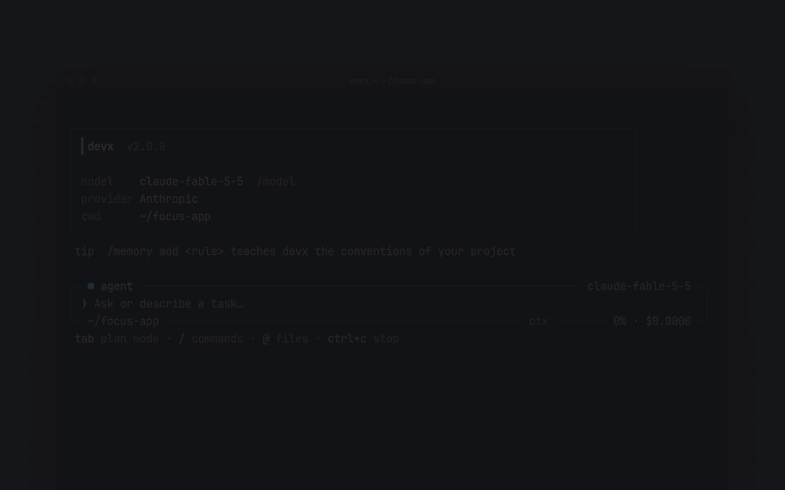

<div align="center">



<br/>

**Надшвидкий автономний ШІ-напарник для програмування та вайб-кодингу в терміналі.**  
Створений спеціально для **Android Termux**, **Windows**, **macOS** і **Linux**.

<br/>

[](https://www.npmjs.com/package/termux-dev)
[](https://github.com/apvcode/Termux-Dev/actions/workflows/ci.yml)
[](LICENSE)
[](https://nodejs.org)
[](https://www.typescriptlang.org)
[](#quick-start)
[](https://github.com/apvcode/Termux-Dev/releases/tag/android-app)

<br/>

[English](README.md) &nbsp;•&nbsp; [Русский](README_ru.md) &nbsp;•&nbsp; **Українська** &nbsp;•&nbsp; [Deutsch](README_de.md) &nbsp;•&nbsp; [Español](README_es.md) &nbsp;•&nbsp; [Français](README_fr.md) &nbsp;•&nbsp; [Português](README_pt.md) &nbsp;•&nbsp; [Chinese](README_zh.md) &nbsp;•&nbsp; [Japanese](README_ja.md)

<br/><br/>

<a href="assets/demo.mp4"></a>

<br/>



</div>

---

## Коротко

<table>
<tr><td valign="top" width="33%"><b>Спершу план, потім діло</b><br/>режими PLAN і AGENT, затвердження в один клік, план за розміром завдання</td><td valign="top" width="33%"><b>Безпечно за замовчуванням</b><br/>питає перед ризикованим, ховає секрети у виводі, відкат через git, необов’язковий ліміт витрат</td><td valign="top" width="33%"><b>Будь-яка модель</b><br/>OpenRouter, Gemini, DeepSeek, Groq, Mistral, OpenAI, Anthropic, Ollama та інші</td></tr><tr><td valign="top" width="33%"><b>MCP з коробки</b><br/>панель, віддалені сервери по HTTP, а агент сам уміє підключати сервери</td><td valign="top" width="33%"><b>Зроблений для термінала</b><br/>зручні макети для телефона, 18 тем, міркування й вивід можна згортати</td><td valign="top" width="33%"><b>Витрати на виду</b><br/>вартість сесії наживо, глибина міркування для кожної моделі, ліміт, якщо потрібен</td></tr>
</table>

## Швидкий старт

```bash
npm install -g termux-dev
devx
```

На Android спершу виконайте в Termux `pkg install nodejs-lts`.

---

## Основні можливості

Інтерфейс побудований навколо рамки вводу, у межах якої видно стан: режим (`agent` / `plan` / `yolo`), модель, тека, git-гілка, індикатор контексту та вартість. До цього — картка-шапка, затемнене відлуння вашого повідомлення, gutter `●` біля відповіді асистента, рядки `◆` для викликів інструментів з тихими однорядковими результатами та diff-блоки для правок, а також живий індикатор роботи. Кожен екран має вузький варіант для Termux у портреті, емодзі та CJK рахуються правильно. Початковий ASCII-вигляд можна ввімкнути в `/settings` → `Interface`.

- **Дворежимна архітектура (PLAN та AGENT):**  
  Миттєве перемикання між **PLAN** (безпечний архітектор, інтерактивні опитувальники, жодних дампів коду) та **AGENT** (автономні правки файлів, команди термінала, автовстановлення пакетів).
- **Затвердження плану в один клік (`[Go / Go and compact context / Other]`):**
  Коли архітектурний план готовий, перегляньте його й підтвердіть `Go`, щоб одразу запустити агента-кодера. `Go and compact context` спершу стискає довгу розмову про планування й виконує затверджений план у короткому свіжому контексті (з телефона це працює так само).
- **Мультимодальний зір і вставка скриншотів:**  
  Вставляйте скриншоти просто з буфера обміну через `Ctrl+V` або `Alt+V` (також `/image` чи вставка шляху до файлу). Вони показуються бейджами на кшталт `[Image #1 203kb]` і йдуть моделі як справжні зображення, якщо модель не читає лише текст. Потрібні `wl-clipboard` на Wayland, `xclip` на X11, `pngpaste` на macOS.
- **Агент може дивитися зображення на диску:**
  Запитайте його про `screenshot.png` чи макет у будь-якій теці, і він відкриє файл через `read_file`, так само як бачить зображення, яке ви прикріпили. PNG, JPEG, WebP і GIF до 5 МБ; вміст файлу справді має бути зображенням. Лише найновіші зображення надсилаються повністю, старіші лишаються примітками в чаті (модель може відкрити файл знову). Модель без зору натомість отримує зрозуміле повідомлення.
- **Вбудований живий вебсервер (`/serve`):**  
  Миттєвий перегляд вебзастосунків та HTML5-ігор на порту 3000. На Android відкривається автоматично через `termux-open-url`.
- **Фонові завдання (`/tasks`):**
  Агент може запустити сервер розробки, спостерігач чи довгий тестовий прогін у фоні й працювати далі. Він може чекати рядка (`ready|error`), прочитати вивід пізніше, і його повідомляють, коли завдання завершується чи виводить те, про що він просив; якщо ви тоді в промпті, він підхоплює новину сам. Значок `◈ 2 bg` у рамці промпту показує, що працює, а `· 1 failed` додається, коли завдання завершилося погано, доки devx не скаже про це агентові; `/tasks` показує завдання, `/tasks <id>` — вивід, `/tasks stop <id|all>` — зупиняє їх. Запуск завдання потребує схвалення, як `bash`; усе зупиняється, коли devx виходить. З `"backgroundAutoWake": false` агент перестає реагувати сам.
- **Миттєвий відкат змін (`/undo`):**  
  Кожна правка через файлові інструменти (`write_file`, `edit_file`) записується й скасовується однією командою. Зміни, зроблені shell-командами (`bash`), **не відстежуються**, а знімки живуть лише в пам’яті поточної сесії.
- **Самодіагностика й автовиправлення помилок:**  
  Вбудована підтримка TypeScript (`tsc`), JavaScript (`node --check`), Python (`py_compile`) та Rust (`cargo check`). ШІ сам знаходить і виправляє помилки перед завершенням ходу.
- **Банк пам’яті проєкту (`.devx/memory.md`):**  
  Постійний контекст проєкту між сесіями через `/memory add <правило>`.
- **Сповіщення, коли devx чекає на вас:**
  Коли агентові потрібне схвалення або він ставить вам запитання (`◆ Clarify`), а термінал не на передньому плані, ви отримуєте сповіщення (власний протокол kitty, `notify-send` у Linux, `osascript` у macOS; у Termux — сповіщення Android з короткою вібрацією). Завершене завдання теж оголошується, з початком відповіді. Термінал має повідомляти про зміну фокусу (більшість сучасних це роблять); коли devx не може визначити, чи ви дивитеся, він мовчить, а не вискакує перед вами.
- **Минулі чати (`search_chats`):**
  Коли ви кажете «як ми вирішили минулого разу» чи «у тому чаті про парсер», агент може переглянути ваші збережені чати за ключовими словами (будь-якою мовою, інші форми слова теж збігаються: сторінка / сторінки) і прочитати потрібний, по кілька повідомлень за раз. Це лише читання й локально, тому нічого не питає; відкритий зараз чат не шукається; вивід інструментів не індексується; а те, що він читає, передається моделі як дані, а не як інструкції. У звичайному завданні агент цим не користується.
- **18 кольорових тем на чисто чорному тлі (`#0a0a0c`):**  
  Глибокий OLED-чорний для комфортного кодингу в терміналі, з повними палітрами замість одного акценту: Cyan Cyber, Synthwave Purple, Matrix Hacker, Solar Amber, Ruby Crimson, Pure Monochrome, Nord Frost, Dracula, Tokyo Night, Gruvbox, Catppuccin Mocha, Solarized Dark, Rose Pine, Monokai, GitHub Dark, Deep Ocean, Sunset Glow та Forest Moss. Див. [Теми](#теми).
- **Розумна історія сесій (`/resume` і `/session`):**  
  Відновлюйте сесії з останніми 20 повідомленнями в повному Markdown і відстежуйте унікальні ID сесій (`#a8f9z`).
- **Розумний багаторядковий редактор (`edit_file 2.0`):**  
  Безпечне редагування коду з повідомленнями про номери рядків при дублікатах і підтримкою `replaceAll`.
- **Повний набір тестів (Vitest):**  
  Покриття тестами циклу агента, файлових систем, захисту, знімків і історії контексту з автоматичним CI.
- **Інтерфейс 9 мовами:**  
  English (за замовчуванням), Русский, Українська, Deutsch, Español, Français, Português, 中文 та 日本語. Мова обирається в `/settings` → `Language`, застосовується одразу й запам’ятовується. Перекладаються повідомлення, підказки й екран налаштувань; код, назви інструментів і відповіді самої моделі — ні.
- **Підтримка будь-яких ШІ-провайдерів:**  
  **OpenRouter**, **Google Gemini**, **DeepSeek**, **Groq**, **Mistral**, **OpenAI**, **Anthropic**, **Alibaba** та локальні моделі (**Ollama**, **LM Studio**).
- **Локальна Ollama:**  
  Вікно контексту Ollama за замовчуванням (4096 токенів) менше за власний промпт devx, тому Ollama мовчки відкидає попередні повідомлення, і модель «забуває» розмову. Запускайте її так: `OLLAMA_CONTEXT_LENGTH=16384 ollama serve` (8192, якщо мало пам’яті). `/doctor` перевіряє вікно й попереджає.
- **Власні провайдери:**  
  `/provider` → **Додати провайдера**: дайте йому назву, адресу (будь-який API, сумісний з OpenAI або Anthropic) і ключ. Він збережеться в `~/.devxrc.json` і з’явиться в списку поруч із відомими; оберіть його знову, щоб використати, змінити назву, адресу чи ключ, або видалити. Сервер на вашому комп’ютері (LM Studio, локальний шлюз) можна додати без ключа.

---

## Встановлення та запуск

### Вимоги
- **Node.js**: `v20.0.0` або новіший
- **npm**, **pnpm** або **yarn**

### Встановлення Node.js та npm

devx потрібен Node.js 20 або новіший (npm іде разом із ним). Оберіть свою систему:

```bash
# Windows (PowerShell)
winget install OpenJS.NodeJS.LTS

# macOS (Homebrew)
brew install node

# Ubuntu / Debian (NodeSource: версія в репозиторії самого дистрибутива часто старша за 20)
curl -fsSL https://deb.nodesource.com/setup_lts.x | sudo -E bash -
sudo apt-get install -y nodejs

# Fedora
sudo dnf install -y nodejs

# Arch Linux
sudo pacman -S nodejs npm

# Android (Termux)
pkg update && pkg install -y nodejs-lts
```

Відкрийте термінал заново та перевірте: `node -v` (має бути `v20` або вище) і `npm -v`. Будь-яка система: інсталятор на [nodejs.org](https://nodejs.org/en/download) або [nvm](https://github.com/nvm-sh/nvm).

### Швидке глобальне встановлення (рекомендовано)

```bash
npm install -g termux-dev
```

### Android (Termux)

```bash
# 1. Оновлюємо пакети й ставимо NodeJS
pkg update && pkg install -y nodejs-lts

# 2. Ставимо devx глобально через npm
npm install -g termux-dev

# 3. Запускаємо devx будь-де!
devx
```

### Збірка з вихідного коду (для розробників)

```bash
git clone https://github.com/apvcode/Termux-Dev.git
cd Termux-Dev
npm install
npm link
```

### Повне видалення

Щоб повністю прибрати `devx` разом із конфігурацією, збереженими сесіями та даними:

```bash
# 1. Видаляємо глобальний npm-пакет
npm uninstall -g termux-dev

# 2. Видаляємо конфіг та історію сесій (Linux / macOS / Termux)
rm -rf ~/.devx ~/.devxrc.json

# (Windows PowerShell)
Remove-Item -Recurse -Force "$HOME\.devx", "$HOME\.devxrc.json" -ErrorAction SilentlyContinue
```

---

## Початок роботи

Запустіть `devx` у теці будь-якого проєкту:

```bash
devx
```

* Під час першого запуску відкриється майстер налаштування: оберіть улюбленого ШІ-провайдера та введіть API-ключ.
* Одразу в **режимі PLAN**:
  ```bash
  devx --plan
  ```
* **Безголовий одноразовий режим** (скрипти, CI/CD, Termux:Widget):
  ```bash
  devx -p "review latest git diff and find security bugs"
  devx -p "fix build errors" --yolo
  ```

---

## Керування з телефона

**Отримати застосунок:** у Android-застосунку є власна сторінка на Termux-Dev: **[Releases → devx for Android](https://github.com/apvcode/Termux-Dev/releases/tag/android-app)**. Кожна версія лежить там файлом `devx-android-X.Y.Z.apk` (відкрийте найновіший на телефоні й дозвольте встановлення з цього джерела); нові версії додаються поруч зі старими. Вихідний код застосунку та його власний README лежать у [гілці `android`](https://github.com/apvcode/Termux-Dev/tree/android). У застосунку телефон прибирається з комп'ютера командою `/phones` у devx або `devx remote revoke <name>`.

devx 2.0 можна керувати із застосунку devx для Android. Невеликий хост працює у фоні на вашому комп'ютері; телефон підключається до нього, бачить і керує тими самими сесіями: кожним чатом, живими відповідями й міркуваннями, картками схвалення, запитаннями, планом, режимами plan/agent/YOLO, моделлю та провайдером, контекстом і вартістю, `/compact` та іншими командами. З телефона можна надсилати файли й фото, а агент може надсилати файли й зображення назад: вони з'являються в чаті на телефоні як картки. Усе працює із закритим терміналом.

Застосунок також є власним кишеньковим асистентом, без облікового запису й без нашого сервера:

- **Чат** з будь-яким провайдером, якого ви додасте (сумісним з OpenAI чи Anthropic): рівні міркувань, фото й файли, проєкти, пам'ять, навички та MCP-сервери.
- **Голос**: призначте його асистентом телефона, і кнопка живлення його відкриває. Він ставить будильники, таймери й нагадування, відкриває застосунки, знаходить контакти, готує дзвінки та повідомлення, керує яскравістю, «Не турбувати», музикою та гучністю. Природний голос від вашого провайдера може читати відповіді замість роботизованого голосу телефона.
- **Місця й погода** з OpenStreetMap, без ключів; він також може дивитися ваші фото й сповіщення, коли ви просите.
- **Заплановані завдання**: «щоранку надсилай мені новини про ШІ».
- **Відповіді картками**: таблиці, графіки, карти, погода, таймери, чеклісти, діаграми та картки застосунків із Google Play і F-Droid.
- **Блокноти**: місце, щоб вчитися або збирати ідеї за однією темою, зі своїми джерелами (файли, фото, веб-сторінки; посилання можна надіслати з будь-якого застосунку). Навчальний блокнот має мету й план уроків, питання у вигляді форм, картки з інтервальним повторенням (окремий екран, віджет на головному екрані, нагадування), статистику занять, аудіо-огляд для прослуховування та відповіді, що посилаються на джерела натискними чипами. На картках можуть бути картинки, вони приходять з Anki або CSV (і виходять пакетом Anki); жива карта понять (як в Obsidian: поняття можна перетягувати, шукати й правити руками, і в навчальних блокнотах, і в блокнотах ідей) показує, як ідеї пов'язані; асистент може також прибирати, перейменовувати й правити джерела.
- **`@` у повідомленні** вказує на блокнот, проєкт, файл або завдання за розкладом; асистент отримує те, що в них лежить. Єдиний пошук шукає по чатах, блокнотах, файлах і тексту всередині них.
- **Бібліотека, бекап і кошик**: кожен файл, який ви прикріплювали або створив асистент, із вбудованим переглядом PDF, Word, слайдів і таблиць; усе (чати, блокноти, пам'ять, налаштування) одним файлом бекапу, ключі лише під паролем, перед відновленням він показується; автоматична щотижнева копія в обрану теку або в теку WebDAV (Nextcloud, NAS); видалені чати й блокноти 30 днів лежать у кошику.
- **Власний вигляд і характер**: дванадцять тем (чорна, темно-сіра, світла та інші), які можуть змінюватися за часом доби, з розмиттям, яке можна вимкнути; манера й ім'я асистента, блокування застосунку екраном блокування або біометрією та замки на окремих чатах. Чати можна закріплювати, архівувати й додавати на головний екран; чотири віджети й дві плитки швидких налаштувань.
- **Дев'ять мов**, ті самі, що й у devx.

```
devx remote start     # запустити хост (працює далі без терміналу)
devx remote pair      # показує QR-код: скануйте його в застосунку й підтвердьте шість цифр тут
devx remote status    # хто підключений, які сесії відкриті
devx remote devices   # сполучені телефони     devx remote revoke <name>   # прибрати один
devx remote service   # запускати разом із комп'ютером (systemd / launchd / тека автозапуску); також у /settings. `service off` вимикає
```

Як телефон досягає комп'ютера без жодного нашого сервера: спершу напряму (та сама Wi-Fi, VPN на кшталт Tailscale або прокинутий порт 47821), а коли це неможливо (мобільний інтернет, NAT оператора) — через безкоштовний публічний MQTT-ретранслятор. Телефон пробує обидва шляхи одночасно й не припиняє спроб; ретранслятор бачить лише зашифровані пакети. Формат передавання та його безпека описані в [docs/remote-protocol.md](docs/remote-protocol.md).

Безпека: телефон додається лише одноразовим кодом із `devx remote pair` (дійсний 5 хвилин) **і** вашим підтвердженням тут, де обидва екрани показують однакові шість цифр. Ключі P-256 (ключ телефона ніколи не залишає його Keystore), кожне з'єднання підписується й шифрується (AES-256-GCM) свіжими ключами. Віддалений доступ — це доступ до оболонки цього комп'ютера: за замовчуванням кожна команда питає схвалення в телефона, а режим «Everything» вимкнений, доки ви не ввімкнете його для сесії.

Якщо в телефона ввімкнено пам'ять devx, його ім'я потрапляє в чат, а агент тут отримує інструмент `phone_memory`, який просить у телефона його нотатки: на цей комп'ютер нічого не копіюється.

## Слеш-команди

Введіть `/` у рядку вводу, щоб відкрити палітру команд з автодоповненням:

| Команда | Опис |
| :--- | :--- |
| **`/plan`** | Перейти в режим **PLAN** (архітектор і планувальник вимог) |
| **`/agent`** | Перейти в режим **AGENT** (кодер і автономний виконавець) |
| **`/mcp`** | Керувати серверами Model Context Protocol (MCP) та зовнішніми інструментами (`/mcp reload`) |
| **`/usage`** | Панель (закрити через `Esc`): що заповнює контекстне вікно (системний промпт, схеми інструментів, повідомлення, результати інструментів, зображення), вартість сесії та наскільки вона певна, токени, кешований вхід, трафік |
| **`/export`** | Експортувати розмову в чистий транскрипт GitHub-Flavored Markdown |
| **`/theme [name]`** | Змінити тему інтерфейсу: список із 18 палітр з пошуком і попереднім переглядом (див. [Теми](#теми)) |
| **`/doctor`** | Діагностика середовища (Node, Termux, компілятори, API-ключі) |
| **`/image`** | Вставити зображення з буфера обміну (те саме, що `Ctrl+V` / `Alt+V`) |
| **`/serve [port]`** | Запустити локальний HTTP-сервер для перегляду веб/ігор (`/serve stop` — зупинити) |
| **`/memory`** | Переглянути, додати (`/memory add <факт>`) або очистити банк пам’яті проєкту |
| **`/copy`** | Скопіювати **останню відповідь** ШІ в буфер обміну повністю (працює й через ssh) |
| **`/rename`** | Перейменувати чат: `/rename <назва>`, без назви ШІ вигадає її знову (`/title` — те саме) |
| **`/permissions`** | Що дозволено без питань («Session» / «Always» на картці підтвердження); `/permissions clear` скидає |
| **`/phones`** | Телефони, сполучені з devx Remote: виберіть один, щоб прибрати, його одразу відключено, і він не зможе підключитися, доки його не сполучать знову |
| **`/rewind`** | Повернутися до одного з **ваших повідомлень**: чат після нього стирається (модель теж його забуває), повідомлення повертається в рядок вводу для правки; файли теж можна повернути (з git) |
| **`/tasks`** | Фонові завдання: список, `/tasks <id>` для виводу, `/tasks stop <id\|all>`, `/tasks clear` |
| **`/undo`** | Скасувати всі зміни файлів останнього ходу ШІ |
| **`/diff`** | Кольоровий git diff змінених файлів проєкту |
| **`/commit`** | Семантичне повідомлення коміту від ШІ та git commit |
| **`/status`** | Стан git-репозиторію |
| **`/session`** | ID активної сесії, статистика та метадані |
| **`/resume`** | Переглянути та відновити збережені сесії |
| **`/session del`** | Вибіркове або масове видалення збережених сесій |
| **`/settings`** | Тема, інтерфейс, автосхвалення (YOLO), пам’ять проєкту, перевірка оновлень і мова інтерфейсу |
| **`/update`** | Перевірити нову версію: картка з тим, що нового, потім **Оновити зараз**, **Пізніше** або (під час запуску) **Пропустити версію**. Встановлення йде на живому екрані покроково, перевіряє, що потрібна версія справді є в npm, і перезапускає devx. У разі помилки покаже причину й команду для ручного запуску |
| **`/model`** | Змінити модель поточного провайдера з живим пошуком |
| **`/effort [level]`** | Задати глибину міркування. Пропонуються лише рівні, які підтримує поточна модель (див. [Глибина міркування](#глибина-міркування)) |
| **`/provider`** | Змінити провайдера (OpenRouter, Gemini, Groq, DeepSeek, Local) |
| **`/compact`** | Стиснути й підсумувати токени контексту чату (стиснений чат зберігається одразу, тож `/resume` дає короткий) |
| **`/clear`** | Очистити контекст і почати нову сесію (стара лишається збереженою, див. `/resume`) |
| **`/init`** | Створити в корені проєкту посібник `AGENTS.md` для розробників |
| **`/help`** | Показати всі доступні команди |
| **`/exit`** | Коректно вийти з devx |

---

## Гарячі клавіші

- **`Tab`** — миттєво перемикає **PLAN** і **AGENT**, не втрачаючи набраний текст.
- **`Ctrl+V`** / **`Alt+V`** — вставити зображення з буфера обміну просто в рядок вводу.
- **`@filename`** — швидке нечітке автодоповнення файлів і повне вбудовування файлу.
- **`Backspace`** — за одне натискання видаляє бейдж `[Pasted text #1]` або `[1.png 203kb]` цілком.
- **`Ctrl+Backspace`** / **`Alt+Backspace`** — стирання тексту по слову (також поки агент працює).
- **`Ctrl+Enter`** — Під час набору: новий рядок (новий абзац) замість надсилання. `Alt+Enter` і `Shift+Enter` роблять те саме там, де термінал їх повідомляє; у терміналі, що не відрізняє їх від `Enter` (наприклад, клавіатура телефона), наберіть `\` перед `Enter`. devx просить термінал їх розрізняти лише там, де відомо, що це працює (kitty, Ghostty, WezTerm, iTerm2, foot, Alacritty); Termux та інші термінали, що читають цей запит як код курсора чи стилю, його ніколи не отримують. `DEVX_EXTENDED_KEYS=1` (або `0`) вмикає його примусово (або вимикає).
- **`Ctrl+P`** / **`Ctrl+O`** — розгорнути або згорнути міркування моделі (`Ctrl+P`) і команди з їхнім виводом (`Ctrl+O`) у всьому чаті, зокрема те, що вже вище. За замовчуванням усе згорнуто; працює і поки агент працює, і в рядку вводу.
- **`Esc`** — зупинити поточну відповідь і все, що вона запустила (команду, що виконується); набране чекає в наступному вводі. Esc також закриває будь-який список і картку.
- **`Ctrl+C`** — негайно зупинити генерацію або вийти.

---

## Глибина міркування

`/effort` задає, скільки модель міркує перед відповіддю: `off`, `low`, `normal`, `high`, `xhigh`, `max` або `auto` (власне значення моделі, нічого не надсилається). Моделі різні, тому меню пропонує **лише рівні, які підтримує поточна модель**:

```
╭─ effort ─────────────────────────────────── claude-sonnet-5-5 ─╮
│  ❯ ● auto    model default, nothing is sent                     │
│    ○ off     no reasoning                                       │
│    ○ normal  balanced (~6k thinking tokens)                     │
│    ○ high    deep reasoning (~16k thinking tokens)              │
│                                                                 │
│   Not offered by this model: max.                               │
╰─────────────────────────────────────────────────────────────────╯
```

- `/effort` відкриває меню, `/effort high` задає рівень напряму (працюють і псевдоніми `medium`, `none`, `maximum` тощо), `/effort auto` повертає значення моделі, `/effort refresh` оновлює дані, з яких будується меню (див. нижче).
- Вибір запам’ятовується **для кожної моделі окремо**. Якщо перейти на модель, яка не пропонує збережений рівень, нічого не надсилається. Поточний рівень видно біля назви моделі (`gpt-5.5 · think high`; `think auto` — власне значення моделі). Поки агент працює, рядок стану показує, скільки токенів модель уже написала на ваш запит (`↓ 364 tokens`), а рядок після ходу підсумовує це (`18.1k in · 59 out`).
- `devx -p "task" --effort high` задає рівень лише для одного запуску (не зберігається).
- Якщо ендпоінт відповідає 400 і скаржиться на параметр міркування, devx повторює запит один раз без нього, повідомляє вас і більше його не надсилає.

**Звідки беруться рівні** (перше джерело, що знає модель, перемагає; меню показує, яке використано):

1. **Ваш власний профіль** у `~/.devxrc.json` (`reasoningProfiles`, нижче).
2. **Сам ендпоінт.** OpenRouter віддає метадані міркування для кожної моделі (які рівні приймає, чи можна вимкнути); Ollama повідомляє можливість «thinking»; LiteLLM і багато шлюзів додають прапорці до списку моделей. **Сторонній або власний провайдер опитується один раз:** кілька невеликих запитів на *його власний* base URL з вашим ключем (`GET /models`, на локальній машині ще `POST /api/show`, для LiteLLM `GET /model/info`). Відповідь кешується на добу в `~/.devx/capabilities.json`. Великих вендорів (OpenAI, Anthropic, Google...) не опитуємо: їхні списки нічого не кажуть про міркування. Вимкнути можна рядком `"probeEndpoints": false` у `~/.devxrc.json`.
3. **Каталог [models.dev](https://models.dev)**: параметри міркування близько 6900 моделей 297 провайдерів (рівні, перемикач, бюджети токенів). Знімок постачається з devx, тож за замовчуванням нічого не завантажується. `/effort refresh` завантажує актуальний у `~/.devx/` і ще раз питає ендпоінт; це єдиний випадок, коли devx звертається до models.dev, і лише тому, що ви виконали цю команду. Те саме завантаження оновлює ціни для відображення вартості (див. «Вартість»).
4. **Правила за назвою моделі** — запасний варіант для всього, що джерела не описують (таблиця нижче).

Як рівень записується в запит, залежить від API у вашому base URL, тож ця частина вбудована в devx.

Правила за назвою моделі (запасний варіант):

| Модель | Рівні | Як надсилається |
| :--- | :--- | :--- |
| OpenAI o-series, gpt-oss | low, normal, high | `reasoning_effort` (`reasoning.effort` в OpenRouter) |
| GPT-5.x, 5.5+ | off (minimal у GPT-5), low, normal, high, а з 5.2 ще xhigh | `reasoning_effort` |
| Grok 3 mini | low, high | `reasoning_effort` |
| Claude 3.7 / 4.x / 5.x (Fable, Opus, Sonnet, Haiku) | off, low, normal, high, xhigh, max (Opus 4 і 4.1 без max) | `thinking.budget_tokens` (Anthropic), `reasoning.max_tokens` (OpenRouter) |
| Gemini 3.x (3.1 Pro, 3.6 Flash) | low, high | `reasoning_effort` |
| Gemini 2.5 Pro / Flash | від low до max (Flash ще й off) | `thinking_budget` (Google), `reasoning.max_tokens` (OpenRouter) |
| Qwen3 | off, low, normal, high, max | `enable_thinking` / `thinking_budget` (DashScope) |
| DeepSeek V3.1+, GLM 4.5+ | off, normal | `reasoning.enabled`, `thinking.type` |
| DeepSeek-R1, QwQ, Grok 4, Magistral | немає: вони завжди міркують | нічого |

Модель, яку не описує жодне джерело, отримує порожній список рівнів, а не здогад. Якщо ви знаєте, як вона приймає параметр міркування, опишіть це в `~/.devxrc.json`:

```json
{
  "reasoningProfiles": {
    "my-model": {
      "levels": ["off", "normal", "high"],
      "param": "reasoning_effort",
      "values": { "off": "none", "normal": "medium", "high": "high" }
    }
  }
}
```

`param` може бути вкладеним (`"reasoning.effort"`). Профіль також перекриває вбудовану таблицю для цього id моделі.

---

## Ввід під час роботи агента

Рамка промпту залишається внизу терміналу під час завдання (із живим контекстом і вартістю), а робота агента прокручується над нею. Друкуйте в ній, поки агент читає файли, виконує команди чи думає, і натисніть Enter: повідомлення стає в чергу, і агент отримує його **на своєму наступному кроці**, між двома викликами інструментів, тож він продовжує роботу, але враховує вашу репліку. Повідомлення, набране, коли модель пише остаточну відповідь, отримує власну відповідь замість того, щоб бути відкинутим. `Ctrl+Enter` починає в повідомленні новий рядок замість надсилання (так само `Alt+Enter` і `Shift+Enter`; `\` перед `Enter` робить це в терміналах, що не розрізняють їх). `Ctrl+Backspace` стирає слово. Наберіть там `/`, і відкриється список усіх команд (стрілки прокручують, `Tab` доповнює, `Enter` виконує): ті, що лише показують чи змінюють налаштування (`/settings`, `/model`, `/theme`, `/usage`, `/mcp`, `/tasks`, `/help` та інші), відкриваються одразу, поки агент працює, і він чекає; ті, що змінюють розмову (`/compact`, `/new`, `/undo`, `/plan` ...), виконуються, коли агент закінчить. Стрілки вгору й вниз повертають рядки, які ви надсилали раніше, зокрема з попередніх чатів (зберігаються в `~/.devx/history.jsonl`). `↓` повертає повідомлення, що чекає, у рядок для редагування; `Enter` на порожньому рядку надсилає його **зараз** (поточну відповідь зупиняють). Стрілки працюють і за ввімкнених Caps Lock та Num Lock. Повідомлення, що починається зі шляху до файлу (`/home/me/boot.img flash this`), — це повідомлення, а не команда. `Esc` (або `Ctrl+C`) зупиняє агента й повертає набране в наступний промпт. Згадки `@file` у цих повідомленнях теж працюють. Поки на екрані картка схвалення чи запитання, рядок відступає, тож ваші `y` / `n` ніколи не потрапляють у повідомлення. Вимкніть це через `"ui": { "typeAhead": false }` у `~/.devxrc.json`.

---

## Контекстне вікно

Розмір вікна шукається, а не вигадується. У такому порядку: `contextLimits` у `~/.devxrc.json` (ваше число для id моделі), каталог [models.dev](https://models.dev) (число від самого виробника для близько 2200 моделей; знімок постачається з devx, `/effort refresh` завантажує актуальний), значення, збережене під час вибору моделі, таблиця моделей devx, правило за назвою моделі і лише потім типові 128k. `/usage` показує, яке з них використано, і попереджає, якщо це здогад. Старі повідомлення відкидаються понад 85% вікна, тож замале вікно змушує devx забувати зарано, а завелике — провайдера відхиляти запит (тоді devx скорочує історію й пробує знову).

```json
{ "contextLimits": { "my-model": 65536 } }
```

---

## Формати API (OpenAI та Anthropic)

Існують два формати: **OpenAI** (`/v1/chat/completions`) та **Anthropic** (`/v1/messages`). Рідний формат Anthropic несе підписані блоки міркування, кешування промптів і точний облік кешу, тому моделі Claude найкраще працюють через нього. devx розуміє обидва й обирає формат **для кожної моделі сам, з одним ключем**:

- `api.anthropic.com` і base URL зі шляхом `/anthropic/` (MiniMax, Z.ai тощо) використовують формат Anthropic.
- Для будь-якого іншого власного шлюзу devx двічі запитує список моделей (кілька невеликих `GET {root}/v1/models` на ваш base URL з вашим ключем): раз як клієнт OpenAI і раз як клієнт Anthropic. Моделі, що є лише в другому списку (зазвичай Claude), йдуть через формат Anthropic, решта — через OpenAI. `/model` показує обидва списки в одному виборі й позначає моделі Anthropic. Вкажіть base URL один раз (`https://gateway.example.com/v1` або без `/v1`); для окремих моделей нічого налаштовувати не треба.
- Відповідь кешується на добу в `~/.devx/formats.json` (лише id моделей, ніколи не ключ). `"probeEndpoints": false` вимикає опитування, `"apiFormat": "openai"` або `"anthropic"` у `~/.devxrc.json` примусово задає один формат для всього.
- Рівні міркування (`/effort`) записуються так, як цього чекає API Anthropic (`thinking.budget_tokens`), щоразу, коли використовується формат Anthropic, навіть за шлюзом. Блоки міркування зберігаються й надсилаються з наступним запитом, тож модель не губить нитку між викликами інструментів. Якщо шлюз відхиляє їх, маркери кешу, завеликий `max_tokens` чи налаштування міркування, devx повторює запит один раз без проблемної частини й повідомляє про це.

## Вартість

Кожен запит надсилає всю розмову заново, а число біля індикатора контексту підсумовує, скільки коштував кожен із цих запитів (кешований вхід дешевший і оцінюється відповідно). Сам індикатор контексту показує 0 для порожнього чату і, від першого повідомлення, усе, що несе наступний запит: системний промпт і схеми інструментів включно.

Число поруч з індикатором контексту — це гроші, витрачені в цій сесії. Воно показує, наскільки devx упевнений:

| Показано | Значення |
| :--- | :--- |
| `$0.0123` | точно: повідомлено провайдером або пораховано за власним прайсом вендора |
| `~$0.0123` | оцінка: пораховано за ціною тієї самої моделі з [models.dev](https://models.dev) (шлюз може брати інакше) |
| `$0.0123+` | щонайменше стільки: для деяких запитів ціна невідома, і їх не враховано |
| `n/a` | для моделі невідома жодна ціна |

Ціни шукаються в такому порядку, перемагає перше джерело, що знає модель: вартість, яку провайдер вказав у відповіді (OpenRouter `usage.cost`, LiteLLM) – ваші власні `prices` у `~/.devxrc.json` – власний прайс-лист кінцевої точки (OpenRouter, LiteLLM) – каталог models.dev (близько 9700 моделей; знімок постачається з devx, `/effort refresh` завантажує актуальний). Кешовані вхідні токени, записи в кеш і рівні довгого контексту оцінюються окремо, як це роблять вендори. Запит, що пішов, але не отримав відповіді (скасований через Ctrl+C, втрачене з'єднання, тайм-аут шлюзу повільної моделі), провайдер зазвичай усе одно виставляє до рахунку, а повторна спроба надсилає всю розмову заново: такі запити теж враховуються, як оцінка (`~`). Невеликі допоміжні завдання (назва чату, повідомлення `/commit`, підсумок `/compact`) виконуються з найлегшим рівнем міркувань, який пропонує модель, і їхня вартість входить до загальної. Модель, яку не знайдено, ніколи не показується як безкоштовна: нічого не коштують лише моделі `:free` і локальні сервери. `/usage` також перелічує кешований вхід і скільки запитів не вдалося оцінити.

```json
{
  "prices": {
    "my-model": { "input": 0.5, "output": 2.0, "cacheRead": 0.05 }
  }
}
```

Значення — у USD за мільйон токенів.

---

## Теми

`/theme` відкриває список, який можна фільтрувати набором тексту; виділена тема показується у власних кольорах під списком. `/theme nord` (або псевдонім на кшталт `tokyo`, `mocha`, `gh`, чи число від 1 до 18) перемикає напряму, вибір зберігається.

Тема — це повна палітра: акцент, другий колір для режиму plan, кольори успіху / попередження / помилки, колір режиму YOLO, чотири ступені сірого для тексту, другорядного тексту, підказок і рамок та тло відлуння вашого повідомлення. Кожна тема перевіряється в тестах на читабельний контраст на темному тлі.

| Тема | Характер |
| :--- | :--- |
| `cyan` Cyan Cyber (за замовчуванням) | електричний ціан і обсидіан |
| `purple` Synthwave Purple | неонова маджента, ретро-фіолет |
| `matrix` Matrix Hacker | зелений люмінофор |
| `amber` Solar Amber | тепле золото ЕПТ |
| `crimson` Ruby Crimson | червоний scarlet |
| `monochrome` Pure Monochrome | лише білий і сірий |
| `nord` Nord Frost | арктичні сині |
| `dracula` Dracula | фіолетовий з рожевим і зеленим |
| `tokyonight` Tokyo Night | індиго та синій |
| `gruvbox` Gruvbox | ретро жовтий і помаранчевий |
| `catppuccin` Catppuccin Mocha | пастельний ліловий |
| `solarized` Solarized Dark | неяскравий бірюзовий і оливковий |
| `rosepine` Rose Pine | м’який рожевий і золотий |
| `monokai` Monokai | лайм і маджента |
| `github` GitHub Dark | чистий синій і зелений |
| `ocean` Deep Ocean | глибоководний ціан |
| `sunset` Sunset Glow | корал і фіолетовий |
| `forest` Forest Moss | мохові зелені |

Кольори точні в терміналах із підтримкою truecolor (`COLORTERM=truecolor`); у 256-кольорових кожен колір відображається на найближчий запис палітри. Задайте `DEVX_COLOR=256` або `DEVX_COLOR=truecolor`, щоб примусово обрати один із двох.

---

## Хуки, ліміти та дозволи

- **Ліміт вартості.** `/settings` → `Cost limit` (або `"maxCostPerSession": 5` у `~/.devxrc.json`, USD). На 80 % devx попереджає; на ліміті він зупиняє завдання, а перед наступним повідомленням питає, чи витрачати більше (продовження піднімає ліміт лише цієї сесії).
- **Дозволено без запитів.** На картці схвалення `Session` дозволяє команду (за програмою й підкомандою, як-от `npm test`) чи MCP-інструмент, поки ви не закриєте devx; `Always` зберігає це в `~/.devxrc.json` (`bashAllowlist`, `allowedTools`). Небезпечні команди, читання секретів, ланцюжки (`&&`, `;`, `|`) і перенаправлення ніколи не запам'ятовуються. `/permissions` показує це, `/permissions clear` прибирає.
- **Хуки.** Команди, що виконуються навколо інструментів агента, задаються в `~/.devxrc.json`:

  ```json
  {
    "hooks": {
      "PreToolUse":  [{ "matcher": "bash", "command": "./check-command.sh" }],
      "PostToolUse": [{ "matcher": "write_file|edit_file", "command": "npx prettier --write ." }]
    }
  }
  ```

  `matcher` — регулярний вираз для назви інструмента (жодного чи `*`: кожен інструмент). Команда отримує виклик як JSON у stdin (`event`, `tool_name`, `tool_input`, а для `PostToolUse` ще `tool_result`) і `DEVX_HOOK_EVENT` / `DEVX_TOOL_NAME` у середовищі. Код виходу `2` хука `PreToolUse` зупиняє інструмент і повідомляє моделі, що команда написала в stderr; код виходу `2` хука `PostToolUse` додає цей текст до результату. Хуки проєкту (`.devx.json`) діють лише в довіреному робочому просторі; на хук дається 10 секунд.
- **Секрети у виводі.** Ключі й токени у виводі інструмента (`sk-…`, `ghp_…`, `Bearer …`, `"apiKey": "…"`, приватні ключі) замінюються на `[hidden secret]`, перш ніж їх побачать модель, чат і збережена сесія.
- **Скасування для всього.** З git `/undo` повертає всю теку до стану перед останнім ходом, зокрема те, що зробили команди оболонки (файли з `.gitignore` не чіпаються).
- **Затверджений план** зберігається в `.devx/plan.md` і дається агентові на 24 години. **Пам'ять проєкту** понад ~4000 символів для моделі урізається до найновіших фактів.
- **MCP.** `/mcp add <name> <command> [args]` або `/mcp add <name> <https-url>` (віддалений сервер через HTTP; токен кладіть у `headers` як `"Bearer ${TOKEN}"`), `/mcp remove <name>`, `/mcp import` (з Claude Code).
- **MCP-інструменти на вимогу.** Схема кожного MCP-інструмента надсилається з кожним запитом, а великий сервер (у Notion ~80 інструментів) може коштувати 100k токенів ще до того, як ви щось набрали. Тому devx одразу надсилає інструменти малих серверів і притримує великі: агент бачить список серверів у своєму інструменті `mcp_search`, знаходить і завантажує лише ті інструменти, що потрібні завданню (`mcp_search` із ключовими словами, назвами інструментів чи просто назвою сервера), і викликає їх з наступного кроку. Завантажені інструменти лишаються на час чату (відновлений чат повертає ті, якими користувався). Які сервери чекають, вирішує розмір (усі інструменти, надіслані разом, вкладаються в ~4k токенів); змусьте це для окремого сервера через `"lazy": true` чи `"lazy": false` у `mcp.json`.

## Модель безпеки

`devx` виконує команди й редагує файли на вашій машині від імені ШІ-моделі, тому за замовчуванням він обережний:

- **Довіра до робочої теки.** Коли ви вперше відкриваєте теку, вас питають, чи довіряти їй (за замовчуванням: ні). У недовіреній теці `provider`, `apiKey`, `baseUrl`, `autoApprove` та `bashAllowlist` з `.devx.json` проєкту **ігноруються**. Клонований репозиторій не може переспрямувати ваш API-ключ на свій сервер чи ввімкнути YOLO.
- **MCP-сервери проєкту потребують схвалення.** MCP-сервери, оголошені проєктом (`.mcp.json`, `.devx/mcp.json`, `.claude/mcp.json`, `.devx.json`), — це програми, що запускалися б на вашій машині. Ви один раз переглядаєте точні команди; якщо вони змінюються, вас питають знову. У безголовому режимі (`-p`) незатверджені проєктні сервери пропускаються. Сервери з `~/.devxrc.json` і `~/.devx/mcp.json` запускаються завжди.
- **Підтвердження.** У безпечному режимі `bash`, `install_package`, інструменти MCP, сервер перегляду та кожне читання чи запис **поза текою проєкту** потребують підтвердження.
- **YOLO (`--yolo`) — не пісочниця.** Він пропускає звичайні підтвердження, але все одно питає перед небезпечними shell-командами (рекурсивне видалення поза проєктом, `find -delete` по широких шляхах, `curl … | sh`, `sudo`, `git push --force`, …) і перед доступом до облікових даних (`~/.ssh`, `~/.aws`, `~/.devxrc.json`, `.env`, приватні ключі). Перевірка shell аналізує команди токен за токеном, але навмисно заплутана команда все ще може проскочити, тож використовуйте YOLO лише в теках і середовищах, які не шкода втратити. У безголовому режимі такі підтвердження показати неможливо, тому дію відхиляють.
- **Extra (`--extra` або `/settings` за ввімкненого YOLO) не питає взагалі нічого.** Ні небезпечні команди, ні файли з ключами, ні новий MCP-сервер: агент може виконати будь-яку команду. Під час вмикання показується попередження, рамка вводу пише `extra`, а як і YOLO він вимикається під час наступного запуску. Використовуйте лише там, де не шкода втратити все.
- **`fetch_url`** відмовляє для localhost, приватних мереж і адрес метаданих хмари (також після перенаправлень). Задайте `DEVX_ALLOW_PRIVATE_NETWORK=1`, щоб дозволити локальні сервери документації.
- **`/serve`** слухає вашу локальну мережу (так працює QR-код для телефона). Він ніколи не віддає dotfiles, ключі, `node_modules` чи символічні посилання за межі проєкту, не надсилає вільних CORS-заголовків і відхиляє запити на публічні імена хостів.
- **Секрети на диску.** `~/.devxrc.json`, `~/.devx/` і збережені сесії створюються доступними лише вам (`0600` / `0700`). Файли сесій містять усю розмову, зокрема вміст файлів, які читав агент.
- **Мовчазні з'єднання.** Запит, що не отримує ні відповіді, ні нових даних 300 с, облишають і надсилають знову (телефон може втратити з'єднання, а застосунок цього не помітить). `"requestTimeoutSeconds": 600` у `~/.devxrc.json` змінює час, `0` вимикає. Модель, що думає хвилинами, не надсилаючи жодного байта, потребує більшого значення.
- **Зображення у збережених чатах** лежать у файлах поруч із чатом (`~/.devx/sessions/<id>.images/`), а не всередині його JSON, тож збереження чату лишається швидким, а `/resume` відкривається хутко. Їх видаляють разом із чатом.
- **Ліміти.** `bash` зупиняє команди через 120 с за замовчуванням (модель може передати `timeout_seconds`, максимум 1800) і закриває stdin. У довгого виводу зберігаються початок і кінець. `read_file` віддає до ~60 000 символів за виклик і підтримує `startLine` / `endLine`.

---

## Підтримайте проєкт

Якщо **devx** вам став у пригоді, поставте зірочку на [GitHub](https://github.com/apvcode/Termux-Dev) — це допомагає проєкту рости й надихає на подальшу розробку!

---

## License

Проєкт поширюється за [ліцензією MIT](LICENSE).

---

<div align="center">

Зроблено [ApvCode](https://github.com/ApvCode) для розробників, вайб-кодерів і хакерів Termux.

</div>
