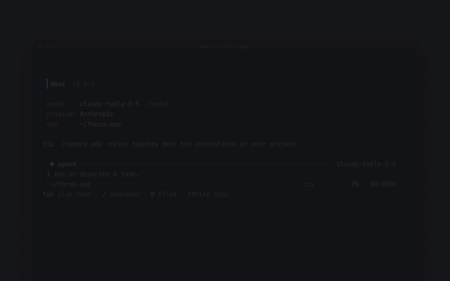

<div align="center">



<br/>

**超快、自主的终端 AI 结对编程与 Vibe Coding 智能体。**  
专为 **Android Termux**、**Windows**、**macOS** 和 **Linux** 打造。

<br/>

[](https://www.npmjs.com/package/termux-dev)
[](https://github.com/apvcode/Termux-Dev/actions/workflows/ci.yml)
[](LICENSE)
[](https://nodejs.org)
[](https://www.typescriptlang.org)
[](#quick-start)

<br/>

[English](README.md) &nbsp;•&nbsp; [Русский](README_ru.md) &nbsp;•&nbsp; [Українська](README_uk.md) &nbsp;•&nbsp; [Deutsch](README_de.md) &nbsp;•&nbsp; [Español](README_es.md) &nbsp;•&nbsp; [Français](README_fr.md) &nbsp;•&nbsp; [Português](README_pt.md) &nbsp;•&nbsp; **Chinese** &nbsp;•&nbsp; [Japanese](README_ja.md)

<br/><br/>

<a href="assets/demo.mp4"></a>

<br/>



</div>

---

## 概览

<table>
<tr><td valign="top" width="33%"><b>先计划，再行动</b><br/>PLAN 与 AGENT 模式，一键批准，计划大小随任务而定</td><td valign="top" width="33%"><b>默认安全</b><br/>风险操作先询问，输出中隐藏密钥，可通过 git 撤销，可选的费用上限</td><td valign="top" width="33%"><b>任意模型</b><br/>OpenRouter、Gemini、DeepSeek、Groq、Mistral、OpenAI、Anthropic、Ollama 等</td></tr><tr><td valign="top" width="33%"><b>内置 MCP</b><br/>控制面板、基于 HTTP 的远程服务器，智能体还能自己配置服务器</td><td valign="top" width="33%"><b>为终端而生</b><br/>适合手机的布局、18 套主题、可折叠的思考和输出</td><td valign="top" width="33%"><b>费用一目了然</b><br/>实时显示会话费用、按模型设置推理强度、需要时可设上限</td></tr>
</table>

## 快速开始

```bash
npm install -g termux-dev
devx
```

在 Android 上，请先在 Termux 中运行 `pkg install nodejs-lts`。

---

## 主要特性

终端界面围绕一个带边框的输入框构建，状态信息就显示在边框上：模式（`agent` / `plan` / `yolo`）、模型、文件夹、git 分支、上下文用量条和费用。此外还有标题卡片、带底色的消息回显、助手回复的 `●` 侧栏、带有安静单行结果的 `◆` 工具调用行、用于编辑的 diff 框，以及实时的工作指示器。每种布局都有适合竖屏 Termux 的窄屏版本，并能正确测量 emoji 与中日韩文字的宽度。可在 `/settings` → `Interface` 中切换回原来的 ASCII 布局。

- **双脑架构（PLAN 与 AGENT 模式）：**  
  在 **PLAN**（安全的架构师，交互式需求问卷，不输出大段代码）与 **AGENT**（自主编辑文件、执行终端命令、自动安装依赖）之间即时切换。
- **一键批准计划（`[Go / Go and compact context / Other]`）：**
  架构计划定稿后，审阅并用 `Go` 确认，立即放手让编码智能体开工。`Go and compact context` 会先总结冗长的规划对话，再在简短的全新上下文中执行已批准的计划（在手机上用法相同）。
- **多模态图片附件：**  
  用 `Ctrl+V` 或 `Alt+V` 直接从剪贴板粘贴截图（也可用 `/image` 或粘贴文件路径）。它们显示为 `[Image #1 203kb]` 这样的徽标，并作为真实图片发送给模型，除非已知该模型只能读取文本。Wayland 需要 `wl-clipboard`，X11 需要 `xclip`，macOS 需要 `pngpaste`。
- **智能体可以查看磁盘上的图片：**
  就任意文件夹里的 `screenshot.png` 或设计稿向它提问，它会用 `read_file` 打开文件，与查看你附加的图片的方式相同。支持 PNG、JPEG、WebP 和 GIF，最大 5 MB；文件内容必须确实是图片。只有最新的几张图片会完整发送，较早的只在聊天中留下一条记录（模型可以再次打开该文件）。不支持视觉的模型会收到一条明确的提示。
- **内置实时 Web 服务器（`/serve`）：**  
  在 3000 端口即时预览 Web 应用和 HTML5 游戏。在 Android 上通过 `termux-open-url` 无缝打开。
- **后台任务（`/tasks`）：**
  智能体可以在后台启动开发服务器、监视器或耗时较长的测试，同时继续工作。它可以等待某一行输出（`ready|error`），稍后读取输出；任务结束或打印出它所关注的内容时会通知它，如果此时你在提示符前，它会自己接手这条消息。提示符边框中的 `◈ 2 bg` 徽标显示正在运行的任务，任务异常结束时会加上 `· 1 failed`，直到 devx 告知了智能体；`/tasks` 列出任务，`/tasks <id>` 显示输出，`/tasks stop <id|all>` 结束它们。启动任务和 `bash` 一样需要批准；devx 退出时所有任务都会被停止。设置 `"backgroundAutoWake": false` 可让智能体不再自行响应。
- **即时快照回滚（`/undo`）：**  
  用文件工具（`write_file`、`edit_file`）做的每次编辑都会被记录，并可一条命令回滚。通过 shell 命令（`bash`）所做的更改**不会**被跟踪，快照仅保存在当前会话的内存中。
- **自愈式诊断与自动安装：**  
  内置支持 TypeScript（`tsc`）、JavaScript（`node --check`）、Python（`py_compile`）和 Rust（`cargo check`）。AI 会在结束一轮之前自动发现并修复错误。
- **项目记忆库（`.devx/memory.md`）：**  
  通过 `/memory add <规则>` 在会话之间保留项目上下文。
- **devx 在等你时的通知：**
  当智能体需要批准或向你提问（`◆ Clarify`），而终端不在前台时，你会收到通知（kitty 自己的协议，Linux 上用 `notify-send`，macOS 上用 `osascript`；Termux 上是带短暂震动的 Android 通知）。任务完成也会通知，并附上回答的开头。终端必须报告焦点变化（大多数现代终端都支持）；当 devx 无法判断你是否在看时，它会保持安静，而不是突然弹到你面前。
- **过往聊天（`search_chats`）：**
  当你说“就像上次我们决定的”或“在那个关于解析器的聊天里”，智能体可以按关键词搜索你保存的聊天（任何语言，不同词形也能匹配），并读取所需的那一个，每次读几条消息。它是只读且在本地的，所以不会询问；当前打开的聊天不会被搜索；工具输出不会被索引；它读到的内容会作为数据而不是指令交给模型。普通任务中智能体不会使用它。
- **纯黑背景（`#0a0a0c`）上的 18 套配色主题：**  
  深邃的 OLED 黑，让终端里的 Vibe Coding 不受干扰；每个主题都是完整调色板，而不只是一个强调色：Cyan Cyber、Synthwave Purple、Matrix Hacker、Solar Amber、Ruby Crimson、Pure Monochrome、Nord Frost、Dracula、Tokyo Night、Gruvbox、Catppuccin Mocha、Solarized Dark、Rose Pine、Monokai、GitHub Dark、Deep Ocean、Sunset Glow 和 Forest Moss。参见[主题](#主题)。
- **智能会话历史（`/resume` 与 `/session`）：**  
  恢复会话时，最近 20 条消息以完整 Markdown 渲染，并可追踪唯一的会话 ID（`#a8f9z`）。
- **智能多行编辑器（`edit_file 2.0`）：**  
  防冲突的代码编辑：遇到重复匹配时给出行号错误，并支持 `replaceAll`。
- **完整的测试套件（Vitest）：**  
  覆盖智能体主循环、文件系统、安全守卫、快照和上下文历史，并配有自动化 CI。
- **9 种语言的界面：**  
  English（默认）、Русский、Українська、Deutsch、Español、Français、Português、中文和日本語。在 `/settings` → `Language` 中选择，立即生效并会被记住。消息、提示和设置界面会被翻译；代码、工具名称和模型自身的回答不会。
- **通用的 AI 提供商支持：**  
  **OpenRouter**、**Google Gemini**、**DeepSeek**、**Groq**、**Mistral**、**OpenAI**、**Anthropic**、**Alibaba**，以及本地模型（**Ollama**、**LM Studio**）。
- **自定义提供商：**  
  `/provider` → **添加提供商**：为它起个名字，填写地址（任何兼容 OpenAI 或 Anthropic 的 API）和密钥。它会保存在 `~/.devxrc.json` 中，并与已知提供商一起出现在列表里；再次选择它即可使用、修改名称、地址或密钥，或将其删除。你自己机器上的服务器（LM Studio、本地网关）可以不填密钥。

---

## 安装与设置

### 前置条件
- **Node.js**：`v20.0.0` 或更高版本
- **npm**、**pnpm** 或 **yarn**

### 安装 Node.js 和 npm

devx 需要 Node.js 20 或更高版本（npm 随之一起安装）。请选择你的系统：

```bash
# Windows (PowerShell)
winget install OpenJS.NodeJS.LTS

# macOS (Homebrew)
brew install node

# Ubuntu / Debian（NodeSource：发行版自带仓库中的版本往往低于 20）
curl -fsSL https://deb.nodesource.com/setup_lts.x | sudo -E bash -
sudo apt-get install -y nodejs

# Fedora
sudo dnf install -y nodejs

# Arch Linux
sudo pacman -S nodejs npm

# Android (Termux)
pkg update && pkg install -y nodejs-lts
```

重新打开终端并检查：`node -v`（应为 `v20` 或更高）和 `npm -v`。任何系统：可使用 [nodejs.org](https://nodejs.org/en/download) 上的安装程序或 [nvm](https://github.com/nvm-sh/nvm)。

### 快速全局安装（推荐）

```bash
npm install -g termux-dev
```

### Android（Termux）

```bash
# 1. 更新软件包并安装 NodeJS
pkg update && pkg install -y nodejs-lts

# 2. 通过 npm 全局安装 devx
npm install -g termux-dev

# 3. 在任何地方启动 devx！
devx
```

### 从源码构建（开发者）

```bash
git clone https://github.com/apvcode/Termux-Dev.git
cd Termux-Dev
npm install
npm link
```

### 完全卸载

要彻底移除 `devx` 以及所有配置、已保存的会话和数据：

```bash
# 1. 卸载全局 npm 包
npm uninstall -g termux-dev

# 2. 删除配置和会话历史（Linux / macOS / Termux）
rm -rf ~/.devx ~/.devxrc.json

# （Windows PowerShell）
Remove-Item -Recurse -Force "$HOME\.devx", "$HOME\.devxrc.json" -ErrorAction SilentlyContinue
```

---

## 快速开始

在任意项目文件夹中启动 `devx`：

```bash
devx
```

* 首次运行时，`devx` 会打开交互式设置向导，用于配置你的 AI 提供商和 API 密钥。
* 直接以 **PLAN 模式**启动：
  ```bash
  devx --plan
  ```
* **无界面单次模式**（脚本、CI/CD、Termux:Widget）：
  ```bash
  devx -p "review latest git diff and find security bugs"
  devx -p "fix build errors" --yolo
  ```

---

## 从手机远程控制

**获取应用：** Android APK `devx-android-x.y.z.apk` 附在每个[发布版本](https://github.com/apvcode/Termux-Dev/releases/latest)中（在手机上打开，并允许从此来源安装）。应用的源代码及其自己的 README 位于 [`android` 分支](https://github.com/apvcode/Termux-Dev/tree/android)。在应用中，可以用 devx 里的 `/phones` 或 `devx remote revoke <name>` 将手机从电脑上移除。

devx 2.0 可以由 devx Android 应用来驱动。一个小型主机在你电脑的后台运行；手机连接到它，看到并控制相同的会话：每个聊天、实时回答和推理、批准卡片、提问、计划、plan/agent/YOLO 模式、模型和服务商、上下文和费用、`/compact` 及其他命令。可以从手机发送文件和照片，智能体也可以把文件和图片发回来：它们会以卡片形式出现在手机聊天中。终端关闭时一切照常运行。

这个应用本身也是一个口袋助手，无需账号，也没有我们的服务器：

- **聊天**：可使用你添加的任意服务商（兼容 OpenAI 或 Anthropic）：推理强度、照片和文件、项目、记忆、技能和 MCP 服务器。
- **语音**：将它设为手机的助手，电源键即可打开它。它能设置闹钟、计时器和提醒，打开应用，查找联系人，准备通话和短信，并控制亮度、勿扰模式、音乐和音量。
- **地点和天气**来自 OpenStreetMap，无需密钥；你询问时，它还可以查看你的照片和通知。
- **定时任务**：“每天早上给我发 AI 新闻”。
- **以卡片呈现的回答**：表格、图表、地图、天气、计时器、清单、图示，以及来自 Google Play 和 F-Droid 的应用卡片。
- **九种语言**，与 devx 相同。

```
devx remote start     # 启动主机（无终端时也持续运行）
devx remote pair      # 显示二维码：在应用中扫描，并在这里确认六位数字
devx remote status    # 谁已连接，哪些会话已打开
devx remote devices   # 已配对的手机           devx remote revoke <name>   # 移除一部
devx remote service   # 随电脑启动（systemd / launchd / 启动文件夹）；也在 /settings 中。`service off` 将其关闭
```

手机如何在没有我们任何服务器的情况下连到电脑：先直连（同一 Wi-Fi、Tailscale 这样的 VPN，或转发的端口 47821），无法直连时（移动网络、运营商 NAT）则通过免费的公共 MQTT 中继。手机会同时尝试两者并持续重试；中继只会看到加密的数据包。传输格式及其安全性见 [docs/remote-protocol.md](docs/remote-protocol.md)。

安全：手机只有凭 `devx remote pair` 的一次性代码（有效期 5 分钟）**并且**经过你在这里的确认（两个屏幕显示相同的六位数字）才会被添加。密钥为 P-256（手机的密钥永远不会离开其 Keystore），每个连接都用全新的密钥签名并加密（AES-256-GCM）。远程访问就是对这台电脑的 shell 访问：默认每条命令都会向手机请求批准，“Everything”模式在你为某个会话开启之前一直关闭。

如果手机开启了 devx 记忆，它的名字会随聊天一起发送，这里的智能体会获得一个 `phone_memory` 工具，用来向手机询问它的笔记：不会向这台电脑复制任何内容。

## 斜杠命令

在输入框中键入 `/` 打开带自动补全的命令面板：

| 命令 | 说明 |
| :--- | :--- |
| **`/plan`** | 切换到 **PLAN** 模式（架构师与需求规划者） |
| **`/agent`** | 切换到 **AGENT** 模式（编码者与自主执行者） |
| **`/mcp`** | 管理 Model Context Protocol（MCP）服务器和外部工具（`/mcp reload`） |
| **`/usage`** | 一个面板（按 `Esc` 关闭）：上下文窗口里都装了什么（系统提示词、工具 schema、消息、工具结果、图片）、本会话费用及其可信度、token、缓存输入、流量 |
| **`/export`** | 将会话导出为整洁的 GitHub-Flavored Markdown 记录 |
| **`/theme [name]`** | 切换界面主题：可搜索的 18 套配色列表，带实时预览（参见[主题](#主题)） |
| **`/doctor`** | 运行环境健康诊断（Node、Termux、编译器、API 密钥） |
| **`/image`** | 粘贴剪贴板中的图片（等同于 `Ctrl+V` / `Alt+V`） |
| **`/serve [port]`** | 启动本地 HTTP 服务器用于 Web/游戏预览（`/serve stop` 停止） |
| **`/memory`** | 查看、添加（`/memory add <事实>`）或清空项目记忆库 |
| **`/copy`** | 将 AI 的**最后一条回答**完整复制到剪贴板（通过 ssh 也可用） |
| **`/rename`** | 重命名聊天：`/rename <名称>`，不带名称则由 AI 重新命名（`/title` 相同） |
| **`/permissions`** | 查看无需询问即可执行的内容（批准卡片上的 Session / Always）；`/permissions clear` 重置 |
| **`/phones`** | 与 devx Remote 配对的手机：选择一部即可将其移除，它会立即断开，并且在重新配对之前无法再次连接 |
| **`/rewind`** | 回到**你的某条消息**：其后的聊天被清除（模型也会忘记），该消息回到输入行供修改；文件也可一并恢复（需要 git） |
| **`/tasks`** | 后台任务：列表，`/tasks <id>` 查看输出，`/tasks stop <id\|all>`，`/tasks clear` |
| **`/undo`** | 撤销 AI 上一轮对文件的所有更改 |
| **`/diff`** | 查看已修改项目文件的彩色 git diff |
| **`/commit`** | 由 AI 生成语义化提交信息并执行 git commit |
| **`/status`** | 查看 git 仓库状态 |
| **`/session`** | 查看当前会话 ID、统计和元数据 |
| **`/resume`** | 浏览并恢复已保存的聊天会话 |
| **`/session del`** | 有选择地或批量删除已保存的会话 |
| **`/settings`** | 配置主题、界面、YOLO 自动批准、项目记忆、更新检查和界面语言 |
| **`/update`** | 检查新版本：先显示新内容卡片，然后选择 **立即更新**、**稍后** 或（启动时）**跳过此版本**。安装会在实时画面上分步进行，确认 npm 确实有该版本，然后重启 devx。失败时会显示原因和手动执行的命令 |
| **`/model`** | 在当前提供商内实时搜索并切换模型 |
| **`/effort [level]`** | 设置推理强度。只提供当前模型支持的级别（参见[推理强度](#推理强度)） |
| **`/provider`** | 切换提供商（OpenRouter、Gemini、Groq、DeepSeek、Local） |
| **`/compact`** | 压缩并总结聊天上下文的令牌（压缩后的聊天会立即保存，所以 `/resume` 得到的是简短的那个） |
| **`/clear`** | 清空上下文并开始新会话（旧会话仍保留，参见 `/resume`） |
| **`/init`** | 在项目根目录生成 `AGENTS.md` 开发指南 |
| **`/help`** | 显示所有可用命令 |
| **`/exit`** | 正常退出 devx |

---

## 快捷键

- **`Tab`** — 在 **PLAN** 与 **AGENT** 模式间即时切换，不会丢失你正在输入的草稿。
- **`Ctrl+V`** / **`Alt+V`** — 将剪贴板中的图片直接粘贴到输入框。
- **`@filename`** — 快速模糊文件补全，并完整嵌入文件内容。
- **`Backspace`** — 一次按键即可整体删除 `[Pasted text #1]` 和 `[1.png 203kb]` 这类徽标。
- **`Ctrl+Backspace`** / **`Alt+Backspace`** — 按词删除文本（智能体工作时也可用）。
- **`Ctrl+Enter`** — 输入时：换行（新段落）而不是发送。在终端能报告它们的地方，`Alt+Enter` 和 `Shift+Enter` 作用相同；在无法把它们与 `Enter` 区分的终端上（比如手机键盘），请在 `Enter` 前输入 `\`。devx 只在已知可行的终端（kitty、Ghostty、WezTerm、iTerm2、foot、Alacritty）上请求终端区分它们；Termux 以及会把该请求当作光标或样式代码来读取的其他终端永远不会收到它。`DEVX_EXTENDED_KEYS=1`（或 `0`）可强制开启（或关闭）。
- **`Ctrl+P`** / **`Ctrl+O`** — 在整个聊天中展开或折叠模型的思考（`Ctrl+P`）以及命令和输出（`Ctrl+O`），包括已经在上方的内容。默认全部折叠；智能体工作时和在输入框中都可用。
- **`Esc`** — 停止当前回答及其启动的内容（正在运行的命令）；你输入的内容留在下一次输入框中。Esc 也会关闭所有列表和卡片。
- **`Ctrl+C`** — 立即停止当前生成或退出。

---

## 推理强度

`/effort` 设置模型在回答前思考多少：`off`、`low`、`normal`、`high`、`xhigh`、`max` 或 `auto`（使用模型自己的默认值，不发送任何参数）。各模型不同，因此菜单**只提供当前模型支持的级别**：

```
╭─ effort ─────────────────────────────────── claude-sonnet-4-5 ─╮
│  ❯ ● auto    model default, nothing is sent                     │
│    ○ off     no reasoning                                       │
│    ○ normal  balanced (~6k thinking tokens)                     │
│    ○ high    deep reasoning (~16k thinking tokens)              │
│                                                                 │
│   Not offered by this model: max.                               │
╰─────────────────────────────────────────────────────────────────╯
```

- `/effort` 打开菜单，`/effort high` 直接设置级别（`medium`、`none`、`maximum` 等别名同样可用），`/effort auto` 恢复模型默认值，`/effort refresh` 更新构建菜单所用的数据（见下文）。
- 选择**按模型**记忆。切换到不提供已保存级别的模型后，不会发送任何参数。当前级别显示在模型名旁边（`o3 · think high`；`think auto` 表示模型自己的默认值）。智能体工作时，状态行会显示模型到目前为止为你的请求写了多少 token（`↓ 364 tokens`），一轮结束后的那一行会做出汇总（`18.1k in · 59 out`）。
- `devx -p "task" --effort high` 只为这一次运行设置级别（不会被保存）。
- 如果端点返回 400 并抱怨推理参数，devx 会去掉该参数重试一次，告知你，并不再发送它。

**级别从哪里来**（第一个了解该模型的来源生效；菜单会说明用了哪一个）：

1. **你自己的配置**，位于 `~/.devxrc.json`（`reasoningProfiles`，见下文）。
2. **端点本身。** OpenRouter 为每个模型列出推理元数据（接受哪些强度、能否关闭）；Ollama 会报告“thinking”能力；LiteLLM 和许多网关会在模型列表中加入标志。**自定义或第三方提供商只会被询问一次**：用你配置的密钥向*它自己的* base URL 发出几个小请求（`GET /models`，本机上还有 `POST /api/show`，LiteLLM 则是 `GET /model/info`）。答案在 `~/.devx/capabilities.json` 中缓存一天。大厂商（OpenAI、Anthropic、Google 等）不会被询问，它们的列表不包含推理信息。可在 `~/.devxrc.json` 中用 `"probeEndpoints": false` 关闭。
3. **[models.dev](https://models.dev) 目录**：约 5700 个模型、213 家提供商的推理选项（强度、开关、token 预算）。devx 自带一份快照，因此默认不下载任何东西。`/effort refresh` 会把最新版本下载到 `~/.devx/` 并再次询问端点；这是 devx 唯一一次联系 models.dev，而且只是因为你运行了该命令。同一次下载也会刷新费用显示所用的价格（参见费用）。
4. **按模型名称的规则**，对来源未描述的一切的后备方案（见下表）。

级别如何写入请求仍取决于你的 base URL 所用的 API，因此这一部分内置在 devx 中。

按模型名称的规则（后备）：

| 模型 | 级别 | 发送为 |
| :--- | :--- | :--- |
| OpenAI o 系列、gpt-oss | low、normal、high | `reasoning_effort`（OpenRouter 上为 `reasoning.effort`） |
| GPT-5、5.1、5.2 | off（GPT-5 为 minimal）、low、normal、high，5.2 起另有 xhigh | `reasoning_effort` |
| Grok 3 mini | low、high | `reasoning_effort` |
| Claude 3.7 / 4 / 4.5 | off、low、normal、high、xhigh、max（Opus 4 与 4.1 无 max） | `thinking.budget_tokens`（Anthropic）、`reasoning.max_tokens`（OpenRouter） |
| Gemini 2.5 Pro / Flash | low 到 max（Flash 另有 off） | `thinking_budget`（Google）、`reasoning.max_tokens`（OpenRouter） |
| Qwen3 | off、low、normal、high、max | `enable_thinking` / `thinking_budget`（DashScope） |
| DeepSeek V3.1+、GLM 4.5+ | off、normal | `reasoning.enabled`、`thinking.type` |
| DeepSeek-R1、QwQ、Grok 4、Magistral | 无：它们始终在推理 | 不发送 |

如果没有任何来源描述某个模型，它就没有级别，而不是靠猜。如果你知道它如何接受推理设置，可在 `~/.devxrc.json` 中描述：

```json
{
  "reasoningProfiles": {
    "my-model": {
      "levels": ["off", "normal", "high"],
      "param": "reasoning_effort",
      "values": { "off": "none", "normal": "medium", "high": "high" }
    }
  }
}
```

`param` 可以嵌套（`"reasoning.effort"`）。配置也会覆盖该模型 ID 的内置表。

---

## 智能体工作时输入

任务期间，提示符边框停留在终端底部（带实时的上下文和费用），智能体的工作在其上方滚动。在智能体读取文件、运行命令或思考时，你可以在其中输入并按 Enter：消息会排队，智能体会**在下一步**，也就是两次工具调用之间收到它，所以它会继续工作，同时考虑你的意见。在模型撰写最终回答时输入的消息，会得到单独的回答，而不是被丢弃。`Ctrl+Enter` 在消息中另起一行而不是发送（`Alt+Enter` 和 `Shift+Enter` 也一样；在无法区分它们的终端上，在 `Enter` 前加 `\`）。`Ctrl+Backspace` 删除一个词。在那里输入 `/`，就会打开所有命令的列表（方向键滚动，`Tab` 补全，`Enter` 执行）：只显示或更改某项设置的命令（`/settings`、`/model`、`/theme`、`/usage`、`/mcp`、`/tasks`、`/help` 等）在智能体工作时也会立即打开，它会等待；会改变对话的命令（`/compact`、`/new`、`/undo`、`/plan` 等）则在智能体完成后执行。上下方向键会调出你之前发送过的行，包括更早聊天里的（保存在 `~/.devx/history.jsonl`）。`↓` 把等待中的消息取回到输入行进行编辑；在空行上按 `Enter` 会**立即**发送它（当前回答会被停止）。方向键在开启 Caps Lock 和 Num Lock 时也能用。以文件路径开头的消息（`/home/me/boot.img flash this`）是消息，不是命令。`Esc`（或 `Ctrl+C`）停止智能体，并把你输入的内容放回下一个提示符。`@file` 提及在这些消息中同样有效。当批准卡片或提问显示在屏幕上时，输入行会让开，所以你的 `y` / `n` 永远不会进入消息。可在 `~/.devxrc.json` 中用 `"ui": { "typeAhead": false }` 关闭。

---

## 上下文窗口

窗口大小是查出来的，而不是编出来的。按以下顺序：`~/.devxrc.json` 中的 `contextLimits`（你为某个模型 ID 设置的数值）、[models.dev](https://models.dev) 目录（约 5000 个模型由厂商给出的数值；devx 自带一份快照，`/effort refresh` 下载最新版）、选择模型时保存的值、devx 的模型表、按模型名称的规则，最后才是默认的 128k。`/usage` 会说明用了哪一个，如果是猜测会发出警告。超过窗口 85% 时会丢弃旧消息：窗口过小会让 devx 忘得太早，过大则会导致提供商拒绝请求（此时 devx 会缩短历史并重试）。

```json
{ "contextLimits": { "my-model": 65536 } }
```

---

## API 格式（OpenAI 与 Anthropic）

存在两种通信格式：**OpenAI**（`/v1/chat/completions`）和 **Anthropic**（`/v1/messages`）。Anthropic 原生格式带有已签名的推理块、提示词缓存和精确的缓存计量，因此 Claude 模型通过它效果最好。devx 两种都会说，并且**按模型自动选择格式，只需一个密钥**：

- `api.anthropic.com` 以及路径含 `/anthropic/` 的 base URL（MiniMax、Z.ai 等）使用 Anthropic 格式。
- 对其他任何自定义网关，devx 会请求两次模型列表（用你自己的密钥向你自己的 base URL 发出几个小的 `GET {root}/v1/models` 请求）：一次以 OpenAI 客户端身份，一次以 Anthropic 客户端身份。只出现在第二份列表中的模型（通常是 Claude）走 Anthropic 格式，其余走 OpenAI 格式。`/model` 在同一个选择器中显示两份列表，并标出 Anthropic 的模型。只需设置一次 base URL（`https://gateway.example.com/v1` 或不带 `/v1`）；无需按模型配置。
- 答案在 `~/.devx/formats.json` 中缓存一天（只保存模型 ID，绝不保存密钥）。`"probeEndpoints": false` 关闭探测，`~/.devxrc.json` 中的 `"apiFormat": "openai"` 或 `"anthropic"` 会为所有模型强制使用一种格式。
- 只要使用 Anthropic 格式（即使在网关后面），推理级别（`/effort`）就按 Anthropic API 期望的方式写入（`thinking.budget_tokens`）。推理块会被保留并随下一次请求送回，这样模型在多次工具调用之间不会丢失思路。如果网关拒绝它们、缓存标记、过大的 `max_tokens` 或推理设置，devx 会去掉有问题的部分重试一次，并告知你。

## 费用

每次请求都会重新发送整个对话，上下文计量器旁边的数字是这些请求各自费用的总和（缓存的输入更便宜，并按此计价）。上下文计量器本身在空聊天时显示 0，从第一条消息起则显示下一次请求携带的全部内容：包括系统提示和工具模式。

上下文用量条旁边的数字是本会话已花费的金额，并表明 devx 有多确定：

| 显示 | 含义 |
| :--- | :--- |
| `$0.0123` | 精确：由提供商报告，或按厂商自己的价目表计算 |
| `~$0.0123` | 估算：按 [models.dev](https://models.dev) 上同一模型的价格计算（网关的收费可能不同） |
| `$0.0123+` | 至少这么多：部分请求没有已知价格，未计入 |
| `n/a` | 该模型没有已知价格 |

价格按以下顺序查找，第一个了解该模型的来源胜出：服务商写入响应的费用（OpenRouter 的 `usage.cost`、LiteLLM）→ 你在 `~/.devxrc.json` 中自己的 `prices` → 端点自身的价格表（OpenRouter、LiteLLM）→ models.dev 目录（约 8500 个模型；devx 附带一份快照，`/effort refresh` 下载最新版）。缓存的输入令牌、缓存写入和长上下文档位，与各厂商一样分别计价。已发出但没有收到回答的请求（用 Ctrl+C 取消、连接丢失、慢速模型的网关超时），服务商通常仍会计费，而重试会再次发送整个对话：这样的请求也会被计入，作为估算值（`~`）。小的辅助任务（聊天标题、`/commit` 消息、`/compact` 摘要）使用模型提供的最轻推理级别运行，其费用也计入总额。找不到的模型绝不会显示为免费：只有 `:free` 模型和本地服务器才不收费。`/usage` 还会列出缓存的输入，以及有多少请求无法计价。

```json
{
  "prices": {
    "my-model": { "input": 0.5, "output": 2.0, "cacheRead": 0.05 }
  }
}
```

数值为每百万 token 的美元价格。

---

## 主题

`/theme` 打开一个可通过键入来筛选的列表；高亮的主题会在列表下方以它自己的颜色预览。`/theme nord`（或别名如 `tokyo`、`mocha`、`gh`，或 1 到 18 的数字）直接切换，选择会被保存。

主题是一套完整的调色板：强调色、plan 模式的第二种颜色、成功 / 警告 / 错误颜色、YOLO 模式的颜色、用于文本、次要文本、提示和边框的四级灰色，以及你的消息回显的背景。每个主题都在测试中检查了在深色背景上的可读对比度。

| 主题 | 风格 |
| :--- | :--- |
| `cyan` Cyan Cyber（默认） | 电光青与黑曜石 |
| `purple` Synthwave Purple | 霓虹品红、复古紫 |
| `matrix` Matrix Hacker | 荧光绿 |
| `amber` Solar Amber | 温暖的 CRT 金 |
| `crimson` Ruby Crimson | 猩红 |
| `monochrome` Pure Monochrome | 仅白与灰 |
| `nord` Nord Frost | 北极蓝 |
| `dracula` Dracula | 紫色配粉与绿 |
| `tokyonight` Tokyo Night | 靛蓝与蓝 |
| `gruvbox` Gruvbox | 复古黄与橙 |
| `catppuccin` Catppuccin Mocha | 粉彩淡紫 |
| `solarized` Solarized Dark | 低眩光的青绿与橄榄 |
| `rosepine` Rose Pine | 柔和的玫瑰与金 |
| `monokai` Monokai | 青柠与品红 |
| `github` GitHub Dark | 清爽的蓝与绿 |
| `ocean` Deep Ocean | 深海青 |
| `sunset` Sunset Glow | 珊瑚与紫罗兰 |
| `forest` Forest Moss | 苔藓绿 |

在支持 truecolor 的终端（`COLORTERM=truecolor`）上颜色是精确的；在 256 色终端上，每种颜色会映射到最接近的调色板条目。设置 `DEVX_COLOR=256` 或 `DEVX_COLOR=truecolor` 可强制使用其中一种。

---

## 钩子、限额与权限

- **费用限额。** `/settings` → `Cost limit`（或 `~/.devxrc.json` 中的 `"maxCostPerSession": 5`，美元）。到 80% 时 devx 会发出警告；达到限额时它会停止任务，并在下一条消息前询问是否继续花费（继续只会提高该会话的限额）。
- **无需询问即可允许。** 在批准卡片上，`Session` 会在你关闭 devx 之前允许某条命令（按程序和子命令，如 `npm test`）或某个 MCP 工具；`Always` 将其保存在 `~/.devxrc.json`（`bashAllowlist`、`allowedTools`）。危险命令、读取机密、链式命令（`&&`、`;`、`|`）和重定向永远不会被记住。`/permissions` 列出它们，`/permissions clear` 清除。
- **钩子。** 围绕智能体工具运行的命令，在 `~/.devxrc.json` 中设置：

  ```json
  {
    "hooks": {
      "PreToolUse":  [{ "matcher": "bash", "command": "./check-command.sh" }],
      "PostToolUse": [{ "matcher": "write_file|edit_file", "command": "npx prettier --write ." }]
    }
  }
  ```

  `matcher` 是工具名称的正则表达式（不写或写 `*`：所有工具）。命令通过 stdin 以 JSON 接收调用（`event`、`tool_name`、`tool_input`，`PostToolUse` 还有 `tool_result`），并在环境中获得 `DEVX_HOOK_EVENT` / `DEVX_TOOL_NAME`。`PreToolUse` 钩子的退出码 `2` 会阻止该工具，并把命令写到 stderr 的内容告诉模型；`PostToolUse` 钩子的退出码 `2` 会把该文本追加到结果中。项目的钩子（`.devx.json`）只在受信任的工作区中生效；每个钩子有 10 秒时间。
- **输出中的机密。** 工具输出中的密钥和令牌（`sk-…`、`ghp_…`、`Bearer …`、`"apiKey": "…"`、私钥）会在模型、聊天和已保存的会话看到之前被替换为 `[hidden secret]`。
- **一切皆可撤销。** 有 git 时，`/undo` 会把整个文件夹恢复到上一轮之前的样子，包括 shell 命令所做的更改（`.gitignore` 中的文件不会被触碰）。
- **已批准的计划**保存在 `.devx/plan.md`，并在 24 小时内提供给智能体。超过约 4000 个字符的**项目记忆**，对模型会被截为最新的事实。
- **MCP。** `/mcp add <name> <command> [args]` 或 `/mcp add <name> <https-url>`（基于 HTTP 的远程服务器；令牌放在 `headers` 中，写成 `"Bearer ${TOKEN}"`），`/mcp remove <name>`，`/mcp import`（从 Claude Code 导入）。
- **按需加载的 MCP 工具。** 每个 MCP 工具的模式都会随每次请求发送，一个大型服务器（Notion 约有 80 个工具）在你输入任何内容之前就可能耗费 10 万令牌。因此 devx 会立即发送小型服务器的工具，并暂缓大型服务器的：智能体在其 `mcp_search` 工具中看到服务器列表，只查找并加载任务需要的工具（用关键词、工具名称或仅服务器名称调用 `mcp_search`），并从下一步起调用它们。已加载的工具在整个聊天期间保留（恢复的聊天会取回它用过的工具）。哪些服务器等待由大小决定（一起发送的所有工具保持在约 4k 令牌以内）；可在 `mcp.json` 中用 `"lazy": true` 或 `"lazy": false` 针对单个服务器强制设置。

## 安全模型

`devx` 代表 AI 模型在你的机器上运行命令和编辑文件，因此默认十分保守：

- **工作区信任。** 第一次打开某个文件夹时会询问你是否信任它（默认：否）。在不受信任的文件夹中，项目 `.devx.json` 里的 `provider`、`apiKey`、`baseUrl`、`autoApprove` 和 `bashAllowlist` 会被**忽略**。克隆来的仓库无法把你的 API 密钥重定向到它自己的服务器，也无法打开 YOLO。
- **项目 MCP 服务器需要批准。** 项目声明的 MCP 服务器（`.mcp.json`、`.devx/mcp.json`、`.claude/mcp.json`、`.devx.json`）是会在你机器上运行的程序。你会审阅一次具体命令；命令变化时会再次询问。在无界面模式（`-p`）下，未批准的项目服务器会被跳过。来自 `~/.devxrc.json` 和 `~/.devx/mcp.json` 的服务器总会启动。
- **确认。** 在安全模式下，`bash`、`install_package`、MCP 工具、预览服务器，以及**项目文件夹之外**的每一次读写都需要确认。
- **YOLO（`--yolo`）不是沙箱。** 它会跳过常规确认，但在执行危险的 shell 命令之前（项目外的递归删除、对宽泛路径的 `find -delete`、`curl … | sh`、`sudo`、`git push --force` 等）以及触碰凭据之前（`~/.ssh`、`~/.aws`、`~/.devxrc.json`、`.env`、私钥）仍会询问。shell 检查会逐个 token 分析命令，但刻意混淆的命令仍可能蒙混过关，因此只在你承受得起损失的文件夹和环境中使用 YOLO。在无界面模式下无法显示这些确认，因此该操作会被拒绝。
- **Extra（`--extra`，或 YOLO 开启时在 `/settings` 中）完全不再询问。** 危险命令、凭据文件、新的 MCP 服务器都不会再问：智能体可以执行任何命令。开启时会显示警告，输入框边框会显示 `extra`，并且和 YOLO 一样，下次启动时会重新关闭。只在你承受得起全部丢失的环境中使用。
- **`fetch_url`** 拒绝 localhost、私有网络和云元数据地址（重定向之后也一样）。设置 `DEVX_ALLOW_PRIVATE_NETWORK=1` 可允许本地文档服务器。
- **`/serve`** 监听你的本地网络（手机二维码就是这样工作的）。它绝不提供点文件、密钥、`node_modules` 或指向项目之外的符号链接，不发送宽松的 CORS 头，并拒绝发往公共主机名的请求。
- **静态保存的机密。** `~/.devxrc.json`、`~/.devx/` 和已保存的会话仅创建为你本人可读（`0600` / `0700`）。会话文件包含完整对话，包括智能体读取过的文件内容。
- **静默连接。** 300 秒内既无回答也无新数据的请求会被放弃并重新发送（手机可能在应用毫无察觉的情况下丢失连接）。`~/.devxrc.json` 中的 `"requestTimeoutSeconds": 600` 可更改时间，`0` 则关闭。需要思考数分钟而不发送任何字节的模型需要更大的值。
- **已保存聊天中的图片**保存在聊天旁边的文件中（`~/.devx/sessions/<id>.images/`），而不是其 JSON 内部，因此保存聊天依然很快，`/resume` 也能迅速打开。它们会随聊天一起删除。
- **限制。** `bash` 默认在 120 秒后终止命令（模型可传入 `timeout_seconds`，最大 1800）并关闭 stdin。长输出会保留开头和结尾。`read_file` 每次调用最多返回约 60 000 个字符，并支持 `startLine` / `endLine`。

---

## 支持本项目

如果你觉得 **devx** 有用，请考虑在 [GitHub](https://github.com/apvcode/Termux-Dev) 上给它点个 star——这有助于项目成长，也会激励后续开发！

---

## License

本项目基于 [MIT 许可证](LICENSE) 发布。

---

<div align="center">

由 [ApvCode](https://github.com/ApvCode) 为开发者、Vibe Coder 和 Termux 玩家打造。

</div>
